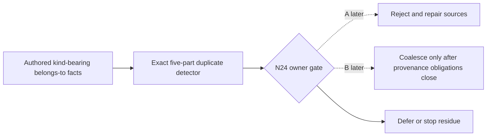

# Architecture Bundle: N24 Belongs-To Duplicate Authorship

## Design Intent

Preserve N20-N23 topology and isolate exact duplicate authored canonical
`belongs-to` propositions. No N24 option is selected.

## 1. Context View



## 2. High-Level Structure View

| Component | Responsibility | Input | Output | Owner boundary |
|---|---|---|---|---|
| ExactSourceBoundary | Reject stale evidence | Nine SHA-bound sources | Closed denominator | Design author and extractor |
| ExactFactIdentity | Compare verb, source, target, kind, context | Authored direct facts | Stable proposition key | Architecture owner |
| AxisClassifier | Separate different kinds and competing parents | D07/D30 | Correct diagnostic class | Definitions owner |
| DecisionGate | Present A/B/defer/stop | Caller-owned statuses | Unselected question | Relationship decision owner |
| ConditionalProvenanceLedger | Keep B obligations unauthorised | Source handles and future merge contract | Downstream blocker | Future Plan owner |

## 3. Low-Level Components View

```text
ExactDuplicateBelongsTo(a, b) iff
  a.verb = b.verb = belongs-to
  and a.source_entity_id = b.source_entity_id
  and a.target_entity_id = b.target_entity_id
  and a.membership_kind_id = b.membership_kind_id
  and a.authority_feature_context = b.authority_feature_context
  and a.authored_source_handle != b.authored_source_handle
```

A rejects repeated authorship, preserves source handles, and requires repair. B
would admit one semantic fact only after a later deterministic merge contract closes
source-handle retention, ordering, diagnostic, and provenance obligations. N24 does
not authorize those representation details now.

## 4. Workflow Process View

1. Reverify exact N23 A and its no-duplicate-policy boundary.
2. Verify nine source digests and extract the denominator.
3. Run the selector twice and require the same fixed point.
4. Classify different-kind facts and D07 competing-parent conflicts before duplicates.
5. Mark A/B as reversible authority hazards; defer/stop remain reversible states.
6. Canonically prefilter and present only four admitted options.
7. Stop before selection, provenance design, partial-view design, Plan, or mutation.

## 5. Decision Flow View

### Decision

When the same canonical `belongs-to` verb, source Entity ID, target Entity ID, exact
admitted D30 kind ID, and admitted authority/feature context are authored more than
once, should the exact duplicate be rejected or conditionally coalesced?

| Option | Benefit | Cost / risk | Downstream impact |
|---|---|---|---|
| A — reject | Fail-closed authorship, smallest validation surface, explicit repair | Authors must remove or repair repetition | Future validator preserves both source handles in the diagnostic |
| B — conditional coalesce | One semantic fact can survive repeated source declarations | Requires later deterministic source ordering, merge provenance, and stable diagnostics before admission | Plan remains blocked until those obligations close |
| C — defer | No unsupported commitment | Exact duplicates remain unresolved | Downstream validation remains blocked |
| D — stop | Terminates cleanly | Leaves the frontier untouched | No further continuation |

Recommendation: **A**, because D01 aims to prevent duplicated authored facts and all
three prior relation-local duplicate gates selected rejection without transferring
authority here. B remains admissible only with its provenance obligations explicitly
conditional and still unselected.

Selected option: `null`. Decision effect: `none`.

## 6. Dependency Interface View

| Dependency | Exact contract | Consumed claim | Explicit non-effect |
|---|---|---|---|
| N23 receipt | Mixed-kind direct facts allowed | Kind identity preserved | No duplicate behavior |
| D02 | Observed duplicates enforceable without closure | N24 precedes partial-view absence policy | No absence verdict |
| D07/D30 | One parent per source/kind; exact non-overlapping kinds | Diagnostic partition | No global dedupe |
| N01/N03/N08 | Relation-local decomposition analogies | Stable exact proposition shape | No cross-relation authority |
| Canonical card | Inverse kind none | No earlier inverse gate | No authored inverse or representation rule |

## Evidence And Claim Ceiling

Deterministic digests are supplied after scope extraction, selection, and prefilter
generation. Design views: `6/6`. Planned witnesses and conditional B provenance
obligations remain unexecuted. Packet acceptance, canonical mutation, implementation,
promotion, publication, release, deployment, and runtime readiness remain false.
Authority effect: `none`.
