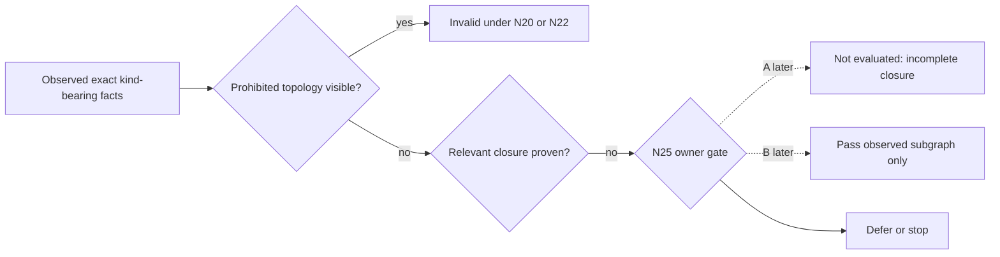

# Architecture Bundle: N25 Belongs-To Same-Kind Cycle Partial-View Verdict

## Design Intent

Preserve N20-N24 and isolate the verdict when no prohibited same-kind cycle is
visible but relevant closure is absent. No N25 option is selected.

## 1. Context View



## 2. High-Level Structure View

| Component | Responsibility | Input | Output | Owner boundary |
|---|---|---|---|---|
| ExactSourceBoundary | Reject stale evidence | Ten SHA-bound sources | Closed denominator | Design author/extractor |
| ObservedViolationClassifier | Apply N20/N22 first | Exact kind-bearing direct facts | Immediate invalid or no observed violation | Relationship validator owner |
| ClosurePresenceBoundary | Distinguish closure present from absent | Evidence envelope | Presence predicate only | Later closure-proof owner |
| DecisionGate | Present A/B/defer/stop | Caller-owned statuses | Unselected verdict question | Relationship decision owner |
| ClaimCeiling | Prevent whole-boundary overclaim | Selected future verdict | Explicit evidence scope | Future Plan owner |

## 3. Low-Level Components View

```text
if observed_self_edge_k or observed_same_kind_cycle_k:
  verdict = invalid
else if relevant_closure_evidence_absent:
  verdict = N25_OWNER_SELECTION_REQUIRED
else:
  verdict = downstream_closed-view_evaluation
```

N25 does not define how relevant closure is proven. It decides only the open-view
no-observed-cycle verdict.

## 4. Workflow Process View

1. Reverify exact N24 A and its partial-view non-effect.
2. Verify ten source digests and two-pass fixed point.
3. Reject observed N20/N22 prohibited topology before absence reasoning.
4. Exclude N23 mixed-kind closure from the N22 same-kind predicate.
5. If relevant closure is absent and no prohibited topology is visible, route N25.
6. Present A/B as reversible authority hazards; defer/stop as reversible states.
7. Stop before selection, closure-proof design, Plan, or mutation.

## 5. Decision Flow View

### Decision

When no prohibited N20 self-edge or N22 same-kind cycle is visible for one exact
admitted D30 kind, but relevant closure evidence is absent, what verdict applies?

| Option | Benefit | Cost / risk | Downstream impact |
|---|---|---|---|
| A — not evaluated | Prevents incomplete evidence from implying global cycle freedom | Withholds a positive result until closure is proven | Later gate defines closure proof shape |
| B — pass observed subgraph only | Gives immediate local feedback with an explicit non-global ceiling | Consumers may still confuse local pass with whole-boundary conformance | Every result must carry observed-subgraph-only scope |
| C — defer | No unsupported commitment | Partial-view verdict remains unresolved | Downstream closure design blocked |
| D — stop | Terminates cleanly | Frontier remains untouched | No further continuation |

Recommendation: **A**, because D02 already distinguishes open views from absence
proof and a global cycle-freedom claim depends on unseen adjacency. B remains fully
admissible only with its explicit non-global ceiling.

Selected option: `null`. Decision effect: `none`.

## 6. Dependency Interface View

| Dependency | Exact contract | Consumed claim | Explicit non-effect |
|---|---|---|---|
| N20/N22 | Observed prohibited topology invalid | Invalidity precedes absence verdict | No reopening |
| N23 | Mixed-kind closed path allowed as exact direct facts | Not an N22 same-kind violation | No derived membership |
| N24 | Exact authored duplicates rejected | Clean observed proposition set | No closure verdict |
| D02 | Observed violations and absence reasoning separate | Open-view claim ceiling | No N25 choice |
| Canonical card | Inverse kind none | No earlier inverse gate | No authored inverse |
| Packet | Partial-view and closure facets distinct | N25 before proof-shape gate | No representation/runtime |

## Evidence And Claim Ceiling

Design views: `6/6`. Planned witnesses remain unexecuted. Closure proof shape,
positive minima, transitivity, reachability, duplicates, representation, runtime,
numeric policy, packet acceptance, canonical mutation, implementation, promotion,
and publication remain outside scope. Authority effect: `none`.
