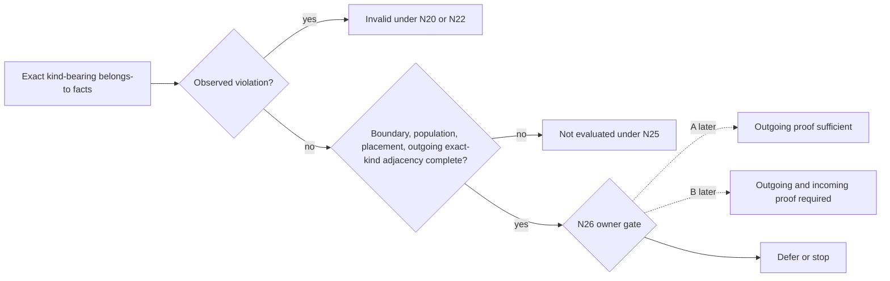

# Architecture Bundle: N26 Belongs-To Same-Kind Cycle Closure Proof Shape

## Design Intent

Preserve N20-N25 and isolate only the proof obligations that turn N25's
`not-evaluated-incomplete-closure` into an evaluable whole-boundary same-kind cycle
predicate. No N26 option is selected.

## 1. Context View



## 2. High-Level Structure View

| Component | Responsibility | Input | Output | Owner boundary |
|---|---|---|---|---|
| ExactSourceBoundary | Reject stale source bytes | Ten SHA-bound sources | Closed denominator | Design evidence owner |
| PredicateScope | Bind one exact active D30 kind | Boundary and registry digest | Kind-specific directed graph | Definitions owner |
| PopulationProof | Establish all eligible Entities and placement | Declared boundary evidence | Complete vertex set | Future validator owner |
| OutgoingAdjacencyProof | Establish every outgoing exact-kind edge | Canonical direct facts | Minimal cycle-proof surface | Future validator owner |
| IncomingAdjacencyProof | Optionally strengthen with reverse-direction completeness | Canonical direct facts | Symmetric proof surface | Relationship decision owner |
| DecisionGate | Present A/B/defer/stop | Caller-owned statuses | Unselected proof-shape question | Relationship decision owner |

## 3. Low-Level Components View

```text
base = boundary_identity_and_kind_complete
    && eligible_entity_population_complete
    && eligible_entity_placement_complete
    && outgoing_belongs_to_adjacency_complete_for_exact_D30_kind

A-proof = base
B-proof = base && incoming_belongs_to_adjacency_complete_for_exact_D30_kind
```

Neither proof changes the authored graph. If the selected proof is absent, N25 A
continues to return `not-evaluated-incomplete-closure`.

## 4. Workflow Process View

1. Reverify exact N25 A and its proof-shape non-effect.
2. Verify ten exact source digests and a two-pass fixed point.
3. Bind the boundary, its kind, eligible Entity population, placement, and one exact
   active D30 membership kind.
4. Require complete outgoing canonical `belongs-to` adjacency for that population
   and exact kind under both actions.
5. Under B only, additionally require complete incoming adjacency for the same
   population, relation, and kind.
6. Present A/B as reversible authority hazards; defer/stop as reversible states.
7. Stop before selection, proof serialization, Plan, or mutation.

## 5. Decision Flow View

### Decision

What exact relevant-closure proof makes the N22 whole-boundary same-kind directed
`belongs-to` cycle predicate evaluable for one exact admitted D30 kind?

| Option | Benefit | Cost / risk | Downstream impact |
|---|---|---|---|
| A — outgoing adjacency plus population | Minimal sufficient proof for discovering every directed cycle edge | Does not supply incoming completeness for other predicates | Later Plan validates the exact-kind outgoing proof only |
| B — bidirectional adjacency plus population | One stronger symmetric evidence envelope may be reusable by later incoming predicates | More evidence acquisition and invalidation cost than this predicate needs | Later Plan must validate both directional closures |
| C — defer | No unsupported commitment | N25 remains not evaluated without closure | Closure-proof design remains blocked |
| D — stop | Terminates cleanly | Frontier remains untouched | No further continuation |

Recommendation: **A**, because complete population plus all outgoing exact-kind
adjacency is sufficient to discover every directed cycle. D02 keeps incoming closure
independent; requiring it here is a legitimate stronger contract, not a necessity.

Selected option: `null`. Decision effect: `none`.

## 6. Dependency Interface View

| Dependency | Exact contract | Consumed claim | Explicit non-effect |
|---|---|---|---|
| N25 | Missing relevant closure gives not evaluated | Proof shape is the next blocker | No action consent |
| N20/N22 | Observed prohibited topology is invalid | Violations precede completeness | No topology reopening |
| N23 | Mixed-kind paths remain separate facts | Predicate remains exact-kind | No kind collapse |
| D02 | Directional closure and population axes | Outgoing and incoming are independent | No metadata representation |
| D30/registry | Exact active kind identity | Kind-filtered adjacency completeness | No mandatory membership |
| Packet | Closure and partial view are distinct | N26 remains candidate-only | No packet mutation |

## Evidence And Claim Ceiling

Design views: `6/6`. Planned witnesses remain unexecuted. No N26 selection, closure
serialization, feature-scope inference, minima, mandatory membership, transitivity,
reachability, duplicates, inverse, representation, runtime/numeric policy, packet
acceptance, canonical mutation, implementation, promotion, or publication is
authorized. Authority effect: `none`.
