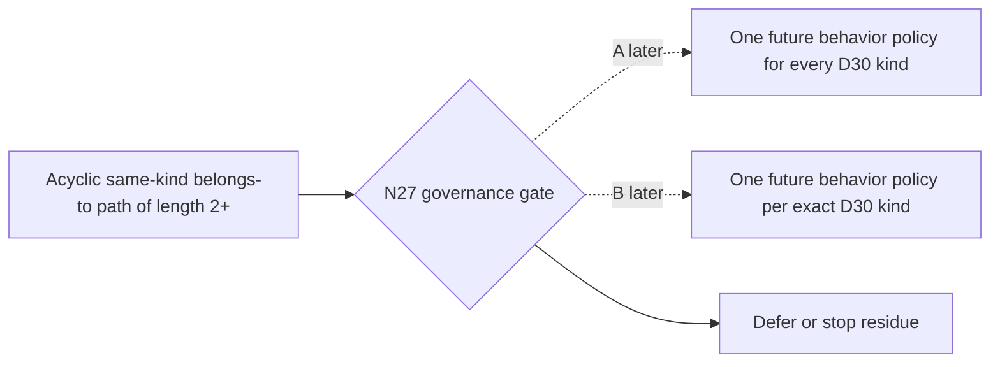

# Architecture Bundle: N27 Belongs-To Path-Consequence Policy Governance

## Design Intent

Preserve N26 A, then decide only whether future same-kind `belongs-to` path
consequences are governed uniformly across all current and later admitted D30 kinds
or independently per exact kind. No path behavior and no N27 option is selected.

## 1. Context View



The boundary excludes direct-only versus derived behavior, mixed-kind consequences,
new canonical edges, naming, provenance, materialization, representation, closure
reopening, mandatory membership, runtime, numeric policy, and packet mutation.

## 2. High-Level Structure View

| Component | Responsibility | Input | Output | Owner boundary |
|---|---|---|---|---|
| ExactSourceBoundary | Reject stale evidence | Nine SHA-bound sources | Closed denominator | Design author and independent extractor |
| N26SelectionBoundary | Preserve closure proof only | Exact N26 A receipt | No path consent | Relationship decision owner |
| SameKindPathClassifier | Preserve exact active kind identity | Acyclic direct path of length 2+ | Path-governance candidate | Architecture owner |
| GovernancePartition | Compare uniform with per-kind authority | Candidate | Future gate partition only | Relationship decision owner |
| ResidueLedger | Preserve behavior and representation residue | Explicit exclusions | Later bounded gates | Design owner |

## 3. Low-Level Components View

The path class considered by N27 is:

```text
canonical verb = belongs-to
path length >= 2
all path edges carry one exact active D30 membership-kind ID k
path is topology-admitted under N20, N22, and N23
no endpoint reachability or transitive consequence is derived yet
```

- A creates one future behavior-governance surface for every current and later
  admitted D30 kind unless fresh authority changes that partition.
- B creates one future behavior gate per exact active kind and requires registry-
  digest review when a kind is added or changed.

Neither action chooses direct-only or derived behavior.

## 4. Workflow Process View

1. Reverify N26 request, prefilter receipt, and exact A owner receipt.
2. Verify nine exact source digests and extract the closed denominator.
3. Run the Design selector twice and require an unchanged fixed point.
4. Classify A/B as reversible authority hazards and defer/stop as reversible states.
5. Canonically prefilter and present only the four admitted options.
6. Stop before behavior selection, Plan, implementation, or canonical mutation.

## 5. Decision Flow View

### Decision

For future consequences of topology-admitted, acyclic, same-kind canonical
`belongs-to` paths of length at least two, should one behavior policy govern every
current and later admitted D30 kind, or should behavior be governed independently
per exact kind?

| Option | Benefit | Cost / risk | Downstream impact |
|---|---|---|---|
| A — uniform governance | One stable rule surface and fewer future decisions | A later behavior choice couples semantically distinct current and future kinds | One later behavior gate spans every admitted kind |
| B — kind-specific governance | Preserves `classification`, `home-assignment`, and future-kind independence | More owner gates, validator branches, and registry-digest reviews | One later behavior gate per exact kind |
| C — defer | Makes no unsupported commitment | Blocks later path behavior | Keeps N27 unresolved |
| D — stop | Terminates this continuation cleanly | Leaves the semantic frontier untouched | No further Design continuation |

Recommendation: **B**. D30 gives the kinds pairwise non-overlapping meanings and
withholds transitivity, so independent governance preserves the strongest exact
source separation. One canonical verb keeps A admissible, but does not make it
source-determined.

Selected option: `null`. Decision effect: `none`.

## 6. Dependency Interface View

| Dependency | Exact contract | Consumed claim | Explicit non-effect |
|---|---|---|---|
| N26 owner receipt | Exact A and SHA | Minimal same-kind cycle proof is fixed | No path governance or behavior |
| N22/N23 receipts | Same-kind cycle rejection and mixed-kind topology separation | Topology-admitted path boundary | No reachability consequence |
| D07/D30 | Per-kind direct uniqueness and exact non-overlapping IDs | Exact same-kind classifier | No transitivity or governance consent |
| Canonical card | One directed relation; inverse kind none | Relation identity | No path law or inverse gate |
| Candidate packet | Ordinary facets remain unresolved | Path governance remains consequential | No packet acceptance or mutation |
| N13 receipt | Owns analogy only | Shows an auditable partition shape | No belongs-to authority |

## Evidence And Claim Ceiling

The deterministic digest bindings are recorded in the generated denominator,
selection, prefilter, runtime handoff, validation, and closeout receipts. Design views:
`6/6`. Planned witnesses remain unexecuted Plan evidence. Packet acceptance,
canonical mutation, implementation, promotion, publication, release, deployment,
and runtime readiness remain false.

Authority effect: `none`.
