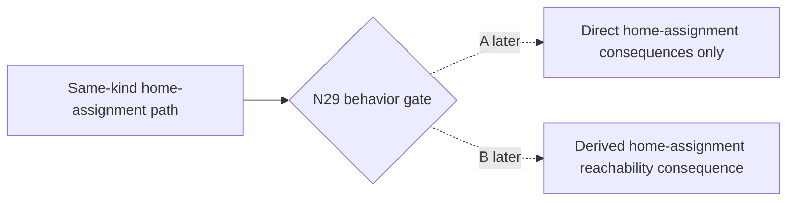
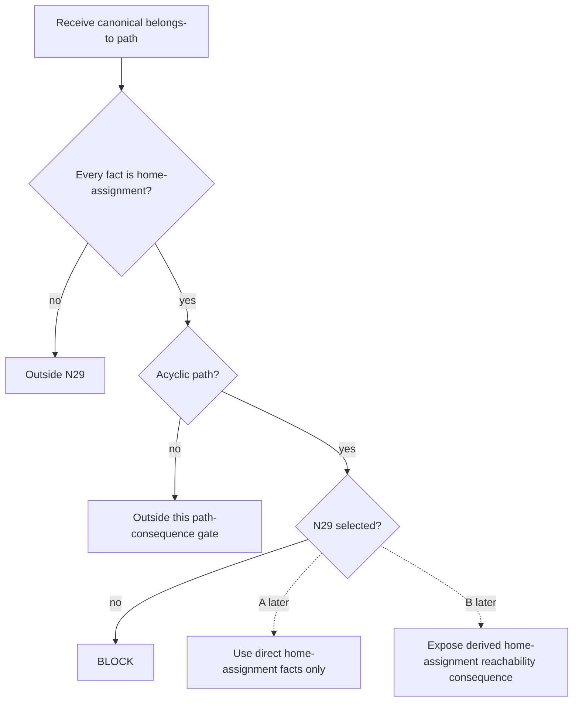

# N29 Six-View Architecture Bundle

Decision: `BMC-REL-NONNUMERIC-29-BELONGS-TO-HOME-ASSIGNMENT-PATH-CONSEQUENCE-BEHAVIOR`
Selection: `null`
Authority: `authority_effect: none`

## 1. Context View

N29 concerns an acyclic path of two or more canonical `belongs-to` facts that all
carry exact active D30 membership kind `home-assignment`. It asks whether
home-assignment consequences have only direct effects or also a non-authoritative
path-reachability consequence.

## 2. High-Level Structure View

The classifier preserves the canonical direct facts and exact `home-assignment` kind.
The consequence policy then either stops at direct facts or exposes derived
reachability as a non-authoritative semantic result. Neither route creates a
canonical edge or an untyped membership result.

`classification` and mixed-kind paths remain outside this home-assignment-only gate.

## 3. Low-Level Components View

1. `HomeAssignmentPathClassifier` recognizes an acyclic path of length at least two
   whose every fact carries exact kind `home-assignment`.
2. `ExactKindGuard` rejects kind collapse and routes any mixed-kind path outside N29.
3. `DirectFactBoundary` keeps canonical authorship on the direct `belongs-to` facts.
4. `HomeAssignmentConsequencePolicy` conditionally returns direct-only consequence
   or non-authoritative derived reachability.
5. `ResidueLedger` retains classification behavior, evidence completeness, naming,
   provenance, representation, and runtime behavior.

These are Design responsibilities, not authorized schema fields or implementation
components.

## 4. Workflow Process View

## 5. Decision Flow View

- A keeps home-assignment consequences on explicitly authored direct facts. It
  preserves D30's direct meaning and minimizes new validation obligations, but does
  not expose a first-to-last home-assignment result across the path.
- B derives a non-authoritative home-assignment reachability consequence over an
  acyclic exact-kind path. It gives D23's relationship-chain axis a
  home-assignment-specific effect, but creates a new semantic layer whose
  completeness, naming, provenance, and representation remain later decisions.
- C defers and keeps home-assignment path behavior unresolved.
- D stops without selecting home-assignment path behavior.

Recommendation: A. D30 defines direct home-assignment and explicitly warns against
inferring transitivity or closure; A therefore preserves the strongest exact current
evidence. D23 keeps B admissible as a deliberate owner-selected path consequence,
but does not make it the default.

## 6. Dependency Interface View

| Dependency | Input | Output | Boundary |
|---|---|---|---|
| N27 B | per-kind governance | home-assignment-local gate | no behavior inferred |
| N28 A | direct-only classification consequence | sole current unresolved kind exposed | answer not copied |
| D30 | direct home/placement-context meaning | direct semantic baseline | no inferred transitivity or closure |
| D23 | finite relationship-chain consequence vocabulary | makes B consequential and admissible | no category law or general closure |
| canonical card and packet | direct `belongs-to` authority and unresolved residue | preserves authored fact boundary | no packet or canonical mutation |
| N29 gate | A/B/defer/stop | one owner choice later | currently unselected |

Claim ceiling: this bundle defines only the home-assignment-specific
path-consequence gate. It does not select an option, create canonical edges, reopen
classification or decide mixed-kind behavior, decide derived-result representation or
evidence completeness, accept or mutate the packet, authorize implementation,
promote, publish, or make the owner choice.
