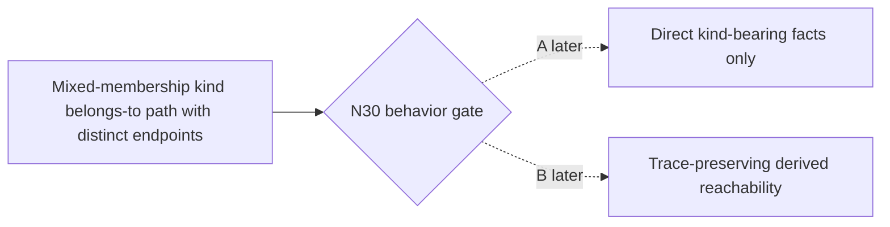
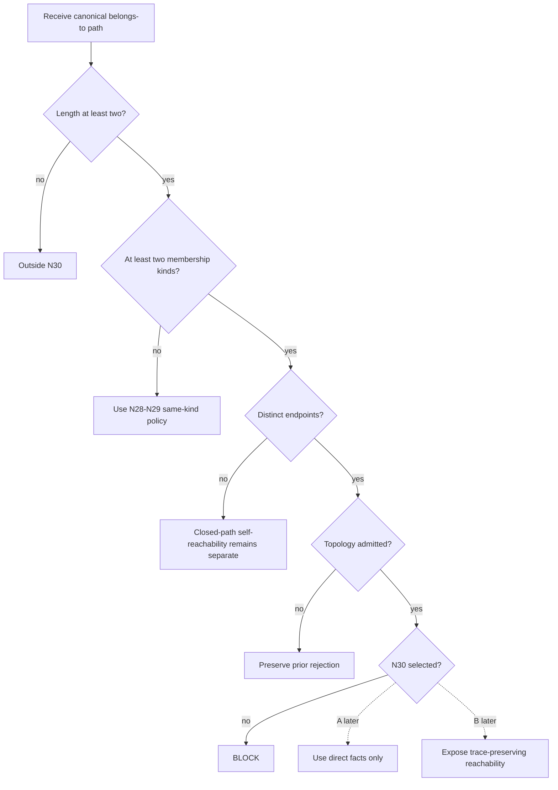

# N30 Six-View Architecture Bundle

Decision: `BMC-REL-NONNUMERIC-30-BELONGS-TO-MIXED-KIND-PATH-CONSEQUENCE-BEHAVIOR`
Selection: `null`
Authority: `authority_effect: none`

## 1. Context View

N30 concerns a topology-admitted directed path of two or more canonical `belongs-to`
facts using at least two exact admitted D30 membership kinds, with distinct endpoints. It
asks whether the path has only direct per-edge consequences or also a
non-authoritative reachability result that preserves its membership-kind trace.

## 2. High-Level Structure View

The classifier preserves all canonical direct facts, their exact per-edge D30
membership kinds, N23's mixed-topology allowance, and N28-N29 direct-only same-kind
policies. A exposes no mixed-path consequence. B exposes a non-authoritative result
that retains the ordered sequence of membership kinds used by the path; it does not claim
one kind-free membership consequence or create a canonical edge.

Closed paths whose endpoints coincide, same-kind paths, membership kind registry
evolution, and all representation/proof/runtime questions remain outside the gate.

## 3. Low-Level Components View

1. `MixedKindPathClassifier` recognizes a directed path of length at least two,
   at least two exact D30 membership kinds, and distinct endpoints.
2. `TopologyGuard` preserves N20-N23 topology decisions without converting N23
   closure allowance into derived self-reachability.
3. `SameKindGuard` preserves direct-only N28-N29 behavior.
4. `DirectFactBoundary` keeps canonical authorship on exact kind-bearing
   direct `belongs-to` facts.
5. `KindTraceGuard` prevents a B result from collapsing distinct axes into a
   kind-free membership consequence claim.
6. `MixedPathConsequencePolicy` conditionally returns no derived result or a
   non-authoritative trace-preserving reachability result.
7. `ResidueLedger` retains closed-path self-reachability, naming, provenance,
   representation, completeness, and runtime behavior.

These are Design responsibilities, not authorized schema fields or implementation
components.

## 4. Workflow Process View

## 5. Decision Flow View

- A keeps mixed-kind path consequences on explicitly authored direct facts. It
  preserves D30's direct semantics and adds no derived semantic layer, but provides
  no endpoint-to-endpoint mixed-path result.
- B derives non-authoritative reachability between distinct endpoints and retains
  the ordered per-edge membership-kind trace. It gives D23's relationship-chain axis a
  mixed-path effect without collapsing membership kinds, but creates later naming,
  provenance, completeness, coalescence, and representation questions.
- C defers and keeps mixed-path consequence behavior unresolved.
- D stops without selecting mixed-path consequence behavior.

Recommendation: A. D30 defines direct, pairwise distinct membership meanings and
withholds transitivity and closure. D23 keeps B admissible as a deliberate typed
path consequence, but neither D23 nor N23 makes it the default.

## 6. Dependency Interface View

| Dependency | Input | Output | Boundary |
|---|---|---|---|
| N23 A | mixed-kind closure not rejected solely for closure | mixed topology can reach N30 classifier | no transitivity or derived self-reachability inferred |
| N27 B | independent same-kind governance | same-kind scope known | no mixed-path behavior inferred |
| N28-N29 A | all current same-kind consequences direct-only | preserved prior behavior | answers not generalized |
| D30 | exact pairwise distinct membership kind IDs and direct semantics | membership-kind trace must remain non-collapsed | no registry precedence or representation |
| D23 | finite relationship-chain consequence vocabulary | makes B consequential and admissible | no full category law or automatic transitivity |
| N30 gate | A/B/defer/stop | one owner choice later | currently unselected |

Claim ceiling: this bundle defines only the distinct-endpoint mixed-kind
path-consequence gate. It does not select an option, derive self-reachability from a
closed mixed path, reopen same-kind decisions, conflate membership kinds, create
canonical edges, decide naming, provenance, representation, or completeness, accept
or mutate the packet, authorize implementation, promote, publish, or make the owner
choice.
