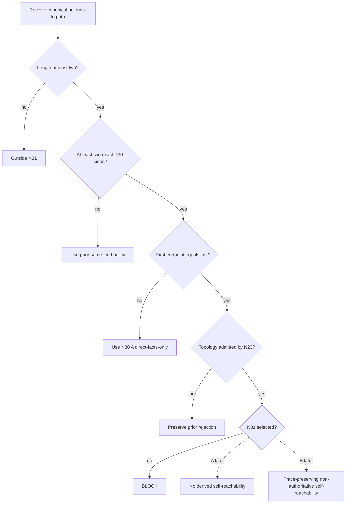

# N31 Six-View Architecture Bundle

Decision: `BMC-REL-NONNUMERIC-31-BELONGS-TO-MIXED-KIND-CLOSED-PATH-SELF-REACHABILITY-BEHAVIOR`
Selection: `null`
Authority: `authority_effect: none`

## 1. Context View

N31 concerns a topology-admitted canonical `belongs-to` closed path of length at
least two, using at least two exact active D30 kinds, whose first and last Entity IDs
are equal. It asks only whether such a path has a derived self-reachability consequence.

## 2. High-Level Structure View

Both actions preserve every direct kind-bearing fact and N23's topology allowance.
A adds no derived result. B adds only non-authoritative self-reachability carrying the
ordered per-edge kind trace. Neither action authors a canonical self-edge or asserts
kind-free self-membership.

## 3. Low-Level Components View

1. `MixedKindClosedPathClassifier` recognizes length ≥2, ≥2 exact kinds, and equal endpoints.
2. `TopologyGuard` preserves N20 and N23 without reopening direct self-edge policy.
3. `DistinctEndpointGuard` preserves N30 A outside the equal-endpoint case.
4. `DirectFactBoundary` retains canonical authority on authored direct facts.
5. `KindTraceGuard` prevents a B result from becoming untyped membership.
6. `SelfReachabilityPolicy` returns none or a non-authoritative trace-bearing result.
7. `ResidueLedger` retains representation, proof, runtime, and implementation questions.

These are Design responsibilities, not implementation components or schema fields.

## 4. Workflow Process View

## 5. Decision Flow View

- A preserves the direct facts and derives no self-reachability. It is minimal and
  aligns with D30's withholding of transitivity and closure.
- B exposes non-authoritative self-reachability with the ordered kind trace. It makes
  D23's finite path consequence visible but creates later naming, provenance,
  coalescence, completeness, and representation questions.
- C defers while preserving the facts and unresolved gate.
- D stops the route without selecting behavior.

Recommendation: A. D30 withholds transitivity and closure; neither N23 nor N30
authorizes an equal-endpoint consequence. D23 keeps B admissible only as a deliberate
owner-selected, non-authoritative path result.

## 6. Dependency Interface View

| Dependency | Input | Output | Boundary |
|---|---|---|---|
| N20 A | direct self-edge rejection | canonical `belongs-to_k(e,e)` remains invalid | no verdict on derived self-reachability |
| N23 A | mixed-kind closed topology allowance | direct facts can reach N31 | no transitivity or self-membership inferred |
| N30 A | distinct-endpoint direct-only behavior | equal endpoints remain separate | no N31 consent |
| D30 | exact kind meanings; transitivity withheld | kind trace remains exact | no kind collapse |
| D23 | finite path consequence vocabulary | keeps B admissible | not automatic transitivity |
| N31 gate | A/B/defer/stop | one later owner choice | currently unselected |

Claim ceiling: N31 defines only derived self-reachability for an admitted equal-endpoint
mixed-kind closed path. It does not author a self-edge, assert canonical or kind-free
self-membership, reopen N20/N23/N30, decide representation or completeness, accept or
mutate the packet, authorize implementation, promote, publish, or choose an option.
