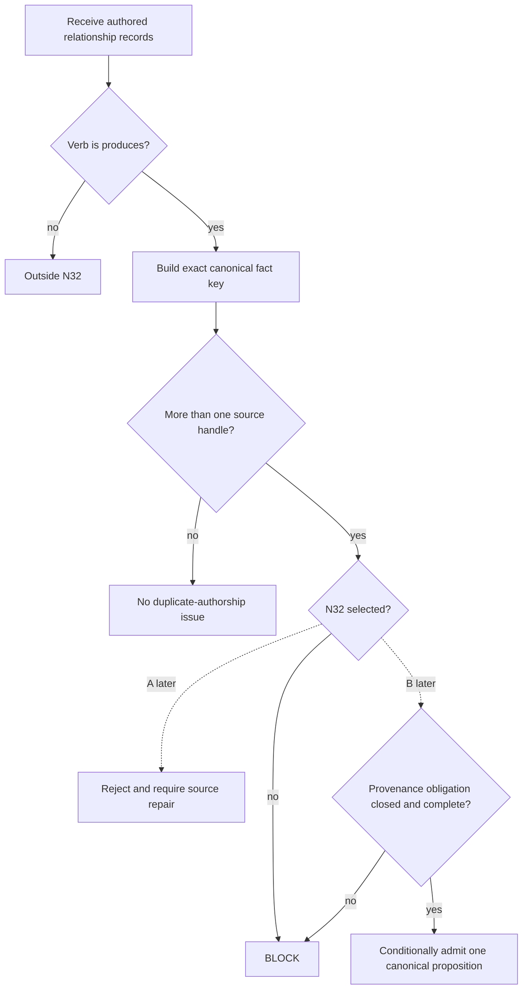

# N32 Six-View Architecture Bundle

Decision: `BMC-REL-NONNUMERIC-32-PRODUCES-DUPLICATE-AUTHORSHIP`
Selection: `null`
Authority: `authority_effect: none`

## 1. Context View

N32 concerns two or more authored records for one exact canonical
`Operation --[produces]--> Event` proposition. Exact identity requires the same verb,
Operation concept ID, Event concept ID, and admitted authority/feature context.
Distinct source handles expose competing authorship; they are not runtime events.

## 2. High-Level Structure View

A rejects the repeated authored proposition and requires source repair. B makes one
canonical proposition conditionally admissible only after a separately closed
deterministic merge-provenance obligation preserves every competing source handle.
Both preserve D08's distinction from `emits`. Neither action compares Event payloads,
counts runtime occurrences, or chooses storage.

## 3. Low-Level Components View

1. `ProducesFactKey` binds verb, Operation ID, Event ID, and authority/feature context.
2. `AuthoredSourceCollector` retains every distinct source handle for one key.
3. `ExactDuplicateDetector` reports a key authored more than once.
4. `RejectPolicy` blocks admission and points to every repair source.
5. `ConditionalCoalescencePolicy` remains blocked until deterministic provenance is
   separately closed and complete.
6. `D08VerbGuard` prevents `emits` or cross-row implications from entering N32.
7. `ResidueLedger` retains payload, occurrence, adjacent facets, and implementation.

These are Design responsibilities, not implementation components or schema fields.

## 4. Workflow Process View

## 5. Decision Flow View

- A exposes every conflicting source and requires authored repair. It is recommended
  because it preserves one authored canonical proposition without inventing merge
  semantics.
- B preserves one canonical proposition only conditionally. Its cost is a later
  deterministic merge-provenance decision and proof; it never permits silent or
  partial coalescence.
- C keeps `produces.duplicates` unresolved and Design blocked.
- D stops the route without interpreting or changing any authored record.

Recommendation: A. The exact sources establish one canonical proposition and leave
duplicate resolution open; they do not already supply a merge-provenance contract.

## 6. Dependency Interface View

| Dependency | Input | Output | Boundary |
|---|---|---|---|
| N32 sequencing | exact `produces` input | verb-local target | no behavior consent; `emits` unchanged |
| D08 B | endpoint/meaning non-collapse | preserves distinct verbs | no cross-row policy |
| canonical card | Operation-to-Event cause fact | exact endpoints and verb | no Event payload or occurrence identity |
| packet row | unresolved `duplicates` facet | justifies owner gate | no adjacent facet selected |
| N01/N03 | relation-local duplicate precedent | keeps A/B structurally admissible | no produces consent |
| N32 gate | A/B/defer/stop | one later owner choice | currently unselected |

Claim ceiling: N32 defines only exact duplicate authored canonical `produces`
resolution. It does not select `emits`, cross-verb rules, payload or runtime Event
identity, numeric bounds, ordering, closure, inverse, occurrence semantics,
representation, runtime cardinality, packet or canonical mutation, implementation,
promotion, publication, or an option.
