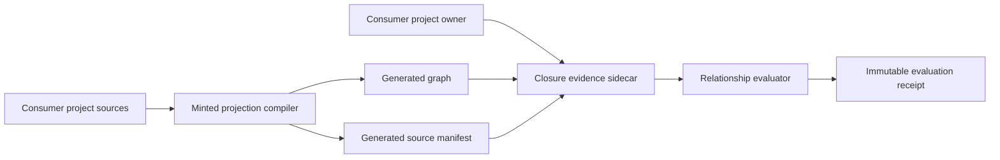

# Architecture bundle: emits closure-envelope placement

Status: proposal-only; N39 owner decision pending.

## 1. Context view



The compiler supplies non-authoritative snapshot evidence; the consumer owns the completeness attestation; the evaluator owns the verdict.

## 2. Capability view

- Bind an exact generated snapshot.
- Attest complete eligible Entity/Event populations and incoming `emits` adjacency.
- Resolve an envelope by contained path and exact digest.
- Evaluate `emits.target_max=1` and persist an immutable receipt.

## 3. Concept/type view

`EmitsIncomingClosureEvidenceEnvelope` is a candidate consumer-authored evidence record. `EmitsTargetMaxEvaluationReceipt` is a candidate evaluator-owned evidence record. The graph, source manifest, build receipt, profile, and registries remain referenced inputs with their existing authority; no new canonical DomainSpec concept or relationship is asserted.

## 4. Operation/flow view

1. Compile declared project sources into graph/source-manifest/build evidence.
2. Consumer resolves the exact boundary, populations, placement, and incoming adjacency.
3. Consumer writes one contained sidecar binding those facts and generated digests.
4. Evaluation caller supplies sidecar path and digest.
5. Evaluator resolves every binding, checks visible violations first, then closure sufficiency, then emits an immutable receipt.
6. Any digest change requires a new envelope and evaluation; historical artifacts are not rewritten.

## 5. State view

```text
draft-sidecar -> digest-bound -> evaluated
draft-sidecar -> rejected-input
digest-bound -> stale-reference (external currentness finding)
evaluated -> historical (never rewritten)
```

These are candidate artifact lifecycle labels, not canonical runtime states.

## 6. Dependency/interface view

| Interface | Producer | Consumer | Binding |
| --- | --- | --- | --- |
| projection evidence | compiler | consumer owner | graph/source-manifest/build digests |
| closure attestation | consumer owner | evaluator | contained path + envelope digest |
| evaluation evidence | evaluator | later lifecycle/packet owner | immutable receipt digest |

`project.json` remains unchanged. Optional request wrappers reference the sidecar and add no completeness fields.

## Significant behavior scenario

Stimulus: a source change produces a new graph digest while an old closure sidecar is supplied. Preconditions: both old and new artifacts exist. Response: the evaluator rejects the mixed snapshot before numeric evaluation. Recovery: the consumer authors a new sidecar for the new digests. Observable evidence: typed input failure plus preserved historical receipt. Acceptance owner: future relationship-evaluator contract owner.

## Concern-to-view trace

| Concern | Class | Disposition | Owner | View |
| --- | --- | --- | --- | --- |
| closure-envelope-placement | authority | required | relationship-decision-owner | context, dependency/interface |
| exact-snapshot-binding | validation | required | design-owner | operation, state |

## Planned witness contracts

- Positive: contained consumer-authored sidecar whose envelope/graph/source-manifest digests agree reaches evaluation.
- Hostile: sidecar under `generated_root`, absolute/traversal path, mismatched digest, compiler-authored completeness, embedded `project.json` output digest, or copied request attestation is rejected.

These are planned contracts, not executed Plan evidence.

## Claim ceiling

Six baseline views are authored. No implementation, runtime execution, canonical schema, packet mutation, profile admission, publication, release, deployment, production, or D06 authority follows.
