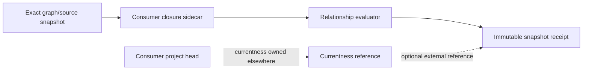

# N40 Architecture bundle: snapshot-relative evaluation

Status: proposal-only; N40 owner decision pending.

## 1. Context view



## 2. High-level structure view

- Snapshot plane: exact source-set, graph, source-manifest, registry, profile, and envelope digests.
- Evaluation plane: `pass`, `invalid`, `not-evaluated-incomplete-closure`, or `error` for only that snapshot.
- Currentness plane: separate owner determination of whether the snapshot represents a present head; never inferred by the evaluator.

## 3. Low-level components view

- Sidecar identity and declaration digest.
- Exact snapshot bindings.
- Consumer completeness attestation.
- Evaluator algorithm identity and immutable receipt.
- Optional opaque currentness reference or explicit unknown; N40 does not mint its schema or vocabulary.

## 4. Workflow process view

1. Resolve and verify every snapshot digest.
2. Evaluate visible invalidity and N37 closure sufficiency.
3. Issue an immutable result limited to the exact snapshot.
4. If a separately owned currentness reference exists, carry its reference without turning it into evaluator authority.
5. A later rebuild creates a new snapshot, sidecar, and evaluation; it never rewrites the old receipt.

## 5. Decision flow view

```text
snapshot bindings inconsistent -> error
visible target_max violation -> invalid
closure proof incomplete -> not-evaluated-incomplete-closure
otherwise -> pass for exact snapshot
present-head claim requested but no external currentness authority -> unsupported/unknown, not inferred
```

## 6. Dependency interface view

| Producer | Artifact | Consumer | Claim boundary |
| --- | --- | --- | --- |
| consumer owner | exact closure sidecar | evaluator | completeness for one snapshot |
| evaluator | immutable result receipt | lifecycle/packet owner | predicate result for one snapshot |
| separate currentness owner | currentness reference | presentation/lifecycle consumer | whether the snapshot represents a current head |

## Planned witnesses

- Exact old snapshot remains historically evaluable after a rebuild, but carries no implicit current-head claim.
- Timestamp, newest filename, path ordering, or file existence cannot establish currentness.
- A changed digest requires a new sidecar and receipt; the prior receipt remains byte-identical.

These are Design contracts, not executed Plan evidence.

## Claim ceiling

No canonical schema, currentness vocabulary, implementation, packet change, profile admission, promotion, publication, release, deployment, production, or D06 authority follows.
