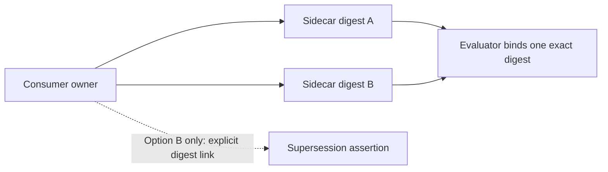

# N41 Architecture bundle: sidecar identity lifecycle

Status: N41-A selected; N42 payload representation pending.

## 1. Context view



## 2. High-level structure view

- Identity plane: owner, boundary, canonical `emits` predicate, exact snapshot tuple, envelope identity, and envelope digest.
- Evaluation plane: one request selects one exact sidecar path/digest.
- Lifecycle plane: N41-A selects no supersession semantics; exact immutable sidecars coexist independently.
- Currentness plane: external under N40-A and unaffected by either N41 action.

## 3. Low-level components view

- Exact sidecar identity and declaration digest.
- Same-scope collision tuple: declaring owner + boundary + predicate + exact snapshot bindings.
- Selected N41-A: multiple immutable digest-addressed attestations may coexist.
- Historical N41-B alternative, not selected: a separate consumer-owner-authored assertion would have linked exact digests while preserving both records.
- Evaluator input always names the exact sidecar it consumed.

## 4. Workflow process view

1. Resolve the exact sidecar path and digest.
2. Verify owner, boundary, predicate, and snapshot bindings.
3. If another same-scope sidecar exists, apply only the selected N41 policy.
4. Evaluate the explicitly supplied sidecar; never select one by timestamp, filename, directory order, or file discovery.
5. Preserve every historical sidecar and receipt byte.

## 5. Decision flow view

```text
one exact supplied sidecar -> evaluate that sidecar
multiple same-scope sidecars + selected A -> coexist; caller must bind one exact digest
supersession assertion -> not admitted by N41-A
implicit latest/current/invalid inference -> reject
```

## 6. Dependency interface view

| Producer | Artifact | Consumer | Claim boundary |
| --- | --- | --- | --- |
| consumer owner | immutable closure sidecar | evaluator | completeness attestation for one exact snapshot |
| evaluation caller | exact sidecar path/digest | evaluator | selects the input, not its currentness |
| consumer owner, B only | exact digest-to-digest supersession assertion | lifecycle consumer | records an explicit relationship between immutable attestations; no invalidation or currentness |

## Planned witnesses

- Two same-scope sidecars coexist and the evaluator consumes the explicitly named digest.
- A newer filename or timestamp cannot select an envelope.
- Under B, a supersession assertion cannot rewrite history, invalidate prior results, or claim present-head currentness.

These are Design contracts, not executed Plan evidence.

## Claim ceiling

No canonical schema, currentness vocabulary, implementation, packet change, profile admission, promotion, publication, release, deployment, production, or D06 authority follows.
