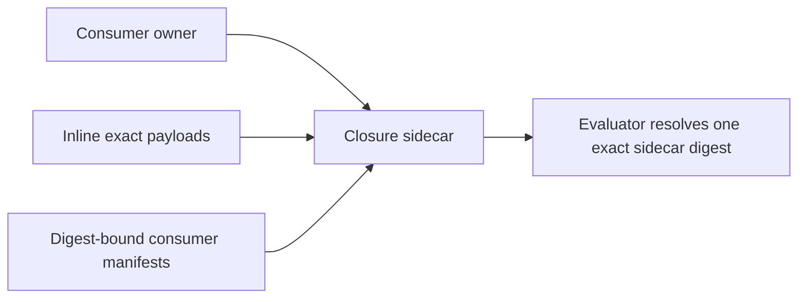

# N42 Architecture bundle: closure payload representation

Status: proposal-only; N42 owner decision pending.

## 1. Context view



Only the selected carrier is authoritative for where the consumer's exact closure payload is found. Generated graph/source-manifest artifacts remain snapshot provenance, not completeness authors.

## 2. High-level structure view

- Subject plane: boundary, canonical `emits.target_max=1`, and exact snapshot bindings.
- Proof-payload plane: source population and placement, target population and placement, and incoming `emits` adjacency.
- Attestation plane: consumer owner declares those payloads complete for the boundary.
- Evaluation plane: evaluator resolves exactly one sidecar digest and every carrier it names.

## 3. Low-level components view

- Option A: every exact closure payload collection is carried directly by the sidecar.
- Option B: every closure payload is a separately resolved consumer-owned manifest referenced by contained path and exact digest.
- Option C: each payload group uses exactly one closed tagged variant, `inline` or `reference`; no untagged or dual form is valid.
- All options preserve exact graph, source-manifest, registry, profile, and contract digest bindings.

## 4. Workflow process view

1. Resolve the exact sidecar path and digest.
2. Verify owner, boundary, predicate, and snapshot bindings.
3. Resolve the selected N42 carrier without path discovery or fallback.
4. Validate exact population, placement, and adjacency values plus completeness declarations.
5. Evaluate visible violations and closure sufficiency under the existing N37 rules.
6. Preserve the sidecar and evaluation receipt as immutable historical evidence.

## 5. Decision flow view

```text
A -> read all proof payloads from the sidecar
B -> resolve every declared payload manifest by contained path and exact digest
C -> for each payload group accept exactly one tagged inline or reference variant
missing, dual, untagged, implicit, or digest-drifting carrier -> reject
```

## 6. Dependency interface view

| Producer | Artifact | Consumer | Claim boundary |
| --- | --- | --- | --- |
| consumer owner | sidecar with inline payloads, A | evaluator | exact completeness payload and attestation |
| consumer owner | digest-bound payload manifests, B | evaluator through sidecar | exact completeness payload; compiler does not inherit authority |
| consumer owner | tagged payload variants, C | evaluator through sidecar | one explicit carrier per payload group |
| compiler | graph/source-manifest evidence | consumer and evaluator | snapshot provenance only |

## Planned witnesses

- Valid inline, referenced, and tagged representations carry the same hypothetical payload values and preserve identical evaluation meaning.
- Missing digest, unresolved path, dual tagged variants, implicit latest-file selection, or compiler-authored completeness is rejected.
- A payload carrier cannot assert currentness, schema admission, packet acceptance, or runtime Event behavior.

These are Design contracts, not executed Plan evidence.

## Claim ceiling

No canonical schema, serialization, filename, manifest schema or producer admission, implementation, packet change, profile admission, promotion, publication, release, deployment, production, or D06 authority follows.
