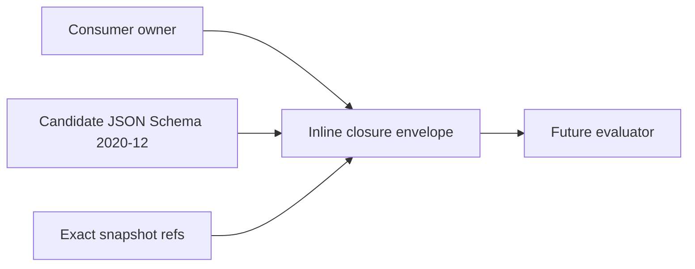

# N43 Architecture bundle: candidate closure envelope schema

Status: proposal-only; direct precedent route; no owner selection.

## 1. Context view



## 2. High-level structure view

- Identity plane: envelope and exact candidate-contract references.
- Subject plane: canonical `emits`, selected `target_max=1` predicate, counting/proof receipts.
- Boundary plane: owner-scoped boundary identity plus opaque kind reference.
- Proof plane: independent exact populations, placement sets, and incoming fact set.
- Snapshot plane: exact source-set, graph, source-manifest, registry, profile, and schema references.
- Attestation plane: consumer declaring owner, producer, and declaration digest.
- Currentness plane: external reference or explicit unknown, never inferred from time or file order.

## 3. Low-level components view

- Draft 2020-12 `$schema` and candidate-local `$id`.
- `additionalProperties: false` on every object-bearing definition.
- Exact ID sets use `uniqueItems`; empty sets remain legal.
- Placement sets are independent from population sets and require later semantic equality validation.
- Incoming adjacency is an exact set of `{source_entity_id, target_event_id}` pairs; order has no meaning.
- Digest-bound references contain `ref`, `version`, and lowercase SHA-256.
- `authority_effect` is fixed to `none`.

## 4. Workflow process view

1. Resolve the exact sidecar and candidate schema digests.
2. Validate closed structural shape.
3. Recompute exact-set and declaration digests.
4. Check population/placement equality and fact endpoint membership.
5. Reject mixed, missing, duplicate, unknown, or authority-collapsing input.
6. Hand the structurally valid envelope to the separately owned evaluator.

## 5. Decision flow view

```text
one live convention evidenced -> direct proposal
candidate schema validates positive fixture -> design evidence
hostile shape or semantic mutation -> reject
schema admission or evaluator execution -> separate future owner
```

## 6. Dependency interface view

| Producer | Contract | Consumer | Boundary |
| --- | --- | --- | --- |
| consumer owner | inline closure envelope | future evaluator | completeness claim only |
| N43 Design | candidate schema | future schema owner | proposal only |
| compiler/projection owner | graph/source-manifest refs | envelope/evaluator | provenance only |
| future semantic validator | cross-set checks | evaluator | structural evidence, not relationship authority |

## Claim ceiling

No canonical schema admission, producer authorization, evaluator-receipt schema, implementation, packet/profile change, publication, release, deployment, production, or D06 authority follows.
