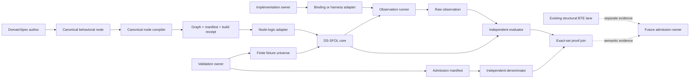
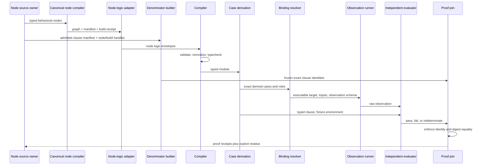
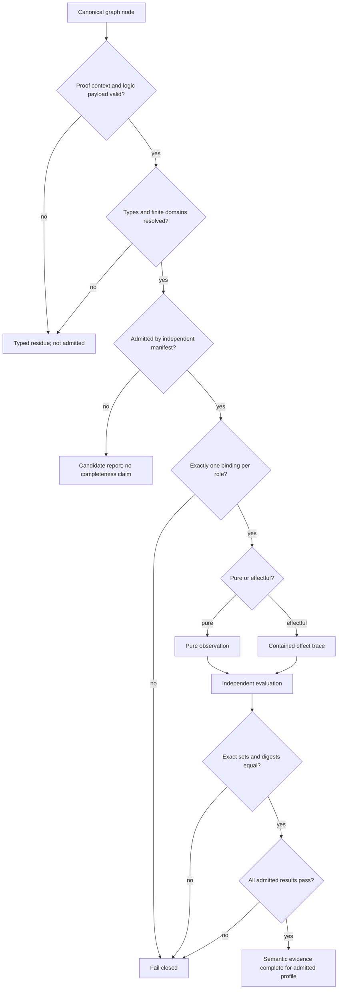
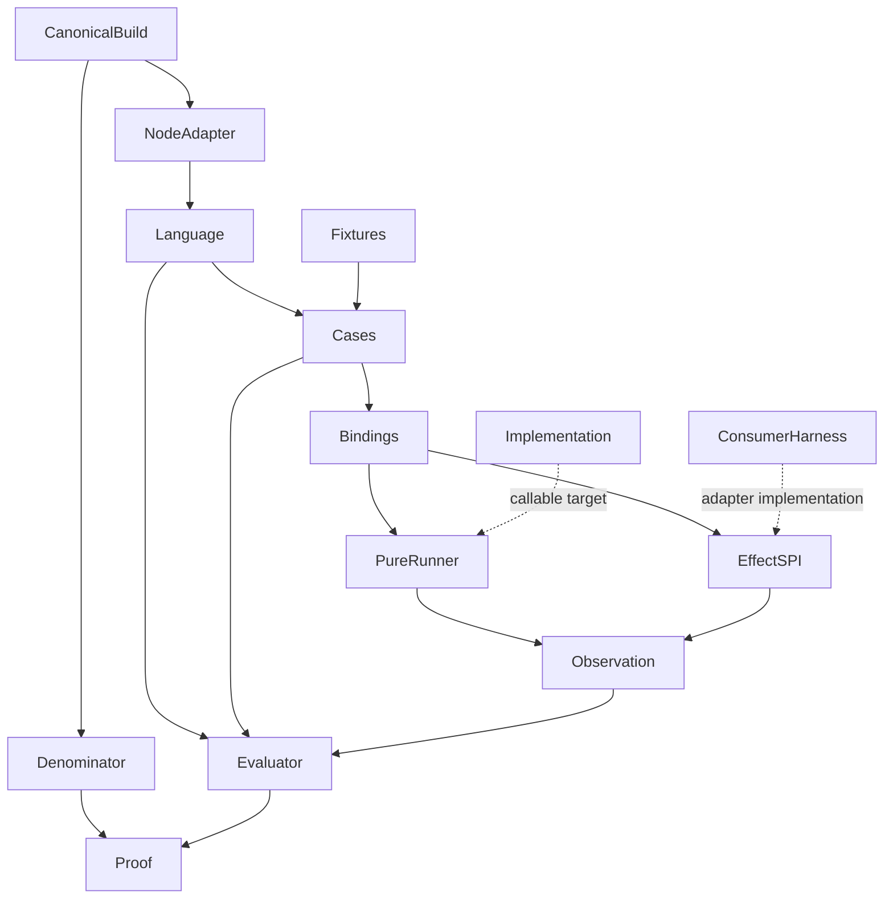

# DomainSpec Specified First-Order Logic Framework Design

## Design Outcome

DS-SFOL is a private DomainSpec semantic-test lane beside the existing
structural backend/type-test engine. It consumes bounded logic from the
canonical node graph/manifest/build pipeline, derives finite cases, observes an
implementation through a pure runner or effect harness, evaluates those
observations independently, and joins the result against an independently
built exact denominator.

The core contains no Financial Settlement or Agent Execution Orchestrator
knowledge. Those features prove portability through consumer-owned clauses,
bindings, fixtures, and harness adapters.

## View 1: Context

The structural lane proves that required nodes, edges, tags, instances, and
backend shapes exist. DS-SFOL proves only the admitted behavioral meaning.
Neither lane promotes or releases a feature.

## View 2: High-Level Structure

| Component | Responsibility | Planned Home |
| --- | --- | --- |
| Node-logic adapter | Validate one proof-context envelope and project logic modules losslessly from canonical graph nodes. | `src/sfol/node-source/` |
| Language kernel | Structured AST contracts, decoding, normalization, type system, diagnostics, and language-version registry. | `src/sfol/language/` |
| Independent denominator | Build the admission-manifest and node/build-handle exact clause set without importing generation code. | `src/sfol/denominator/` |
| Case derivation | Expand admitted typed clauses over finite validation-owned fixture universes. | `src/sfol/cases/` |
| Binding resolver | Resolve exactly one typed implementation or harness target for every executable role. | `src/sfol/bindings/` |
| Pure observation runner | Call a pure symbol and record the raw return or error without judging it. | `src/sfol/runners/pure/` |
| Effect observation SPI | Define contained setup, execution, trace capture, and teardown contracts. | `src/sfol/runners/effect/` |
| Independent evaluator | Evaluate the specified term/relation over declared inputs and raw observations. | `src/sfol/evaluator/` |
| Proof join and replay | Enforce exact identity/digest equality and replay allowlisted evidence. | `src/sfol/proof/` |
| Consumer adapters | Supply canonical node logic, fixtures, bindings, and effect harness implementations. | consumer-owned feature roots |

All core locations are under
`projects/domainspec-v2/impl/test-derivation-engine/`. No public Arcanum path is
in scope.

## View 3: Low-Level Components

### Typed Intermediate Representations

The language pipeline uses four immutable representations:

1. `NodeLogicEnvelope`: proof-context, node, logic-module, graph, manifest,
   build, profile, and source-set handles plus the structured payload.
2. `ValidatedLogicModule`: declarations and clauses with node-local paths but
   no inferred types.
3. `TypedLogicModule`: fully resolved sorts, effect schemas, and typed terms.
4. `DerivedCase`: stable case identity, clause identity/digest, finite inputs,
   expected-expression handle, executable role, and fixture digest.

No later representation can erase the earlier identity or digest chain.

### Evaluation Algebra

Every evaluation returns one of:

- `value(T)`;
- `false` or `true` for a predicate;
- `indeterminate(code, span, detail)` for unsupported, absent, or invalid
  evidence.

`indeterminate` is data and is always a failing residue for an admitted
completeness profile. Exact integer and rational values are represented without
floating-point coercion.

### Quantifier Boundary

`forall` and `exists` require a named, typed, finite fixture universe. The
universe identity and digest become part of each derived case and proof
receipt. An undeclared or empty universe is a typed diagnostic unless the
node clause explicitly admits emptiness.

### Observation Boundary

The pure runner records arguments, raw return, raw throw, target digest, and
runtime version. The effect runner records explicit pre-state, post-state,
ordered calls, writes, events, errors, and containment metadata. Runners do not
receive an expected answer.

### Proof Boundary

A `LogicProofReceipt` joins node/graph/manifest/build handles, denominator,
typed module, fixture, binding, target, observation, evaluator, and tool
digests. A receipt cannot repair an incomplete set and cannot be used as
source input.

## View 4: Workflow Process

The denominator is built by a module whose dependency rules forbid imports
from compiler, case, binding, emitter, runner, evaluator, and proof outputs.

## View 5: Decision Flow

“Complete” in the last state is explicitly scoped to the selected semantic
profile. It is not full feature, release, solver, or production completeness.

## View 6: Dependencies and Interfaces

Forbidden dependencies:

- `denominator` to any generated, bound, run, evaluated, or receipt module;
- `evaluator` to the implementation target or consumer harness;
- `language`, `cases`, or `proof` to adopter-specific modules;
- any core component to the structural BTE result as a semantic oracle;
- any DS-SFOL component to Markdown, table/fence extractors, direct node-file
  traversal, or a separately reconstructed graph;
- generated tests or receipts back into source or admission inputs.

## Decisions

| ID | Decision | Reason |
| --- | --- | --- |
| D-SFOL-01 | Implement a bounded executable first-order profile, not full FOL. | Deterministic execution and honest claim bounds. |
| D-SFOL-02 | Keep structured logic in owning canonical behavioral nodes. | Business meaning remains with node authority and follows the node process. |
| D-SFOL-03 | Make bindings expected-value-free. | Prevent implementation or adapter truth from replacing specification truth. |
| D-SFOL-04 | Use an independently implemented exact denominator. | Counts derived from the generator can produce a false green. |
| D-SFOL-05 | Separate pure and effect observation contracts. | A return-value runner cannot prove state, call, or event effects. |
| D-SFOL-06 | Require a framework corpus and two independent adopters. | Generic type names alone do not establish generality. |
| D-SFOL-07 | Extend the private engine in a separate semantic lane. | Preserve structural BTE scope and public/private boundaries. |
| D-SFOL-08 | Defer external solver selection. | This plan is for deterministic bounded evaluation, not production formal solving. |
| D-SFOL-09 | Consume only the canonical graph/manifest/build proof context. | Direct Markdown or a second graph can diverge from minted-project truth. |

## Risks and Controls

| Risk | Control |
| --- | --- |
| The project grows into an unbounded theorem prover. | Versioned DS-SFOL v1 grammar and explicit unsupported residue. |
| The framework merely hard-codes Financial Settlement. | Core-corpus vocabulary check plus a second independent adopter. |
| Generated and expected results share the same bug. | Independent evaluator and denominator dependency gates. |
| Equal counts hide missing and extra clauses. | Exact identity and compatible digest equality. |
| Effect tests claim more than their harness observes. | Explicit effect schema, containment, and observation completeness checks. |
| Feature prose is silently treated as executable truth. | Markdown is rejected; only admitted structured logic projected from canonical nodes enters. |
| Current node v1 silently drops semantic logic. | Real adoption is gated on a successor node contract and lossless compiler projection. |
| The semantic lane inflates structural BTE claims. | Separate reports, receipts, and terminology; admission composes them later. |

## Design Completion

The context, structure, component, workflow, decision, and dependency views are
complete. All concepts in this design are defined in [GLOSSARY.md](GLOSSARY.md)
or in the feature specification, and all implementation work is deferred to
the work pack.
