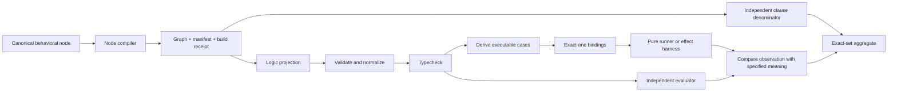

# DomainSpec Specified First-Order Logic Framework

## What This Module Owns

This module owns the private DomainSpec bridge from explicitly authored logic
inside canonical behavioral nodes to deterministic, independently evaluated
executable tests. It defines a bounded typed node payload, exact clause
accounting, implementation binding contracts, observation boundaries, and
proof-oriented generation results.

It does not own business meaning, structural BTE authority, implementation
behavior, feature-source approval, solver selection for formal validation,
release admission, or production truth.

## Module Map



## Capabilities

| Capability | Outcome | Detail |
| --- | --- | --- |
| Node-owned logic | Canonical behavioral node bodies carry stable, versioned structured logic modules. | [operations.md](operations.md) |
| Bounded language | Validate and typecheck structured pure terms, predicates, finite quantifiers, function definitions, and effect relations. | [operations.md](operations.md#language-processing) |
| Independent denominator | Freeze the exact admitted clause/obligation set without importing generator outputs. | [operations.md](operations.md#independent-denominator) |
| Exact binding | Join one clause-derived case to one typed implementation target or one declared harness. | [mappings.md](mappings.md#binding-map) |
| Independent execution | Separate implementation observation from specification evaluation. | [interfaces.md](interfaces.md#runner-interfaces) |
| Fail-closed aggregation | Reject missing, extra, duplicate, stale, skipped, todo, unbound, or indeterminate admitted cases. | [states.md](states.md#clause-lifecycle) |

## Language Boundary

The language is named **DomainSpec Specified First-Order Logic**, abbreviated
**DS-SFOL**. “First-order” means variables range over typed domain values,
records, and finite collections. It does not include higher-order functions,
unbounded quantification, arbitrary recursion, proof search, or a claim of
general FOL decidability.

DS-SFOL v1 includes:

- typed literals, variables, field access, records, lists, sets, and enums;
- exact integer and rational arithmetic;
- comparisons and Boolean connectives;
- conditional expressions and bounded folds;
- `exists` and `forall` over declared finite fixture universes;
- pure function definitions and predicates;
- invariants, preconditions, postconditions, and transitions;
- relations over explicit `pre`, `post`, and finite `effects` observations.

Unsupported syntax or an unresolved/partial evaluation produces typed
`indeterminate` residue. It never guesses an expected result.

## Node Authoring Contract

DS-SFOL logic is structured machine data in `body.logic` of its owning
canonical behavioral node. The node profile must explicitly admit the DS-SFOL
payload version. The canonical node compiler must retain the payload losslessly
in the normalized graph and bind its digest to the source manifest, build
receipt, source-set digest, and node digest. External logic files and free-text
logic fields are not admitted in v1.

The planned `body.logic` payload contains:

- `schema_version: domainspec-node-logic/v1`;
- one stable `module_id` owned by the node;
- typed declarations and finite-domain references;
- structured clauses with stable IDs, kinds, inputs, result/observation types,
  and AST expressions or relations;
- candidate/admitted status without implementation bindings.

One node owns at most one logic module. One module may declare multiple
functions, predicates, invariants, transitions, or effect relations, but every
clause ID is unique within the feature proof context. The language AST is
structured data, not a code string.

The DS-SFOL entrypoint consumes only a validated proof-context envelope over
the canonical graph, source manifest, and build receipt. It must not read
Markdown, tables, fenced blocks, or an independently reconstructed feature
graph. Current `minted-node/v1` lacks this payload contract; no real adopter is
eligible until a successor node profile and compiler preserve it.

Implementation binding files are non-authoritative adapters. They may name
modules, symbols, argument mappings, fixture/harness handles, and observation
fields. They must never store an expected answer that should be derived from
the source clause.

## Domain Concepts

| Concept | Type | Key Constraint |
| --- | --- | --- |
| NodeLogicModule | Value Object | Versioned node-owned collection of declarations and structured clauses. |
| LogicClause | Rule | One stable typed behavioral statement bound to a canonical node handle. |
| NodeLogicEnvelope | Value Object | Lossless graph/manifest/build projection for one node logic module. |
| ClauseDenominator | Value Object | Independent exact set of admitted clause/obligation identities. |
| TypeEnvironment | Value Object | Closed declaration of sorts, variables, and field shapes. |
| FixtureUniverse | Value Object | Finite validation-owned values used for quantifiers and cases. |
| LogicBinding | Mapping | Exactly one implementation or harness target per executable role. |
| RawObservation | Event | Immutable result produced by running implementation code. |
| EffectTrace | Event | Ordered finite writes, calls, emissions, and state snapshots. |
| EvaluationResult | Value Object | `pass`, `fail`, or typed `indeterminate` from independent evaluation. |
| LogicProofReceipt | Value Object | Digest-bound join from node source and canonical build through observation and evaluation. |

## Concept Registry

| Concept | ID | Type |
| --- | --- | --- |
| DS-SFOL compiler | specified-first-order-logic.CompileLogicModule | Operation |
| Clause denominator | specified-first-order-logic.BuildClauseDenominator | Operation |
| Pure case derivation | specified-first-order-logic.DerivePureCases | Operation |
| Effect case derivation | specified-first-order-logic.DeriveEffectCases | Operation |
| Logic evaluator | specified-first-order-logic.EvaluateClause | Operation |
| Binding resolver | specified-first-order-logic.ResolveLogicBinding | Mapping |
| Observation comparator | specified-first-order-logic.CompareObservation | Mapping |
| Logic clause lifecycle | specified-first-order-logic.LogicClauseLifecycle | State Machine |
| Raw observation | specified-first-order-logic.RawObservation | Event |
| Logic proof receipt | specified-first-order-logic.LogicProofReceipt | Value Object |

## Feature Concept Graph

| From | Edge | To | Evidence |
| --- | --- | --- | --- |
| specified-first-order-logic.CompileLogicModule | produces | specified-first-order-logic.LogicClauseLifecycle | [states.md](states.md#clause-lifecycle) |
| specified-first-order-logic.BuildClauseDenominator | enforces | specified-first-order-logic.DerivePureCases | [operations.md](operations.md#independent-denominator) |
| specified-first-order-logic.BuildClauseDenominator | enforces | specified-first-order-logic.DeriveEffectCases | [operations.md](operations.md#independent-denominator) |
| specified-first-order-logic.ResolveLogicBinding | maps | specified-first-order-logic.RawObservation | [mappings.md](mappings.md#binding-map) |
| specified-first-order-logic.EvaluateClause | produces | specified-first-order-logic.LogicProofReceipt | [mappings.md](mappings.md#proof-join) |
| specified-first-order-logic.CompareObservation | produces | specified-first-order-logic.LogicProofReceipt | [mappings.md](mappings.md#proof-join) |

## Required Invariants

1. Node logic and bindings have different owners and different schemas.
2. The denominator cannot import the validator, generator, binding resolver,
   emitter, runner, or their output records.
3. The evaluator cannot import or invoke the implementation under test.
4. A binding resolves exactly once by stable clause/case/role identity; empty,
   first-match, subset, predicate, or multiple resolution fails.
5. Expected values and predicates come from node-owned DS-SFOL plus validation-owned
   fixture universes, never from running implementation code.
6. Pure and effectful observations use distinct contracts.
7. Exact-set completeness is by stable identities and compatible digests, not
   equal counts:

   ```text
   C_spec = C_projected = C_validated = C_typed = T_generated
          = C_bound = O_run = R_evaluated
   ```

8. An admitted completeness profile permits no implicit skip, todo, orphan,
   unsupported, unbound, stale, duplicate, or indeterminate result.
9. Generated tests and receipts are evidence, not source or promotion
   authority.
10. Core modules contain no adopter-specific rule, symbol, fixture, or path.
11. Every admitted clause preserves an exact node, graph, manifest, build,
    profile, and source-set handle chain; direct Markdown or a second graph
    fails closed.

## Generality Proof

The framework is not general merely because types are generic. Generality
requires:

1. a framework-owned corpus with no adopter terminology;
2. Financial Settlement as the first realistic adopter;
3. Agent Execution Orchestrator as an independent second adopter;
4. both adopters use the same versioned core contracts without changing core
   semantics;
5. adopter-specific node logic, bindings, and harness adapters remain in
   adopter-owned locations.

## Non-Goals

- Full first-order satisfiability or validity solving.
- SMT, Lean, Datalog, Cedar, Alloy, or TLA+ integration.
- Automatic invention of node logic, fixture universes, or business truth.
- Direct parsing of Markdown aspect documents, `Formal` cells, or fenced logic
  blocks as DS-SFOL authority.
- Reconstructing a parallel graph from feature prose or node files.
- Replacing the structural BTE catalogues or their current receipts.
- Claiming every behavioral obligation is a pure function.
- Editing adopter source during core implementation.
- Public Arcanum changes, release, promotion, or production authorization.

## Definition Of Complete

The framework is complete for its admitted v1 profile when every exact
node-owned clause is independently counted, projected from one canonical
build, validated, typed, bound, exercised, observed, evaluated, and replayed;
any residue fails closed; the framework corpus and two adopter corpora pass
deterministic positive, negative, mutation, and replay checks; and
adopter-specific knowledge remains outside the core.
