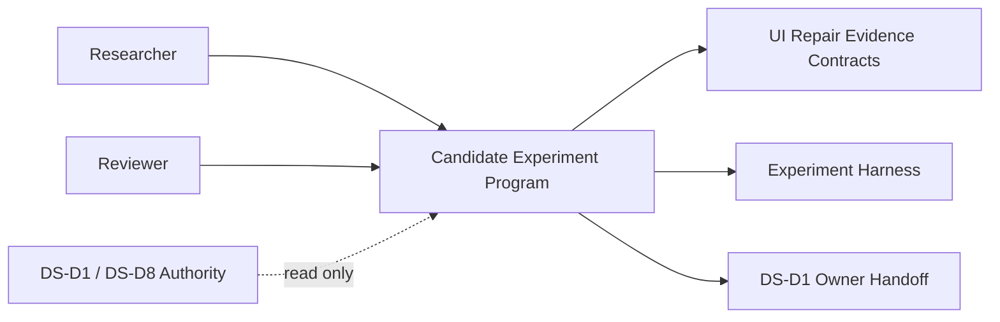
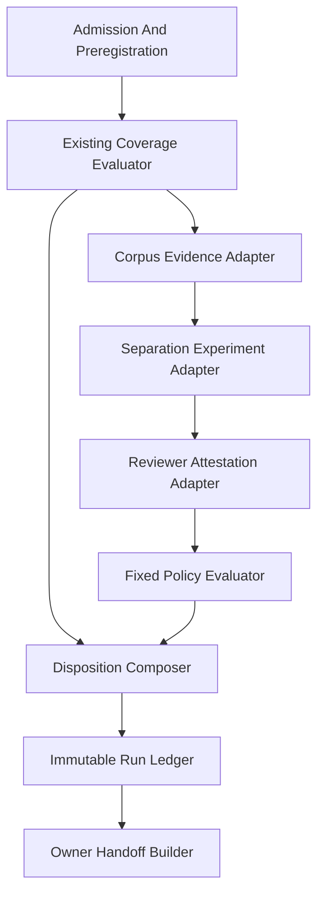
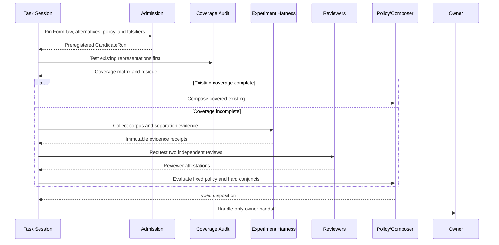
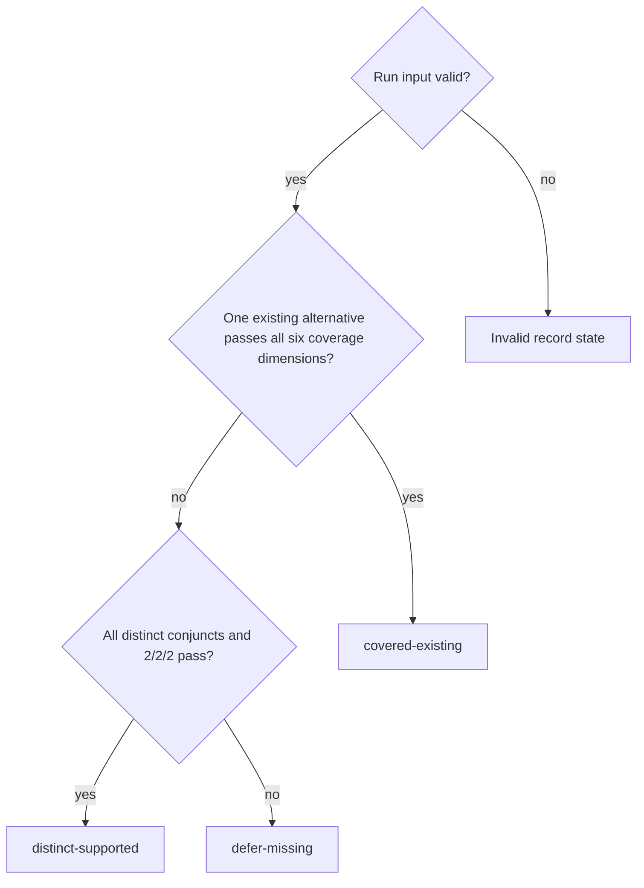

# Architecture: UI Candidate Formalization Experiments

## Design Intent

Build one candidate-local evidence pipeline that can prove distinction, prove
existing coverage, or preserve uncertainty. Keep source facts, experiment
results, reviewer judgments, policy evaluation, and owner authority in separate
record planes joined only by immutable handles.

## 1. Context View



The program owns candidate evidence runs. Empirical reviewers own attestations.
DS-D1 and DS-D8 owners remain the only canonical decision authorities.

## 2. High-Level Structure View



## 3. Low-Level Components View

| Component | Input | Output | Rule |
| --- | --- | --- | --- |
| CandidateRun validator | Candidate law, alternatives, policy, predecessor | Valid/invalid run envelope | One candidate and one law version only |
| Coverage evaluator | Candidate instances, named existing alternatives | Per-alternative six-dimension matrix | No pooling between alternatives |
| Corpus adapter | Source revision, authorship, style, selectors | Corpus attestations | Literal observations remain separate from candidate projection |
| Separation adapter | Preregistered experiment vectors | Positive/contrast/erasure/consequence receipts | Labels and authored criteria cannot be witnesses |
| Review adapter | Reviewer identity, roles, evidence handles | Independent reviewer attestation | Reviewer identity counts once across roles |
| Policy bridge | Candidate-local evidence handles | Fixed 2/2/2 counts and conjunct states | No threshold overrides |
| Disposition composer | Coverage and distinct matrices | One typed disposition plus residue | Coverage pass precedes distinct pass |
| Run publisher | Semantic record and predecessor | Content/record/generation IDs | Append-only, replayable, overwrite refusal |
| Handoff builder | Accepted run generation | Owner packet | No canonical mutation payload |

## 4. Workflow Process View



## 5. Decision Flow View



No outcome maps directly to canonical mutation. Every valid disposition routes
through owner review.

## 6. Dependency And Interface View

| Dependency | Direction | Contract | Boundary |
| --- | --- | --- | --- |
| UI repair audit and generations | read | Content-addressed receipt handles | Mechanical source; no copied authority |
| Candidate cards and verdict matrices | read | Candidate ID/law/source handles | Candidate-only, provisional |
| DS-D1 definitions | read | Existing type IDs and current status | No writes from experiment execution |
| DS-D8 relationships | read | Existing signatures and digest | No edge admission from experiment execution |
| Experiment Harness | invoke | Preregistered profile, fixtures, metrics, result | Execution evidence owner |
| Task Session | invoke | One SWU context and write scope | Bounded execution owner |
| Reviewer input | import | Signed/identified attestation record | External evidence; independence required |
| Owner handoff | output | Run and receipt handles, disposition, residue | Review request, not mutation |

## Candidate Run State Model

```text
draft -> preregistered -> coverage-evaluated
coverage-evaluated -> covered-existing -> handed-off
coverage-evaluated -> evidence-open -> evidence-complete -> reviewed -> evaluated -> handed-off
coverage-evaluated -> defer-missing
evidence-open -> defer-missing
reviewed -> defer-missing
```

Published generations are immutable. A retry creates a successor generation
with the prior generation ID and changed-input reason.

## Design Decisions

| ID | Decision | Consequence |
| --- | --- | --- |
| ADR-UCFE-001 | Separate literal facts, experiment results, reviews, and disposition records | Review or policy cannot rewrite source facts. |
| ADR-UCFE-002 | Coverage evaluation precedes distinct evaluation | Existing ontology is reused when positive no-loss evidence supports it. |
| ADR-UCFE-003 | Use a three-disposition algebra | Missing evidence stays distinct from collapse or support. |
| ADR-UCFE-004 | Reuse repair policy/dossier semantics by handle | Threshold and hard-conjunct drift fail closed. |
| ADR-UCFE-005 | Pilot before reusable template extraction | General process claims require Form-run evidence. |
| ADR-UCFE-006 | All canonical outputs are handoffs only | Candidate runs cannot self-promote. |

## Risks And Controls

| Risk | Failure | Control |
| --- | --- | --- |
| Corpus independence is asserted loosely | One author inflates corpus count | Authorship attestations and duplicate-source checks |
| Existing alternatives are cherry-picked | False distinction | Preregister nearest neighbors and owner source handles |
| Coverage is inferred from missing distinction | False collapse | Six positive coverage dimensions required |
| Framework labels survive erasure | Label-derived identity | Label-erasure and criterion-erasure experiments |
| Review roles inflate reviewer count | False 2-reviewer pass | Count reviewer identity once; require independence |
| Pilot process is generalized too early | Unproven reusable workflow | Template extraction only after audited Form run |
| Route-open Action edge leaks into Form evidence | Authority contamination | DS-D8 read-only and explicit prohibited inference |

## Planning Boundary

Plan may create execution contracts for the Form pilot and conditional template
extraction. It must keep corpus B selection and reviewer identities as evidence
gates, and must not schedule canonical candidate or relationship mutation.
