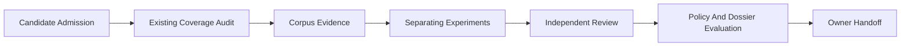

# UI Candidate Formalization Experiments

## What This Module Owns

This module owns preregistered, per-candidate evidence runs from candidate
hypothesis through bounded disposition. It does not own DomainSpec type or
relationship authority.

## Module Map

## Capabilities

| Capability | Outcome | Key contract |
| --- | --- | --- |
| Candidate admission | One finite candidate run with preregistered alternatives | No candidate run begins without distinct/covered/defer hypotheses. |
| Existing coverage audit | Evidence-backed reuse or an open distinct route | Collapse requires positive equivalence and no-loss evidence. |
| Corpus evidence | Pinned per-candidate real observations | At least 2 independent corpora and 2 styles for portability pass. |
| Separating experiments | Independent-positive and erasure evidence | Shared hygiene and labels cannot satisfy separation. |
| Independent review | Bounded reviewer agreement | At least 2 independent agreeing reviewers. |
| Evaluation | Typed disposition and residue | Conjunctive; no scores or threshold tailoring. |
| Owner handoff | Reviewable evidence package | Handoff cannot mutate DS-D1 or DS-D8. |

## Core Records

| Record | Meaning | Authority boundary |
| --- | --- | --- |
| CandidateRun | One candidate, law version, alternatives, evidence universe, and state | Candidate evidence only |
| CoverageAlternative | Existing type, edge, role, projection, or compound interpretation tested against the candidate | No implicit canonical endorsement |
| CorpusAttestation | Authorship, source, style, selectors, receipts, and observation state | Literal evidence, not identity |
| SeparationExperiment | Positive, contrast, label-erasure, criterion-erasure, and changed-consequence result | Experiment result, not promotion |
| ReviewerAttestation | Reviewer identity, role, independence, agreement, and evidence handles | Review input only |
| CandidateDisposition | `distinct-supported`, `covered-existing`, or `defer-missing` plus residue | Owner handoff, not authority mutation |

## Invariants

1. Evidence is never pooled between candidates.
2. A candidate run references exactly one candidate law version.
3. Existing coverage is evaluated before new-type support.
4. `covered-existing` requires positive equivalence, substitutability, changed
   consequence parity, and no observed obligation loss.
5. `distinct-supported` requires all hard conjuncts plus fixed 2/2/2.
6. Any missing hard conjunct yields `defer-missing` unless positive coverage
   evidence supports `covered-existing`.
7. `fail`, `absent`, `kill`, `demote`, and universal collapse are not valid
   dispositions.
8. Every run is immutable, content-addressed, replayable, and predecessor-aware.
9. Owner handoff is required before any canonical mutation proposal.

## Form Pilot

The pilot tests whether Form owns a stable aggregate interaction law beyond
existing Component, Operation/Action behavior, Interface, Rule, Mapping, and
typed edges such as `submits`. The existing Body War evidence is corpus A only.
Corpus B and reviewer attestations are external evidence gates.

## Success Condition

The package succeeds when the Form pilot can be executed and audited without
changing thresholds or authority, and its output truthfully selects one of the
three dispositions. It does not require Form to pass.
