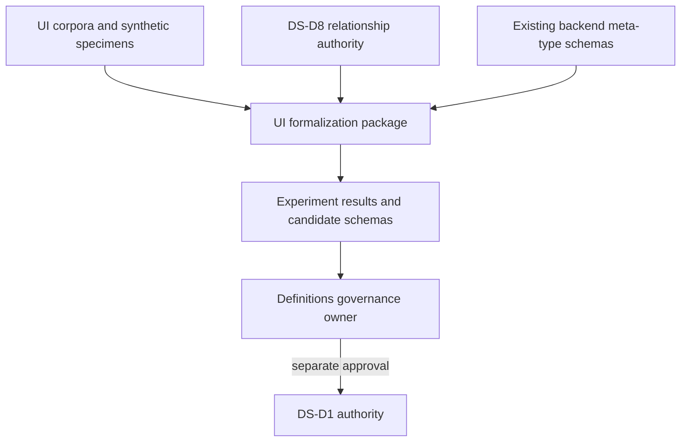
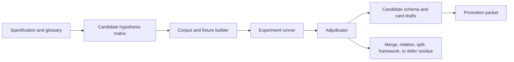
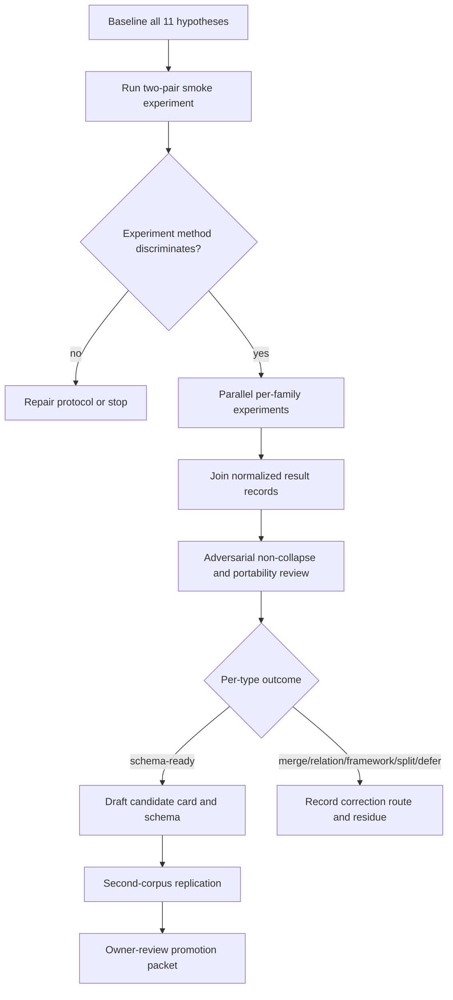

# Architecture: UI Meta-Type Formalization

> Superseded as the active implementation architecture by
> [Required UI Profile Architecture](../ui-profile-implementation/ARCHITECTURE.md).
> This file continues to own the historical falsification/replication design and
> must not be rewritten to imply that its original evidence gates were met.

## Design Intent

Separate formation research from DS-D1 authority. The architecture turns each
UI label into a falsifiable candidate, runs repeatable experiments, and emits an
owner-review packet; only a later definitions-governance decision may promote
surviving artifacts.

## 1. Context View



Boundary: the package reads DS-D8 and DS-D1 artifacts as source contracts. It
does not write either authority surface.

## 2. High-Level Structure View



| Component | Responsibility | Output |
| --- | --- | --- |
| Candidate hypothesis matrix | Name formation law, nearest neighbors, and failure interpretation for all 11 labels. | Reviewable matrix and per-type hypotheses. |
| Corpus builder | Normalize real and synthetic specimens without deriving meaning. | Versioned specimen manifest and fixtures. |
| Experiment runner | Apply structural criteria, edge checks, mutation tests, and portability checks deterministically. | Machine result records and command receipts. |
| Adjudicator | Classify evidence without promotion. | Per-type provisional verdict and residue. |
| Candidate authoring lane | Draft complete human/machine twins for survivors. | Candidate cards, schemas, fixtures, tests. |
| Promotion handoff | Package evidence for the authority owner. | Promotion packet or explicit no-promotion result. |

## 3. Low-Level Component View

### Candidate hypothesis record

```yaml
type_id: DS-D1.20
label: Form
hypothesis: fields plus validation plus submission contract separates Form from Component
nearest_neighbors: [Component, Interface]
allowed_witnesses: [structural-table, exercised-ds-d8-edge]
forbidden_shortcuts: [self-declared-type-only, raw-edge-set-inequality]
expected_outcomes: [candidate-schema-ready, merge-candidate, defer-evidence-gap]
```

### Experiment result record

```yaml
experiment_id: UIF-E-FORM-COMPONENT-01
candidate: Form
corpus_refs: []
criterion_ref: candidate criterion path
positive: {expected: accept, observed: pending}
malformed_negative: {expected: reject, observed: pending}
neighbor_negative: {expected: reject-or-reroute, observed: pending}
portability: {framework_styles: [], observed: pending}
graph_coherence: {ds_d8_refs: [submits, contracts], observed: pending}
verdict: pending
residue: []
```

### Candidate schema path

Surviving experiments draft under the development package first:

```text
candidate-meta-types/ui/<type>.schema.yml
candidate-meta-types/ui/<type>.md
experiments/fixtures/<type>/
experiments/results/<type>.result.yml
```

Moving artifacts to `impl/spec/meta-types/ui/` is explicitly outside this
package's execution authority and requires a later owner decision.

## 4. Workflow Process View



The smoke experiment is counterbalanced: `Form` versus `Component` tests a
plausible surviving specialization, while `Adapter` versus existing `Mapping`
tests whether the method can produce a collapse result instead of rewarding
every proposed label.

## 5. Decision Flow View

For each label:

1. If no bounded public criterion can be stated, return
   `defer-evidence-gap`.
2. If the criterion is only a framework name or syntax convention, return
   `framework-vocabulary` unless a neutral contract survives portability.
3. If an existing DS-D1 type accepts the same specimens and no separating
   witness survives, return `merge-candidate`.
4. If the distinction is expressed only by graph connection and has no stable
   node record, return `relation-not-node`.
5. If one label requires incompatible formation laws, return
   `split-candidate`.
6. Only when constructibility, discrimination, non-collapse, portability,
   graph coherence, and round-trip validation pass may the label become
   `candidate-schema-ready`.
7. `candidate-schema-ready` still requires definitions-governance approval;
   it never promotes automatically.

## 6. Dependency And Interface View

| Dependency | Direction | Contract | Failure behavior |
| --- | --- | --- | --- |
| Existing meta-type schemas | read | Reuse schema/card/fixture/test conventions. | Flag incompatible rule needs; do not fork silently. |
| Content and instance validators | read, later candidate extension | Public structural validation only. | Boundary flag if meaning or execution is required. |
| DS-D8 relationships | read | Active signatures supply graph-coherence checks. | Block any claim that endpoint use proves formation. |
| UI corpora | read-only input | At least two framework styles or a justified neutral corpus. | Mark portability incomplete. |
| Definitions governance | handoff | Receives evidence packet and owns promotion. | Package remains candidate if no decision. |
| Task Session | execution handoff | Executes one SWU and returns validation receipt. | Work-pack state does not advance without receipt. |

## Architecture Decisions

| ID | Decision | Rationale |
| --- | --- | --- |
| UIF-AD1 | Experiments are mandatory, not optional. | The current gap is missing discrimination evidence, not missing prose. |
| UIF-AD2 | Run a counterbalanced two-pair smoke experiment before all-label fan-out. | Proves the method can both preserve and collapse candidates. |
| UIF-AD3 | Candidate artifacts live under development until owner approval. | Keeps research evidence separate from DS-D1 authority. |
| UIF-AD4 | Parallel lanes write disjoint per-type result paths and join through one adjudication schema. | Enables concurrency without result-shape drift. |
| UIF-AD5 | Framework portability is a gate for Hook and a check for every surviving label. | Prevents React vocabulary from masquerading as universal ontology. |
| UIF-AD6 | Existing validator rule kinds are preferred; new bounded rules require explicit tests and classification. | Avoids a parallel DSL and preserves decidability. |

## Risks And Residue

- Real UI corpora may not contain all 11 labels as explicit records; synthetic
  specimens must be labeled as synthetic and cannot alone justify promotion.
- `Component` may remain an umbrella rather than a first-class formation type.
- `Binding` may resolve to a relationship record, `Adapter` may merge into
  `Mapping`, and `Hook` may remain framework vocabulary.
- `State Indicator` may split into domain-state visualization and async
  request-state presentation.
- DS-D8 signatures may need future repair, but this package can only emit a
  relationship-authority request.

## Design Distill

The coherent unit is not one schema. It is one candidate hypothesis plus a
positive, malformed-negative, nearest-neighbor, portability, and graph-coherence
result record. Smaller units cannot establish non-collapse; larger all-at-once
promotion would hide per-type failures.
