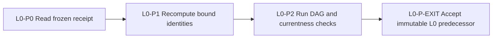
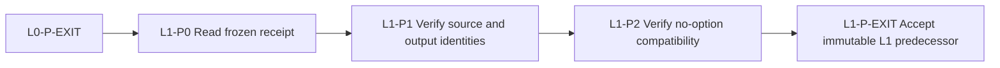
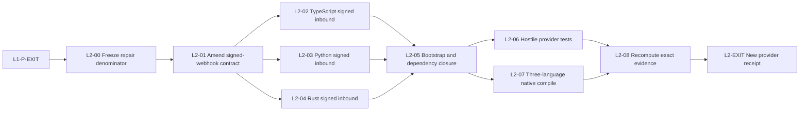
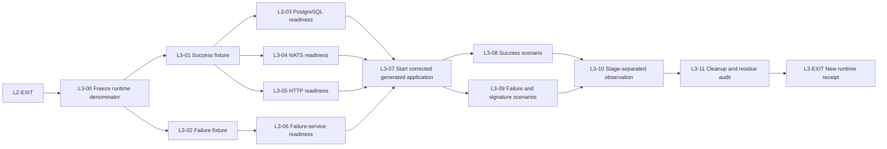
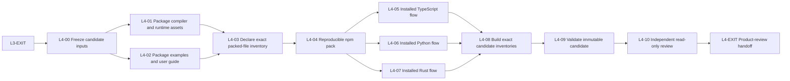

# DomainSpec Whole-Application Compilation Continuation DAG

This plan closes the remaining gaps in the five-layer whole-application compilation capability. It preserves passed L0 and L1 guarantees, repairs the provider realization at L2, replays the real-runtime proof at L3, and qualifies one exact installed candidate at L4.

Completion of this DAG establishes only an exact candidate ready for product review. It does not grant admission, publication, release, deployment, production readiness, or provider authority.

## Current frontier

| Layer | Current state | Required action |
| --- | --- | --- |
| L0 — TypeScript formation | Passed | Verify receipt and source currentness; do not mutate. |
| L1 — Three-language CLI | Passed | Verify receipt, CLI compatibility, and source currentness; do not mutate. |
| L2 — Provider realization | Reopened | Implement the declared signed-webhook capability in TypeScript, Python, and Rust, then recompile and reseal. |
| L3 — Real-runtime proof | Superseded by L2 repair | Replay with the corrected generated provider adapters and produce new runtime and cleanup evidence. |
| L4 — Installed candidate | Failed independent review | Complete package schemas, exact file inventory, user flow, three installed startup scenarios, and exact candidate freeze. |

## Cross-layer dependency graph

```mermaid
flowchart LR
  A[L0-P Preserve formation proof] --> B[L1-P Preserve CLI proof]
  B --> C[L2-C Amend provider contract]
  C --> D1[L2-TS TypeScript provider]
  C --> D2[L2-PY Python provider]
  C --> D3[L2-RS Rust provider]
  D1 --> E[L2-V Provider verification]
  D2 --> E
  D3 --> E
  E --> F[L2-EXIT New provider receipt]
  F --> G[L3-R Replay bounded runtime]
  G --> H[L3-EXIT New runtime receipt]
  H --> I1[L4-A Package assets]
  H --> I2[L4-D Documentation and examples]
  I1 --> J[L4-P Exact pack]
  I2 --> J
  J --> K1[L4-TS Installed TypeScript flow]
  J --> K2[L4-PY Installed Python flow]
  J --> K3[L4-RS Installed Rust flow]
  K1 --> L[L4-F Exact candidate freeze]
  K2 --> L
  K3 --> L
  L --> M[L4-I Independent review]
  M --> N[L4-EXIT Product-review candidate]
```

## L0 — Preserve the minimum formation proof

Decision question: After this layer check, we know whether the original TypeScript whole-application proof remains an unchanged valid predecessor.

| Node | Work | Exit evidence | Hard stop |
| --- | --- | --- | --- |
| L0-P0 | Read the existing L0 terminal receipt and its declared denominator. | Receipt identity and declared input/output set. | Receipt is missing or does not identify the proof. |
| L0-P1 | Recompute every source, fixture, plan, and test identity bound by L0. | Currentness comparison with no drift. | Any L0-bound byte changed. |
| L0-P2 | Re-run only the structural DAG/currentness validators needed to trust the predecessor. | Passing validation report. | A validator repairs or rewrites evidence. |
| L0-P-EXIT | Accept L0 as an immutable dependency. | Preservation record referencing the existing L0 receipt. | Any implementation edit would be required in L0. |

Included scope: predecessor validation only.

Deferred scope: new formation behavior, new languages, providers, runtime, and packaging.

Prior guarantee preserved: one deterministic TypeScript domain-plus-integration plan natively compiles without semantic or path collapse.

## L1 — Preserve the three-language CLI proof

Decision question: After this layer check, we know whether the public three-language CLI remains a valid unchanged predecessor for the provider repair.

| Node | Work | Exit evidence | Hard stop |
| --- | --- | --- | --- |
| L1-P0 | Read the L1 terminal receipt and three-language denominator. | Exact predecessor binding. | A supported language is absent. |
| L1-P1 | Recompute the bound CLI, composer, selection, and generated-project identities. | Currentness report with no drift. | L1-bound source or artifact drifted. |
| L1-P2 | Run the compatibility check proving calls without `--integration-source` retain existing behavior. | Exact compatibility result. | The additive whole-application path changes the existing CLI path. |
| L1-P-EXIT | Accept L1 as the provider layer predecessor. | Preservation record referencing the existing L1 receipt. | Provider repair requires redefining L1 behavior. |

Included scope: currentness and compatibility only.

Deferred scope: provider correctness, provider execution, installed runtime scenarios, and release.

Prior guarantees preserved: TypeScript, Python, and Rust generation is deterministic; publication is atomic; the new CLI option is additive.

## L2 — Repair and reseal explicit provider realization

Decision question: After this layer, we know whether every declared reference provider capability is actually emitted, reachable, and natively compilable in all three languages.

| Node | Work | Exit evidence | Hard stop |
| --- | --- | --- | --- |
| L2-00 | Freeze the L1 receipt, provider selection, capability matrix, language set, and exact repair scope. | Repair denominator with TypeScript, Python, Rust, PostgreSQL, NATS, outbound HTTP, and signed inbound HTTP. | A provider becomes implicit or the language denominator changes. |
| L2-01 | Make signed webhook verification an explicit provider-pack contract: raw-body HMAC verification, constant-time comparison, invalid-signature rejection, and no handler call on rejection. | Capability rule and generated-interface contract. | The signature algorithm or failure behavior remains implicit. |
| L2-02 | Generate TypeScript inbound verification and pass the configured secret through bootstrap. | TypeScript source plus positive/negative adapter tests. | `WEBHOOK_SECRET` remains decoded but unused. |
| L2-03 | Generate equivalent Python inbound verification and bootstrap wiring. | Python source plus positive/negative adapter tests. | TypeScript and Python signature semantics differ. |
| L2-04 | Generate the Rust webhook route, HMAC verification, handler boundary, and locked direct dependencies. | Rust source, lock contribution, and positive/negative adapter tests. | Rust exposes only health or depends on undeclared transitive crates. |
| L2-05 | Recompose bootstrap, configuration, root manifests, module indexes, and dependency locks. | Reachability and dependency-closure report. | Generation executes an external effect or embeds a credential value. |
| L2-06 | Test invalid signature, malformed signature, missing secret, unselected pack, secret leakage, and provider/domain non-collapse. | Hostile provider report. | Rejected input invokes application code or provider code gains domain authority. |
| L2-07 | Generate and natively compile the complete selected application in TypeScript, Python, and Rust. | Three pinned native compilation reports. | Any language is skipped or compilation uses checkout-only bytes. |
| L2-08 | Recompute source, generated-artifact, lock, test, and tool identities. | Exact L2 evidence inventory. | Old evidence is retained after a bound source changes. |
| L2-EXIT | Seal a new provider completion receipt. | Receipt binding the corrected provider set and all L2 evidence. | Runtime behavior is inferred from compilation. |

Parallel work: L2-02, L2-03, and L2-04 may run concurrently after L2-01. Hostile testing and native compilation may run concurrently after L2-05.

Prior guarantees preserved: provider selection remains explicit; adapters do not define business meaning; generation remains pure; configuration carries references rather than secret values.

## L3 — Replay the bounded real-runtime proof

Decision question: After this layer, we know whether the corrected generated provider adapters behave as declared across isolated disposable services.

| Node | Work | Exit evidence | Hard stop |
| --- | --- | --- | --- |
| L3-00 | Bind the new L2 receipt, image digests, scenario definitions, environment identity, and owned-resource labels. | Exact runtime denominator. | A service image is floating or cleanup ownership is ambiguous. |
| L3-01 | Create a uniquely labeled PostgreSQL/NATS/HTTP stack for the success path. | Success-fixture lifecycle record. | State is reused from another scenario. |
| L3-02 | Create a separately labeled PostgreSQL/NATS/HTTP stack for failure paths. | Failure-fixture lifecycle record. | Success and failure share mutable services. |
| L3-03 | Apply generated migrations to fresh success and failure databases. | Migration and readiness receipts. | Migration source differs from the generated candidate. |
| L3-04 | Create exact queue, topic, stream, acknowledgement, and dead-letter resources. | NATS readiness and topology receipt. | Queue and topic semantics collapse. |
| L3-05 | Start local payment and signed-webhook peers without public-network dependence. | HTTP readiness receipt. | Authentication is bypassed by the fixture. |
| L3-06 | Prepare provider rejection, retry, dead-letter, rollback, and invalid-signature controls in the isolated failure stack. | Failure-control receipt. | The harness replaces rather than exercises generated adapters. |
| L3-07 | Start the application from generated bytes and selected provider bootstraps. | Health, configuration, and generated-entry-point evidence. | A manual source patch is required. |
| L3-08 | Execute the successful commerce operation. | Separate commit, provider-acceptance, transport-delivery, consumer-completion, and business-observation facts. | Any stage is inferred from another stage. |
| L3-09 | Execute duplicate, rollback, rejection, retry-classification, dead-letter, and invalid-signature cases. | Causal failure report proving invalid signatures never reach the application handler. | Retry classification selects the effect or an effect escapes after failure. |
| L3-10 | Project only allowed observations to ORODI and prove no return/control edge. | Sanitized immutable observation and edge audit. | ORODI can influence execution. |
| L3-11 | Stop and remove every owned process, container, network, volume, database, and temporary root. | Zero-residue audit. | Any owned resource remains. |
| L3-EXIT | Seal a new bounded-runtime receipt against the corrected L2 receipt. | Current runtime completion receipt. | Evidence implies production behavior, scale, or release. |

Parallel work: service readiness may run concurrently inside each isolated stack. Success and failure scenarios may run concurrently only when their labels, ports, networks, volumes, and temporary roots are disjoint.

Prior guarantees preserved: Event and Message remain distinct; commit is not provider acceptance; provider acceptance is not consumer completion; classification is not effect selection; ORODI is observation-only.

## L4 — Package and qualify one exact installed candidate

Decision question: After this layer, we know whether a clean consumer can install the exact package and reproduce generation, compilation, startup, scenario execution, observation, and verification in every supported language.

| Node | Work | Exit evidence | Hard stop |
| --- | --- | --- | --- |
| L4-00 | Bind the new L3 receipt and enumerate every intended package, example, documentation, test, tool, environment, and evidence input. | Exact candidate-input manifest. | A required input is represented only by a broad directory. |
| L4-01 | Ship public APIs, provider resources, lock metadata, and the provider, integration-generation, application-integration-binding, and whole-application schemas. | Installed-path asset inventory and schema identity checks. | A documented asset resolves only inside the source checkout. |
| L4-02 | Ship one coherent commerce example and a copyable user flow from sources through cleanup. | User guide and executable example scripts for generation, compilation, configuration, startup, scenario, observation, verification, and cleanup. | Documentation stops at an in-memory plan or depends on development-only paths. |
| L4-03 | Generate and freeze the exact expected packed-file list, with one path, size, mode, and digest per file plus forbidden-pattern rules. | Exact package allowlist. | Broad `dist` inclusion can hide a deterministic unexpected file. |
| L4-04 | Run `npm pack` twice and compare tarball digest, metadata, and exact file inventory. | Reproducible tarball and allowlist comparison. | Counts match but paths or bytes differ. |
| L4-05 | In a disposable consumer, install only the tarball; generate, compile, start, run the scenario, observe, verify, and clean up the TypeScript application. | Complete installed TypeScript report. | The flow imports source-checkout files or omits startup/scenario evidence. |
| L4-06 | Repeat the complete installed flow for Python. | Complete installed Python report. | Python receives a weaker qualification path. |
| L4-07 | Repeat the complete installed flow for Rust. | Complete installed Rust report. | Rust receives a weaker qualification path. |
| L4-08 | Produce complete source-graph, generated-artifact, packed-file, test-denominator, compiler/tool, environment, runtime-evidence, cleanup, and validator inventories. | Exact per-file and per-result manifests. | A material candidate byte or required test can drift without detection. |
| L4-09 | Validate every inventory, predecessor receipt, result, and claim ceiling without mutation. The manifest binds the validator identity. | Passing candidate-currentness report. | Validation repairs evidence or omits its own implementation identity. |
| L4-10 | Perform an independent read-only obligation-by-obligation audit. | Review report with pass, fail, or not-evaluable for every node and discrepancy. | Any unresolved discrepancy remains. |
| L4-EXIT | Seal the final receipt and product-review handoff. | Exact candidate identifier, package digest, evidence root, and forbidden-inference list. | Review failure, drift, residue, authority growth, or release inference. |

Parallel work: L4-01 and L4-02 may run concurrently. L4-05, L4-06, and L4-07 may run concurrently only in disjoint disposable consumers and runtime resources.

Prior guarantees preserved: all L0-L3 semantic, compatibility, provider-authority, runtime-stage, observation, cleanup, and claim boundaries remain true after installation.

## Required execution order

1. Preserve and validate L0 and L1.
2. Repair and reseal L2; no L3 or L4 evidence survives an L2 source change without explicit revalidation.
3. Replay and reseal L3 using the corrected generated providers.
4. Build the L4 package surface and documentation in parallel.
5. Freeze the exact packed-file allowlist before package qualification.
6. Qualify TypeScript, Python, and Rust in separate clean consumers.
7. Freeze and validate the complete candidate.
8. Request the independent read-only review.
9. Form L4-EXIT only when that review has no unresolved discrepancy.

## Non-regression guardrails

- No provider identifier becomes domain meaning or a default selection.
- No generated adapter may add a Rule, Policy, Workflow, State Machine, outcome, or business decision.
- Existing CLI behavior without `--integration-source` remains byte-compatible.
- Generation and planning perform no external provider effect.
- TypeScript, Python, and Rust have the same semantic and qualification denominator.
- Signed-webhook rejection occurs before the application handler in every language.
- Success and failure scenarios never share mutable fixtures.
- Runtime stages remain separately observable and cannot stand in for one another.
- ORODI has no return or control edge.
- Package qualification uses only installed tarball bytes and declared external tools.
- Candidate and package inventories are exact per-file allowlists, not counts or broad directory claims.
- Every owned temporary resource is removed before a terminal receipt forms.
- Every receipt and review retains `authority_effect: none`.

## Promotion outcome

When the terminal passes, the result is an exact installable DomainSpec whole-application candidate ready for product review. Product approval, publication, release, deployment, production operation, and support remain separate decisions outside this DAG.
