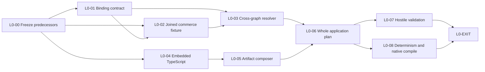
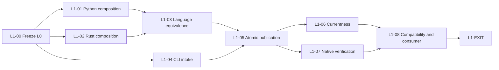
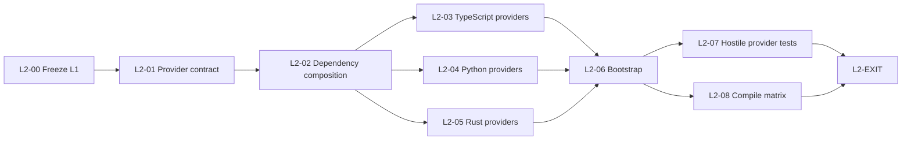
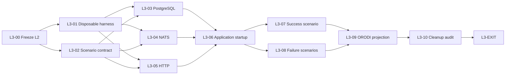
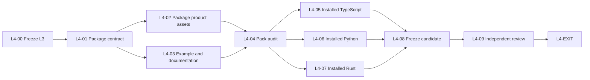

# Whole-Application Compilation Execution DAG

[EXECUTION-DAG.json](EXECUTION-DAG.json) is the machine-readable execution contract for the five layers in [IMPLEMENTATION-LAYERING.md](IMPLEMENTATION-LAYERING.md). It contains 53 dependency-closed nodes, one root, one terminal for each layer, and one final candidate terminal.

## Execution semantics

1. A node is ready only when every dependency has outcome `passed`.
2. A ready node runs all of its checks and records all causal failures.
3. A failed node makes its descendants `not_evaluable`; descendants are not silently skipped.
4. Nodes may run concurrently only when their dependencies pass and their write scopes do not overlap.
5. Each layer starts from the preceding layer's exact terminal receipt.
6. A layer terminal binds current sources, artifacts, checks, tools, environment, cleanup, and claim ceiling.
7. Passing formation does not establish compilation; compilation does not establish runtime behavior; runtime evidence does not grant release.
8. Commands without `--integration-source` preserve current behavior and bytes.
9. No node may mutate or reinterpret an already frozen predecessor to make its own checks pass.

## Complete layer DAG

```text
L0-00 -> L0-01 -> L0-02 -> L0-03 --\
   |                                      +-> L0-06 -> L0-07 --\
   +---------------> L0-04 -> L0-05 ----/                  +-> L0-EXIT
                                                L0-08 -----/

L0-EXIT -> L1-00 -> L1-01 --\
                    L1-02 ----+-> L1-03 --\
                    L1-04 ----------------+-> L1-05 -> L1-06 --\
                                                       L1-07 ----+-> L1-08 -> L1-EXIT

L1-EXIT -> L2-00 -> L2-01 -> L2-02 -> L2-03 --\
                                      L2-04 ----+-> L2-06 -> L2-07 --\
                                      L2-05 ---/                  +-> L2-EXIT
                                                           L2-08 -/

L2-EXIT -> L3-00 -> L3-01 --+-> L3-03 --\
                 L3-02 -----+-> L3-04 ----+-> L3-06 -> L3-07 --\
                             +-> L3-05 ---/            L3-08 ----+-> L3-09 -> L3-10 -> L3-EXIT

L3-EXIT -> L4-00 -> L4-01 -> L4-02 --\
                              L4-03 ----+-> L4-04 -> L4-05 --\
                                                   L4-06 ----+-> L4-08 -> L4-09 -> L4-EXIT
                                                   L4-07 ---/
```

## L0 DAG — TypeScript minimum proof

Decision: After this layer, we know whether one TypeScript domain graph and integration graph can form and natively compile as one coherent project.



| Node | Work | Primary evidence | Hard stop |
| --- | --- | --- | --- |
| L0-00 | Freeze current application and integration surfaces. | Exact predecessor inventory. | Missing/drifting candidate or overlapping writer. |
| L0-01 | Define typed cross-graph joins and failures. | Closed binding schema and kind matrix. | Join lacks a canonical representation. |
| L0-02 | Align the commerce integration fixture with real domain selectors. | Joined source and expected binding manifest. | Required meaning would be invented. |
| L0-03 | Resolve exact references against one compiled snapshot. | Immutable binding receipt and causal diagnostics. | Fuzzy or unqualified fallback required. |
| L0-04 | Produce embedded TypeScript contributions. | Owned artifacts plus structural manifest/module contributions. | Standalone output must change. |
| L0-05 | Compose paths, imports, and `tsconfig.json`. | Closed path-owner and import graphs. | Silent overwrite or ambiguous rewrite. |
| L0-06 | Form the public whole-application plan. | Exact combined plan and digest. | Any child/binding digest can be omitted. |
| L0-07 | Run semantic and structural hostile cases. | Non-collapse report. | Any hostile case passes. |
| L0-08 | Run multiprocess repeatability and `tsc`. | Native compile and cleanup reports. | Nondeterminism, compile failure, or residue. |
| L0-EXIT | Join L0 evidence. | Exact L0 terminal receipt. | Missing node, stale evidence, or claim inflation. |

Parallel lane: after L0-06, L0-07 and L0-08 run concurrently. All earlier steps stay serial where they freeze the semantic input of the next step.

## L1 DAG — Three-language CLI completion

Decision: After this layer, we know whether whole-application compilation is repeatable through the public CLI for every supported language.



| Node | Work | Primary evidence | Hard stop |
| --- | --- | --- | --- |
| L1-00 | Freeze the passed L0 contract. | L1 predecessor manifest. | L0 drift or language-denominator change. |
| L1-01 | Compose Python packages and root manifest. | Closed Python artifact/import graph. | Package identity is lost. |
| L1-02 | Compose Rust modules and Cargo manifest. | Closed Rust module graph. | Unresolved module or dependency inference. |
| L1-03 | Compare joined semantics across three languages. | Binding and semantic parity report. | Any language changes meaning. |
| L1-04 | Add explicit `--integration-source` routing. | Parser/route tests and public exports. | Existing dispatch changes. |
| L1-05 | Publish one exact new target. | Combined receipt and inventory. | Partial target can appear complete. |
| L1-06 | Verify every input and output independently. | Causal currentness report. | Verification repairs output. |
| L1-07 | Run TypeScript, Python, and Rust native tools. | Pinned native reports. | Tool substitution or byte rewrite. |
| L1-08 | Prove compatibility and installed CLI behavior. | No-option byte comparison and consumer report. | Checkout coupling or compatibility drift. |
| L1-EXIT | Join L1 evidence. | Three-language compilation receipt. | Missing language or provider-runtime inference. |

Parallel lanes: Python, Rust, and CLI intake can start after L1-00. Currentness and native compilation can run concurrently after publication.

## L2 DAG — Explicit provider realization

Decision: After this layer, we know whether explicit provider selections can produce runnable adapter and bootstrap code without redefining domain meaning.



| Node | Work | Primary evidence | Hard stop |
| --- | --- | --- | --- |
| L2-00 | Freeze the complete compiler surface. | Provider-lane predecessor manifest. | Implicit provider selection. |
| L2-01 | Define closed provider-pack selection. | Schema, capability rules, claim ceiling. | Provider gains domain authority. |
| L2-02 | Compose exact dependencies and registrations. | Structural root-manifest contributions. | Unpinned dependency. |
| L2-03 | Generate TypeScript PostgreSQL/NATS/HTTP adapters. | Compilable selected TypeScript pack. | Business behavior appears in adapter. |
| L2-04 | Generate Python PostgreSQL/NATS/HTTP adapters. | Compilable selected Python pack. | Business behavior appears in adapter. |
| L2-05 | Generate Rust PostgreSQL/NATS/HTTP adapters. | Compilable selected Rust pack. | Business behavior appears in adapter. |
| L2-06 | Compose bootstrap, migrations, and configuration. | Reachable entry points and schema. | Planning performs an external effect. |
| L2-07 | Attack provider selection and secret boundaries. | Hostile and secret-scan reports. | Fallback, secret leak, or authority growth. |
| L2-08 | Compile the selected provider matrix. | Locked three-language native reports. | Network-dependent or undeclared compile. |
| L2-EXIT | Join L2 evidence. | Concrete-code completion receipt. | Compilation is reported as runtime proof. |

Parallel lanes: the three language provider packs run concurrently after the shared pack and dependency contracts are fixed. Hostile tests and native compilation run concurrently after bootstrap composition.

## L3 DAG — Bounded real-runtime proof

Decision: After this layer, we know whether the generated reference application behaves correctly across real disposable integration boundaries.



| Node | Work | Primary evidence | Hard stop |
| --- | --- | --- | --- |
| L3-00 | Freeze generated providers and service identities. | Runtime denominator. | Unpinned image or unsafe cleanup scope. |
| L3-01 | Create uniquely owned disposable resources. | Harness lifecycle and empty cleanup proof. | Resource ownership cannot be proven. |
| L3-02 | Define success, failure, receipts, and disclosure before execution. | Scenario/evidence contract. | Expected behavior is undeclared. |
| L3-03 | Create fresh PostgreSQL and apply migrations. | Database readiness receipt. | Reused or mismatched state. |
| L3-04 | Create exact NATS channel resources. | Broker readiness receipt. | Channel semantics collapse. |
| L3-05 | Start local outbound and webhook fixtures. | HTTP readiness receipt. | Public network or auth bypass. |
| L3-06 | Start the generated application. | Health and configuration evidence. | Manual source patch or secret output. |
| L3-07 | Execute the successful commerce path. | DB, broker, HTTP, and receipt evidence. | Any stage is inferred or collapsed. |
| L3-08 | Execute rollback, rejection, retry, dead-letter, and signature failures. | Bounded failure evidence. | D48 selects continuation or effect escapes. |
| L3-09 | Project sanitized observations to ORODI. | Immutable observation and no-return proof. | Forbidden data or control edge. |
| L3-10 | Remove and audit every owned resource. | Disposal receipt. | Any owned residue remains. |
| L3-EXIT | Join runtime and cleanup evidence. | Bounded runtime completion receipt. | Production inference or incomplete cleanup. |

Parallel lanes: PostgreSQL, NATS, and HTTP readiness run concurrently. Success and failure scenarios run independently after application startup, but the same mutable fixture instance must not be shared between them.

## L4 DAG — Packaging and exact candidate

Decision: After this layer, we know whether whole-application compilation survives package installation and can be presented as an exact review candidate.



| Node | Work | Primary evidence | Hard stop |
| --- | --- | --- | --- |
| L4-00 | Freeze all passed product/evidence inputs. | Package-input manifest. | Runtime evidence drift. |
| L4-01 | Define exact installed surface. | File allowlist and export map. | Checkout-only dependency. |
| L4-02 | Package schemas, APIs, locks, and providers. | Installed product assets. | Escaping schema ref or hand-edited mirror. |
| L4-03 | Package tested example and user guide. | Consumer-facing complete workflow. | Untested example or internal instruction. |
| L4-04 | Build and audit the tarball. | Exact pack inventory. | Unexpected/missing file or residue. |
| L4-05 | Run clean installed TypeScript flow. | Consumer TypeScript report. | Undocumented repair or residue. |
| L4-06 | Run clean installed Python flow. | Consumer Python report. | Undocumented repair or residue. |
| L4-07 | Run clean installed Rust flow. | Consumer Rust report. | Undocumented repair or residue. |
| L4-08 | Freeze exact candidate. | Source/artifact/package/test/environment manifest. | Stale binding or release claim. |
| L4-09 | Perform independent read-only review. | Obligation-complete review report. | Mutation or unresolved discrepancy. |
| L4-EXIT | Join the entire DAG. | Review-ready candidate handoff. | Missing node, drift, residue, or authority inference. |

Parallel lanes: package assets and documentation proceed concurrently after the package contract. Installed TypeScript, Python, and Rust qualification use separate clean consumers and run concurrently after the pack audit.

## Promotion boundaries

| Terminal | What it establishes | What it still cannot establish |
| --- | --- | --- |
| L0-EXIT | One deterministic natively compilable TypeScript whole-application plan. | Public CLI completion, other languages, providers, runtime, package. |
| L1-EXIT | Public, exact, three-language whole-application compilation. | Concrete provider code or runtime behavior. |
| L2-EXIT | Explicit concrete provider code compiles in all languages. | Successful provider calls or business behavior. |
| L3-EXIT | Bounded reference-runtime behavior and cleanup are observed. | Production behavior, scale, deployment, release. |
| L4-EXIT | Exact installed product candidate is ready for review. | Product approval, admission, release, deployment, production. |

## Validation

Run:

```bash
python3 validate_dag.py
```

The validator checks the exact five-layer and three-language denominators, unique nodes, dependency closure, acyclicity, a single root, one ordered terminal per layer, cross-layer promotion edges, root-to-terminal reachability, required evidence fields, explicit deferrals, and `authority_effect: none`.
