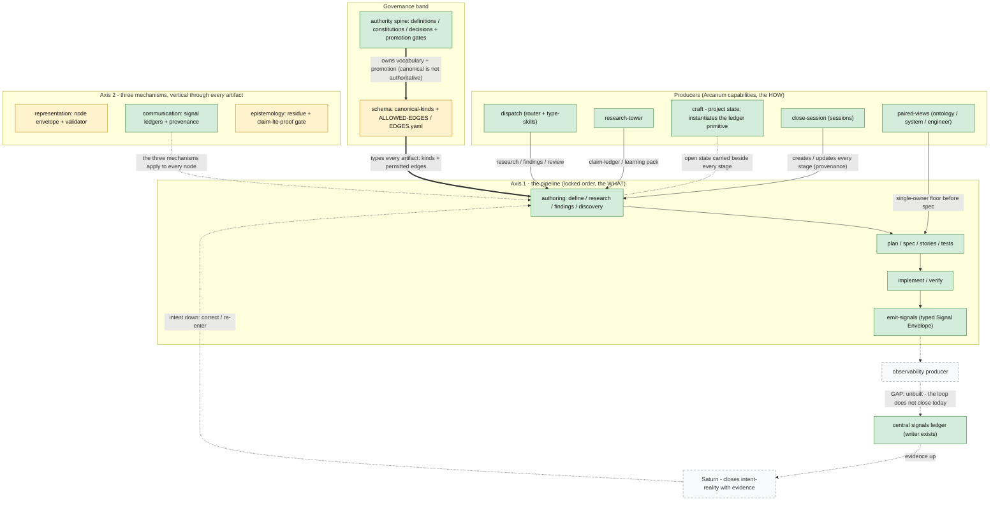

# Framework Unification — How the Pieces Fit

## Context

One diagram of the intent→code engine, synthesized from two candidate views authored at
opposed altitudes: the [two-axis spine](candidates/two-axis-spine.md) (pillars × pipeline ×
mechanisms) and the [component wiring](candidates/component-wiring.md) (named components ×
the kinds they produce and govern). It commits to the **one owned spine** — the
[CONCEPT-MAP](../CONCEPT-MAP.md) two-axis model, locked 2026-06-16 — and docks the named
pre-spec components (dispatch, tower, craft, sessions, paired-views, schema, authority
spine) where they actually act on it. It deliberately excludes the L0–L7 meta-layers, the
VSM machine-map, and the deck's 8-layer stack (competing framings, not retired — not
merged here). Honesty rules inherited from both candidates: Saturn is drawn dashed
(named, nowhere built); every node carries a status class; the feedback loop is drawn
with its real gap; no open fork is resolved by drawing.

## Diagram

**Legend.** Green = **built** (installed and runs today) · amber = **designed** (written
as candidate schema/contract, not ratified or not mechanically enforced) · dashed grey =
**aspirational** (named, nowhere built). Edge classes: **solid** = production (a
component emits artifacts into a stage) · **thick** = governance (types or promotes,
grants no authority by drawing) · **dashed arrow** = a cross-cutting or not-yet-existing
flow · **dotted open link** (craft) = state carried alongside, neither production nor
governance. Renderer-compatibility convention: edges whose label says "every stage" /
"every node" land on the lane's **first node** — read them as applying to the whole lane.

## Reading the diagram

**The pipeline lane (Axis 1).** The locked order `define → research → findings →
discovery → plan → spec → stories → tests → implement → verify → emit-signals`,
condensed into four grouped nodes — grouping only, never reordering. All four groups are
built: the orchestrator runs them. Built ≠ typed: **plan** and **implement** remain the
two typing gaps inside green groups. Two structural forks live on this lane and stay
open: one-plan-vs-two (CONCEPT-MAP OQ-A residual) and DomainSpec = one engine × three
mirrors + a v2 rewrite (which surface is canonical is undecided).

**Producers.** The five named components that emit artifacts into the pre-spec segment.
**dispatch** produces `research` / `findings` / `review` — it is a producer process, not
a peer of the schema. **research-tower** turns a corpus into cited claims and a learning
pack, instantiating ledgers of its own (claim-ledger, subagent-closeout-ledger).
**close-session** produces `session` records — the only component whose edges are
restricted to acts (`creates` / `updates`), never claims. **paired-views** authors the
ontology / system / engineer triad — the single-owner floor a spec stands on; its outputs
are not yet in the kind enumeration (open). **craft** is deliberately drawn with a dotted
open link, not a producer arrow: it carries the *current open state* of a project (blockers,
decisions, gaps, recomposition) beside every stage rather than feeding one. Its
`.craft/ledger.yml` is the paradigm instance of the **ledger primitive** — a typed,
scoped state/evidence register, source of truth only for its own rows — whose promotion
(CAV2-D20) is deferred, and whose kind row currently conflates two senses
([component-wiring OQ-1](candidates/component-wiring.md#oq-1-the-ledger-sense-fork)).

**The governance band.** The **schema** (canonical-kinds + the edge grammar) types every
artifact the pipeline produces; it is amber because the enumeration is candidate and
uncited by construction — a design, not law. The **authority spine** owns vocabulary and
promotion: an instance is authoritative only at `authority_state: promoted`, so
**canonical ≠ authoritative** everywhere in this picture. The schema's edge section
carries a standing collision with the vault's consolidated 22-edge catalog — annotated,
not resolved.

**The mechanisms box (Axis 2).** The three `layers/` folders as vertical mechanisms, not
stages: communication is built (append-only signal ledgers, provenance); representation
and epistemology are designed (only the frontmatter slice of the node envelope is
enforced; the claim ≤ proof gate is Lean-deferred, with the prose Open-Questions
convention running now as the operational residue accounting). One dashed edge into the
lane's first node is the axis crossing — it reads as "applies to every node".

**The loop, drawn honestly.** `emit-signals` is built and carries the strongest schema in
the pipeline — but the path onward runs through the **observability producer, which is
unbuilt**. The central ledger has a writer and no producer; that edge carries the GAP
label, and everything downstream of it is dashed: evidence-up to Saturn, intent-down from
Saturn to `define`. Saturn itself is a named pillar with a defensible spec statement and
zero build. The diagram's central claim is exactly this: **the feedback loop does not
close today**, and building one component — the producer — converts three dashed edges to
solid.

## What this diagram does NOT claim

- No second spine: L0–L7, VSM, and the 8-layer stack are excluded, not reconciled.
- Saturn is not a built peer; dashed is the claim ceiling.
- No fork is resolved by drawing: ledger sense, edge catalogs, one-plan-vs-two,
  engine/mirrors/v2 — all annotated, all open.
- Nothing amber or dashed is ratified; drawing a governance edge grants no authority.

## Open Questions

Carried, not duplicated — each is owned where it is detailed:

- **OQ-1. Ledger sense fork** — craft-derived primitive vs append-only event ledger,
  conflated in the kind row; CAV2-D20 deferred. Owner:
  [component-wiring OQ-1](candidates/component-wiring.md). Status: OPEN.
- **OQ-2. Two edge catalogs / vault collision** — schema edge grammar vs
  ontology-conventions v2.3.0; provenance vs domain-concept catalogs. Owners:
  [two-axis-spine OQ-2](candidates/two-axis-spine.md),
  [component-wiring OQ-2](candidates/component-wiring.md). Status: OPEN.
- **OQ-3. Observability producer** — the GAP edge; re-issue this diagram at 0.2.0 when it
  lands. Owner: [two-axis-spine OQ-4](candidates/two-axis-spine.md). Status: OPEN.
- **OQ-4. Pipeline forks** — one plan or two; engine × mirrors + v2 canonicity. Owner:
  [two-axis-spine OQ-1/OQ-3](candidates/two-axis-spine.md). Status: OPEN.

## Connections

| Document | Type | Description |
|---|---|---|
| [candidates/two-axis-spine.md](candidates/two-axis-spine.md) | `derives-from` | Candidate A: the pillar/pipeline/mechanism spine and the honest loop. |
| [candidates/component-wiring.md](candidates/component-wiring.md) | `derives-from` | Candidate B: producer/rollup/governance wiring of the named components. |
| [../CONCEPT-MAP.md](../CONCEPT-MAP.md) | `derives-from` | The owned two-axis spine this diagram commits to. |
| [../../../cyberAlchemy-v2/ontology/canonical-kinds/CANONICAL-KINDS.md](../../../cyberAlchemy-v2/ontology/canonical-kinds/CANONICAL-KINDS.md) | `cites` | Kind enumeration, producer column, edge grammar (candidate, uncited banner). |
| [../../../cyberAlchemy-v2/authority/definitions/reviews/ledger-primitive-review.md](../../../cyberAlchemy-v2/authority/definitions/reviews/ledger-primitive-review.md) | `cites` | What the ledger primitive is; promotion deferred with blockers. |
