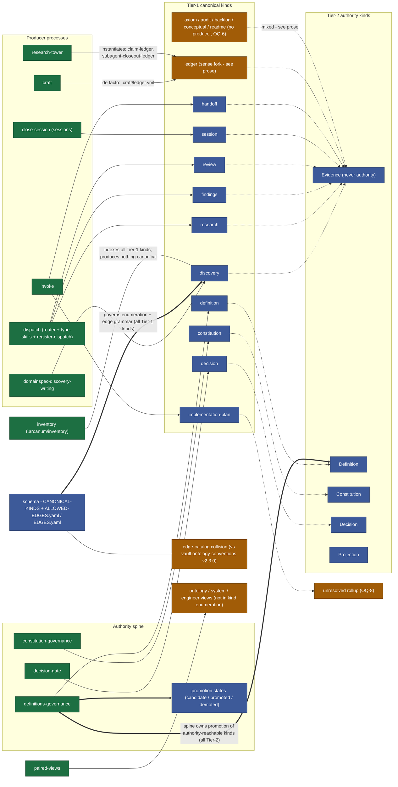

# Component Wiring — pre-spec components and the artifact kinds between them

## Context

This diagram sits at the **component altitude**: the named pre-spec components of the
umbrella and how they wire together through the artifact kinds they produce and govern.
The components are: **schema** (CANONICAL-KINDS + ALLOWED-EDGES/EDGES.yaml), **dispatch**
(subagents-strategy router + research/review/experiment type-skills + register-dispatch),
**tower** (research-tower), **craft**, **sessions** (close-session), the **authority
spine** (definitions-governance / constitution-governance / decision-gate + promotion
states), **paired-views**, and **inventory**. It deliberately excludes the pillar/pipeline
spine (DomainSpec → Arcanum → Saturn — a sibling diagram covers that) and all
instance-level edges (`derives-from`, `creates`, etc.). Sources: the Tier-1 kind
enumeration in `cyberAlchemy-v2/ontology/canonical-kinds/CANONICAL-KINDS.md` (note its
⚠️ uncited-by-construction banner — nothing there is ratified) and the Tier-2 rollup
targets in `cyberAlchemy-v2/ontology/AUTHORITY-KINDS.md`.

## Diagram

**Legend (status classes):** green **built** = installed and operating today (skill or
folder exists and runs); blue **designed** = written as a candidate schema/contract, not
ratified; orange **open** = unresolved standing (no producer, sense fork, or live
collision).

**Legend (group-level edges):** some renderers reject edges that start or end on a
subgraph, so group-level edges land on one **representative node** and read as applying
to the whole group — the edge label says so explicitly. Three edges use this convention:
schema ⇒ `discovery` stands for schema ⇒ every Tier-1 kind;
`definitions-governance` ⇒ `Definition` stands for the whole authority spine ⇒ every
Tier-2 authority kind; inventory — `discovery` stands for inventory indexing every
Tier-1 kind.

## Reading the diagram

**Regions.** Left: the producer processes — dispatch, discovery-writing, close-session,
invoke, tower, craft — plus the authority spine's three governance routes, which are
producers too (they emit definition/constitution/decision artifacts). Center: the Tier-1
canonical kinds the schema enumerates. Right: the Tier-2 authority kinds they roll up to.
The schema component sits above the kinds; paired-views and inventory sit below as
components that neither produce enumerated kinds nor govern them.

**Producer edges (solid).** Taken from the CANONICAL-KINDS process column: dispatch →
research/findings/review; domainspec-discovery-writing → discovery; close-session →
session; definitions-governance → definition; constitution-governance → constitution;
decision-gate → decision; invoke → handoff and implementation-plan. Dispatch is drawn as
a **producer process**, not a peer of the schema — it makes artifacts; it does not govern
kinds. The two edges into `ledger` are **de facto**, not schema-registered: craft is the
paradigm producer (`.craft/ledger.yml`) and research-tower instantiates the same
primitive (claim-ledger.md, subagent-closeout-ledger.md), yet the schema's `ledger` row
names no process (OQ-6). Paired-views → views is a real production edge, but its outputs
are not in the enumeration at all.

**Rollup edges (dashed).** Each Tier-1 kind names exactly one Tier-2 authority kind — a
typed coupling, not a promotion. The seven Evidence-rolling kinds (discovery, research,
findings, review, session, handoff, ledger) are **never authority-reachable**: terminal
evidence, inputs only. definition/constitution/decision roll to their namesake Tier-2
kinds and are the only drawn kinds that can ever be promoted. implementation-plan's
rollup is unresolved (OQ-8). The orphan group's rollups are mixed: audit/backlog/
conceptual → Evidence, readme → Projection, axiom → unresolved (OQ-2); the single dashed
edge is a simplification.

**Governance edges (thick).** The schema governs the kind enumeration and the edge
grammar (ALLOWED-EDGES.yaml permits; EDGES.yaml means) — drawn schema ⇒ `discovery`,
representative for **all** Tier-1 kinds. The authority spine owns promotion — drawn
`definitions-governance` ⇒ `Definition`, representative for spine ⇒ **all** Tier-2
authority kinds: an authority-reachable instance is authoritative only at
`authority_state: promoted` — **canonical ≠ authoritative**, everywhere in this diagram.
The plain (arrowless) lines are neither class: inventory indexes artifacts without
producing anything canonical (drawn to `discovery`, representative for all Tier-1
kinds), and the schema carries a standing collision with the vault's consolidated
22-edge catalog (annotated, not resolved — see OQ-2 below).

**The ledger node is orange on purpose.** Two senses are conflated: the Craft-derived
primitive (a typed, scoped state/evidence register, source-of-truth only for its own
rows, recursive via parent/child + recomposition — the sense craft and tower actually
instantiate) versus the "append-only event ledger" gloss the CANONICAL-KINDS row carries.
Promotion to CAV2-D20 was **deferred** with named blockers
(`cyberAlchemy-v2/authority/definitions/reviews/ledger-primitive-review.md`). This
diagram marks the fork; it does not pick a side.

## What this diagram does NOT claim

- **No claim is ratified.** CANONICAL-KINDS is candidate and uncited by construction;
  AUTHORITY-KINDS is candidate. Blue nodes are designs, not law.
- **No pillar story.** DomainSpec/Arcanum/Saturn and the intent→reality loop are out of
  scope (sibling diagram).
- **No instance-level edge semantics.** `derives-from`, `creates`, `updates`,
  `contradicts` and the session rule are not drawn; this is the component graph, one
  altitude up.
- **No resolution of the ledger sense fork** or of the edge-catalog collision — both are
  annotated as open, per the sources.
- **No completeness of producers.** Six kinds have no producer (OQ-6); the wiring for
  them is absent because it does not exist, not because it was omitted.
- **No authority via drawing.** A producer edge grants nothing; rollup grants nothing;
  only the spine's promotion gates confer authority.

## Open Questions

### OQ-1. The `ledger` sense fork
Context: the CANONICAL-KINDS `ledger` row glosses the kind as "append-only ledger" (the
D26 event-ledger sense), while the primitive craft and tower actually instantiate is the
Craft-derived typed/scoped/recursive state-evidence register; CAV2-D20 promotion was
deferred with blockers. Recommendation: run the ledger-primitive-review's next moves
(recursivity, relation profile, conformance fixture), then a definitions-governance pass
that either splits the two senses into two rows or names one canonical. Status: OPEN.

### OQ-2. Edge-catalog collision
Context: the schema's Edges section is in unresolved collision with the vault
ontology-conventions 22-edge consolidated catalog (revived tombstones, a re-minted
`updates`, a mis-cited `consumed-by`). This diagram cites the schema's grammar as one of
the schema component's two governed surfaces, so the collision propagates here.
Recommendation: decision-gate, as the schema itself routes it; this diagram inherits the
outcome. Status: OPEN.

### OQ-3. Producerless kinds break the wiring picture
Context: ledger, axiom, audit, backlog, conceptual, readme have no owning producer route
(schema OQ-6), so the component graph has kind-nodes with no inbound solid edge — and
the de facto ledger producers (craft, tower) are unregistered. Recommendation: either
register the de facto producers in the process column or accept that "produced by a
declared process" is not the canonicity test and say so in the schema. Status: OPEN.

### OQ-4. Paired-views triad and inventory outputs have no schema standing
Context: paired-views produces ontology/system/engineer view artifacts and inventory
produces index/compiled-knowledge state; neither output appears in the kind enumeration,
so two built components wire into nothing the schema recognizes. Recommendation:
ontology route to propose rows (or an explicit non-canonical ruling) before the
enumeration closes (schema OQ-1). Status: OPEN.
