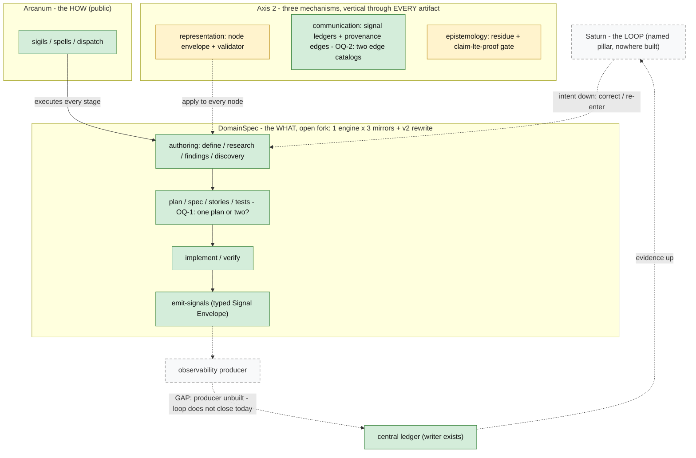

# Two-Axis Spine — Pillars × Pipeline × Mechanisms

## Context

This diagram renders the spine at pillar altitude: the three pillars (DomainSpec = what, Arcanum = how, Saturn = loop) laid over the **one** two-axis model owned by [CONCEPT-MAP.md](../../CONCEPT-MAP.md) — the horizontal pipeline (locked order, owner decision 2026-06-16) and the three vertical mechanisms that apply to every pipeline artifact. It commits to exactly that spine and deliberately excludes the L0–L7 meta-layers, the VSM machine-map, and the Saturn deck's 8-layer stack (see SATURN-LAYER-MAP.md OQ-2 — those are competing framings, not this one). It also excludes component/skill wiring, which is covered by a sibling candidate. Every node carries a status class; the feedback loop is drawn honestly — it does not close today.

## Diagram

**Legend:** green = **built** (runs today) · amber = **designed** (specified, not mechanically enforced) · dashed grey = **aspirational** (named, nowhere built). Dashed edges = flows that do not exist today. **Convention:** edges labeled "every stage" / "every node" land on the lane's first node (`authoring`) for renderer compatibility, but read as applying to the whole lane, not just that node.

## Reading the diagram

- **DomainSpec lane (Axis 1, horizontal).** The locked pipeline `define → research → findings → discovery → plan → spec → stories → tests → implement → verify → emit-signals`, condensed into four grouped nodes for readability — grouping only, never reordering. All four groups are **built**: the orchestrator runs them (`domainspec-pipeline`, Steps 1–2 confirm plan→spec). Two typing gaps sit inside the built groups: **plan** has no schema home and **implement** has no template (CONCEPT-MAP stage table) — the stages run, their artifacts are the least typed. The lane title annotates the open structural fork: DomainSpec today is one engine reflected in three mirrors plus a v2 rewrite in flight; this diagram draws the engine, not the mirrors, and does not resolve the fork.
- **Arcanum lane.** Built and public. Its single edge — "executes every stage" — is the pillar-level relation: Arcanum capabilities are *how* each pipeline stage gets done. Per the legend convention, the edge lands on the lane's first node but means the whole pipeline. No capability wiring here (sibling diagram).
- **Mechanisms box (Axis 2, vertical).** The three `layers/` folders as mechanisms, not stages. One dashed "apply to every node" edge into the pipeline lane — drawn from the first mechanism node to the lane's first node (legend convention), it means all three mechanisms crossing every pipeline artifact. That is the axis crossing, dashed because full envelope-level enforcement is designed, not built. Statuses per CONCEPT-MAP §Real-vs-aspirational: **communication** built (append-only ledgers, I8); **representation** designed (only the frontmatter/identity slice of the envelope is enforced today); **epistemology** designed (prose Open Questions convention runs now; the claim ≤ proof gate is Lean-deferred).
- **The loop, drawn honestly.** `emit-signals` produces typed signals (built, the strongest schema in the pipeline). But the path from there to the central ledger runs through the **observability producer, which is unbuilt** — the ledger has a writer and no producer (README open decision 3). That edge carries the GAP label; everything downstream of it (ledger→Saturn evidence-up, Saturn→define intent-down) is dashed. Saturn itself is dashed: a named pillar with a defensible spec statement (SATURN-LAYER-MAP §4), zero build.

## What this diagram does NOT claim

- **No second spine.** The L0–L7 meta-layers, the VSM machine-map, and the deck's 8-layer stack are excluded framings; whether the 8-layer stack reconciles with this two-axis model is an open question elsewhere (SATURN-LAYER-MAP OQ-2), not settled here.
- **Saturn is not a built peer.** It is a name plus a spec one-liner. Rendering it dashed is the claim ceiling.
- **The feedback loop does not close.** No path from emitted signals back to intent exists today; the diagram draws the missing producer, not a working loop.
- **No fork is resolved.** One-plan-vs-two, the two edge catalogs, and the DomainSpec engine/mirrors/v2 fork are annotated in place and left open (below).
- **Built ≠ typed.** The pipeline groups being green means the stages run, not that their artifacts are schema-validated; plan and implement remain the typing gaps.

## Open Questions

### OQ-1. One plan stage or two? (carries CONCEPT-MAP OQ-A residual)
**Context:** the orchestrator's Step-1 execution plan (before spec) and Route 3's implementation plan (after spec) may be distinct concepts sharing one stage name; the diagram draws one `plan` inside the grouped node.
**Recommendation:** owner decision in CONCEPT-MAP; update the grouped node only after ratification.
**Status:** OPEN (carried).

### OQ-2. Two edge catalogs, one type system? (carries CONCEPT-MAP OQ-B)
**Context:** provenance edges (envelope `connections`) and the 29 domain-concept edges (`RELATIONSHIPS.md`) are typed independently; the communication node names both without merging them.
**Recommendation:** decide shared registry vs two registries before any envelope validator; the diagram stays agnostic.
**Status:** OPEN (carried).

### OQ-3. DomainSpec: one engine, three mirrors, plus a v2 rewrite.
**Context:** the DomainSpec lane draws the single engine; the mirror copies and the v2 rewrite are annotated in the lane title only. Which surface is canonical is undecided.
**Recommendation:** single-owner decision (paired-views track); do not redraw the lane as multiple lanes before then.
**Status:** OPEN.

### OQ-4. Observability producer (carries README open decision 3 / discovery OQ-3).
**Context:** the GAP edge is the diagram's central honesty claim; building the producer converts three dashed edges to solid and changes Saturn's reachability.
**Recommendation:** re-issue this diagram at version 0.2.0 when the producer lands — the loop-closure change is the whole point of the picture.
**Status:** OPEN (carried).

## Connections

| Document | Type | Description |
|---|---|---|
| [../../CONCEPT-MAP.md](../../CONCEPT-MAP.md) | `derives-from` | Single source of spine truth: locked pipeline order, the three mechanisms, statuses, OQ-A/OQ-B. |
| [../../README.md](../../README.md) | `cites` | Layer statuses and the producer-gap open decision. |
| [../../../../ops/development/2026-06-21-paper-saturn-explainer/SATURN-LAYER-MAP.md](../../../../ops/development/2026-06-21-paper-saturn-explainer/SATURN-LAYER-MAP.md) | `cites` | §4 pillar statement + honest-status caveat (Saturn/DomainSpec spec-only). |
