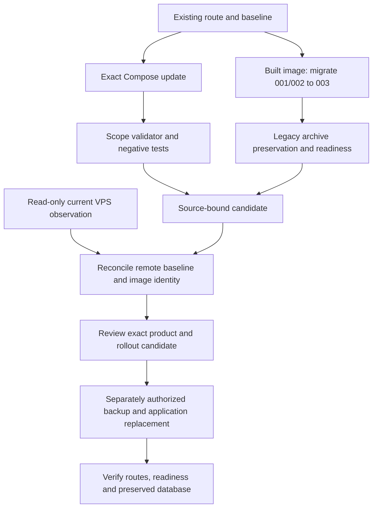

# Existing VPS console update candidate r2

Target: https://kep.cyberalchemylab.com/, root@187.77.248.154,
/srv/kep-hosted-devnet, existing Compose project kep-hosted-devnet,
existing PostgreSQL volume kep-hosted-devnet_kep-postgres.

This is a locally validated update candidate. Approval, live-state verification,
remote execution and image transfer are not performed by this package.



## Construction frontier

Locally implemented: successor Compose, exact-difference validator, negative
regression tests, and image account/file recovery with notice dismissal. The
predecessor migration test is linked as historical evidence, not rerun in r2. Candidate pins the tested
local image ID; it is not a registry digest or proof of remote image identity.
The existing database service, volume, private network, edge network and Traefik
labels must remain identical to the normalized baseline. Only application image,
readiness command and shutdown grace period change. The hostname is fixed to the
executed route, not the obsolete generic script default.

Existing browser and backup/restore observations are linked evidence, not rerun
by the validator. The new migration test covers one legacy archive sentinel and
an otherwise minimal 001/002 database, not compatibility with every live record.

## Operator dependencies and exact effect boundary

Owner: deployment operator. Current remote Compose, application image, volume,
health, TLS and database schema must be observed read-only before selecting a
rollout. Do not read or print the environment file or credential contents.
Compare observed Compose against the recorded baseline; reconcile differences
rather than overwrite them. A passed local validator does not prove this match.

Owner: product reviewer. Assess the exact current product and deployment candidate,
including account recovery, public abuse controls, historical binding drift and
backup limitations. Prior deployment attempts are consumed authorizations.

Owner: rollout operator, only after exact authorization. Preserve the existing
Compose project name, database container and volume. Stage the exact image,
verify transported image semantics, and preserve rollback Compose/environment
bytes privately. Stop the old application writer before starting its replacement;
no overlapping writers or automatic rollback. Take and verify the authorized
pre-update backup. Never run compose down -v or replace the database service.
Apply only the application update and observe additive migration 003, /ready,
/, /workbench, /console-experience/, and database/volume continuity.

A prior binary is not automatically a valid rollback: it lacks the single-writer
fence and may not preserve new account/file state. On failure stop and assess the
exact effect; do not restore a database or repeat a deployment implicitly.

## Deferred operational residue

Current VPS observation, TLS currency, monitoring/alerts, independent backup and
restore verification, RPO/RTO, and exact rollout review remain pending. An unhealthy
Docker container is not automatically restarted by restart:unless-stopped; operator
monitoring must act on readiness failure. Historical records remain unchanged.

## Local checks

From this directory:

```
PYTHONDONTWRITEBYTECODE=1 python3 validate.py
PYTHONDONTWRITEBYTECODE=1 python3 -m unittest test_validate.py
```

Validation uses fixed dummy interpolation values and does not invoke SSH, pull
images, start services, inspect credentials, or write evidence files. Compose is
normalized with the existing project name and compared field-for-field. Do not
run compose up from this directory as a shortcut to deployment.

## Notification-fix successor

This candidate replaces the local image selection with a build containing the
3.5-second success-notice dismissal. The prior candidate remains intact. The
source manifest binds all selected runtime, browser, migration and build inputs;
validation rejects drift instead of implying the previous image contains it.

Read-only VPS observation on 2026-09-06 confirmed the baseline Compose digest,
older image and database volume. /health was 200, /ready was 404, and migration
003 was absent. This is a dated observation, not a future rollout preflight.
Re-observe currentness before an exact authorized effect.
