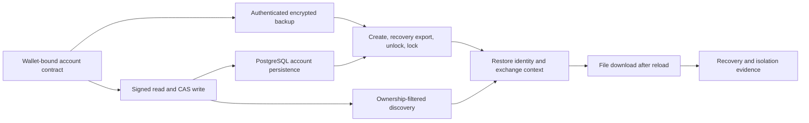

# Wallet account and recovery candidate

Date: 2026-09-06. Scope: local KEP console construction. No commit, publication, deployment, account migration or live-chain effect.

## Prototype definitions and navigation scaffold

These terms are local candidate definitions, not admitted ontology records:

- Account: one wallet-bound encrypted document plus backend-discovered file ownership.
- Wallet authorization: a signed read or revision-bound write expiring within 120 seconds. This implementation does not create a persistent bearer login session.
- Encryption identity: the registered public encryption identity and its private key, kept in browser memory while unlocked and encrypted in the account document when saved.
- Recovery file: a wallet identifier and a random 256-bit account decryption key. It is downloaded by the user, never sent to the server, and is not a wallet secret.
- Exchange context: the handoff and originator material required to reopen or grant a file. It excludes original payload bytes and downloaded plaintext.
- Discovery: file packages whose owner identities belong to the signing wallet. Discovery does not manufacture missing encryption keys or sender handoff context.

Navigation: Account -> authorized Wallet; Account -> encrypted Identity and Exchange Context; Identity -> existing File ownership; Recovery File -> local Account decryption. Backend models in `accounts.rs`, routes in `account_routes.rs`, client cryptography in `account-client.js`, and console integration are the testable implementation prototype. Existing file policy, ownership and finality rules remain their source owners.

## Product construction DAG

Current frontier: tested local account candidate ready for review. All planned implementation and targeted validation nodes are complete. No unrelated operational queue gates this prototype.

## Implemented behavior

- `POST /v1/account/read`: signed wallet, bounded authorization expiry; returns that wallet's encrypted account and owned file package statuses. Cache-Control is no-store. A different wallet cannot read the target account or discover its packages.
- `POST /v1/account/write`: signature binds wallet, expiry, expected revision and ciphertext SHA-256. Body is bounded to 1.5 MB; decoded encrypted account to 1 MB. Compare-and-swap rejects stale concurrent updates. The exact latest ciphertext retry is idempotent. Candidate persistence precedes in-memory replacement.
- Account records use the existing serialized application state transaction. A serde default preserves older states without accounts; no destructive database migration is required. The existing backend remains a single-writer deployment model.
- AES-256-GCM account encryption uses a fresh random 96-bit nonce and 128-bit authentication tag. Additional authenticated data binds format, wallet and revision. The recovery key is random rather than password-derived or derived from a public wallet signature. Operation basis: [W3C Web Cryptography API, AES-GCM](https://www.w3.org/TR/webcrypto/#aes-gcm).
- First setup requires downloading and confirming the recovery file before saving the account. The checkbox is user acknowledgement, not proof of durable external backup.
- Unlock requires the same wallet and recovery file. Restored identity is verified against the signing wallet’s registered identity records; recovery never replays the original registration operation. Lock clears in-memory identity, key, exchanges and draft state. No account secret is written to localStorage/sessionStorage by the application.
- The overview restores saved exchange metadata and merges backend-discovered package IDs/statuses. A newly received file requires the sender's handoff on first import; imported context is then saved. Old session-only identities cannot be recovered if their original keys were lost.
- Successful uploads, handoff imports, grants and receipt updates save encrypted account state. Save failures remain visible and gate new actions until retried. Conflicting tabs fail closed; the UI requires explicit acknowledgement before discarding unsaved changes and locking to reload the latest account.
- Grant checkpoints save started state before a transaction request. Missing outcomes remain unresolved rather than authorizing duplicate submission. Live recovery around wallet transaction interruption is not claimed tested.
- Original file ciphertext and decrypted original bytes are never copied into the account backup, preserving the file-expiry storage boundary. Unsaved draft bytes remain tab-local.

## Operational support

Owner: current local development task. A separate disposable `kep_accounts_test` database in the existing task-owned PostgreSQL container tests persistence. Build/restart affects only the loopback backend on port 8783. The linked console continues to be the approved console experience.

Deferred operational residue: production hosting, TLS/session deployment policy, backup custody procedures, support-assisted recovery, account key rotation, wallet replacement, multi-writer backend operation and live Devnet wallet testing. None is approved by these tests.

## Evidence and claim ceiling

- JavaScript: 28 tests pass and all three generated bundles match source. New tests cover key/wallet/revision mismatch, tampering, unique nonces, no payload duplication, exact save retry, recovery and lock.
- Rust: nine ordinary targeted tests pass (two account tests plus seven file/interface/recipient regression tests).
- PostgreSQL account persistence test passes separately: encrypted document and revision survive application reconstruction.
- Browser PASS: create wallet account, download and confirm recovery file, upload original, reload, unlock with the same wallet and recovery file, restore identical identity and one exchange, download and save the original, lock account. Zero JavaScript errors and no overflow at 320px.
- Recovered original SHA-256 matches input: `e0bc67dd79827270b37cfe77563646812e2a091fde90700bde386749afc33935` (10,246 bytes). Browser wallet was a test signer; no live wallet transaction was performed.

Prior file-lifecycle and console-integration documents/receipts are historical and unchanged. DomainSpec, alchLang, Arcanum and unrelated dirty work are outside the write scope. This is product construction evidence, not production security approval or deployment authority.

## Open Questions

- Should a future login session reduce wallet message prompts without weakening request binding?
- What key rotation and wallet replacement/recovery paths should the product support?
- Should first-use recipient handoff context be delivered through a separately encrypted inbox?
- How should concurrent conflicting account edits be merged beyond the current fail-closed revision gate?
