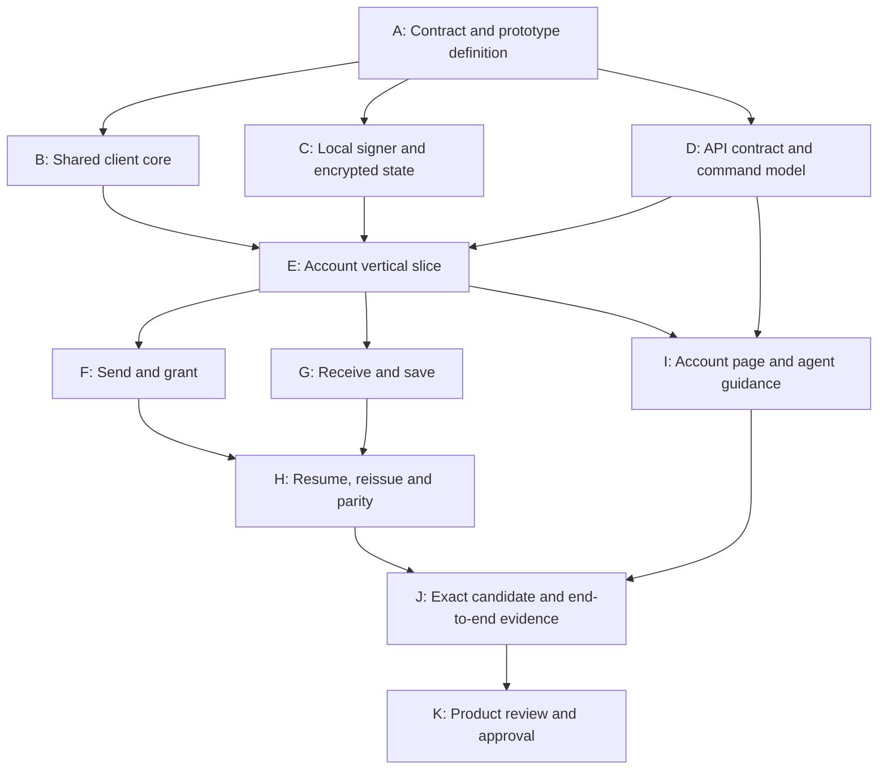

# KEP CLI and API client plan

Date: 2026-09-06
Status: first-release implementation candidate; not product-approved or deployment-authorized
Owner: KEP product owner; implementation and validation performed by the selected development task
Scope: hosted-devnet-exchange/v1/implementation
Authority effect: none. This document authorizes no credentials, live transactions, publication, installation, or deployment.

## Outcome and boundary

A user or authorized agent can create or recover an account, authenticate, encrypt and upload an original, grant access, receive and save it, inspect availability, and resume interruptions entirely through CLI or API. Browser wallets remain an optional console adapter. The account page provides installation and authentication guidance; it is never required for CLI authentication.

“Everything” means parity with the existing supported hosted Devnet operations, including reissue request/fulfillment where supported. It does not invent deletion, revocation, key rotation, delegated bearer tokens, mainnet support, or password-reset capabilities. The API inventory below must settle any missing operation before a full-parity claim.

The selected first-release boundary is narrower than full parity: account create/login, identity export, exchange list, send, receive and acknowledgement retry. Reissue is deferred to the next release and is not represented as available in the CLI or public guide.

## Current implementation frontier

| Node | Current evidence |
|---|---|
| B–G | Implemented for the selected first-release commands; exact prepared send state is encrypted locally and known signatures are checkpointed before finality waiting. |
| H | Partial by explicit scope decision: interruption recovery is implemented; reissue remains deferred. |
| I | Implemented for the account choice and CLI/API guide; distribution still requires an operator-selected channel. |
| J | In progress: focused client tests, actual Rust HTTP account/upload integration, 13-entry package boundary and clean-directory install pass. Disposable PostgreSQL, cross-client hosted trial, dependency disposition and exact image manifest remain open. |
| K | Not started; no product approval or deployment authority. |

## Current evidence and reusable sources

- `ui-src/protocol.js`: canonical signed messages and signing domain, encryption, HPKE envelopes, initialize/grant/reissue transaction builders, submission and finalization checks.
- `ui-src/account-client.js`, `src/account_routes.rs`: wallet-signed reads/writes, encrypted account recovery, revision conflicts and exact ciphertext retries. No browser session cookie is required.
- `ui-src/file-client.js`: original-file packaging, 10,000,000-byte ceiling, verification and acknowledgement.
- `ui-src/console-session.js`: identity restore, exchange lifecycle and checkpoints around uncertain submissions. Browser defaults and incomplete local persistence need replacement by injected adapters.
- `ui-src/console-experience.js`, `ui-src/agent-instructions.js`: presentation and agent guidance.
- `ui-src/cli-provider.js`, `static/kep-sign.mjs`: manual browser-to-terminal message-signing bridge; not a standalone CLI. Retire its active UI only once its replacement is tested.
- Prior review reproduced cancelled lookup pinning an unconnected wallet and acknowledgement-signing cancellation preventing verified bytes from returning. It also identified reused request-download filenames and account-page instructions describing send rather than login. Prior passing tests do not establish end-to-end CLI correctness.

## Proposed architecture and defaults

Use a Node-based CLI first to reuse the existing JavaScript cryptography and transaction builders. Select and test a supported Node version at implementation time; do not advertise an untested runtime range.

CLI commands and browser views call one environment-independent client core. Inject API transport, signer, file access, clock, durable state store and approval policy. Node-only key and filesystem imports must never enter browser bundles. A separately importable client library and an exact versioned API contract enable agents and non-JavaScript clients; copying a prompt is not an API integration.

Authentication uses the existing canonical wallet signatures. `login` selects an explicit service/network/wallet profile, verifies account access and restores the encrypted identity when a recovery file is provided. It neither creates a new identity silently nor promises a bearer session. Subsequent authenticated calls are signed locally. Account creation is explicit. Account recovery requires the existing wallet and recovery material; it is not a server-side reset.

The first local signer reads an explicitly selected Solana CLI keypair; no key upload, browser import, implicit wallet discovery or real-key test fixtures. Keep recovery keys and content keys encrypted at rest. Public profile configuration stores references, never secret values. Protect local files using OS-appropriate permissions, atomic writes and a per-profile lock. Passphrases/recovery secrets must not appear in process arguments, output or logs. Use a private input channel for unattended runs. Closing a process clears unlocked in-memory state; logout clears selected/unlocked state without deleting recovery material.

Before effects, bind configured endpoint, signing audience, program and network/genesis identity. Preserve the existing canonical signing domain; do not change it merely to match an arbitrary API URL. Reject mismatches and unexpected redirects rather than silently changing environments.

Persist operation IDs, exact prepared requests, encryption context, ciphertext references, pending account revisions and transaction signatures before effects. Encrypt secret-bearing journals. Reconcile ambiguous outcomes before resubmitting. Separate verified-file persistence, acknowledgement authorization, acknowledgement submission and account sync. Save verified bytes atomically before asking for receipt signing; cancellation must retain a retryable receipt and usable original.

Interactive commands show the concrete file, recipient, destination, retention policy and network effects. Noninteractive commands require explicit effect options and policy acceptance, return a structured action-required error when insufficient, and never hang on a prompt. Logs go to stderr; `--json` emits versioned public results to stdout with stable exit codes and secret redaction. An automated agent runs only within its operator-provided scope; this plan creates no delegated credential system.

## Product-construction DAG



| Node | Dependencies | Deliverable and completion criteria |
|---|---|---|
| A | None | Inventory supported API routes, signing formats, state transitions, recovery and error semantics. Define account/authentication/signer responsibilities and a small agent-facing scaffold linking existing owners. Draft product, business, DomainSpec and compiled-system views for the CLI capability without changing admitted records. Define a capability matrix and explicit exclusions. |
| B | A | Extract shared logic into proposed `client/` modules; inject browser/Node adapters. Preserve canonical vectors and current browser behavior. Fix cancelled lookup state rollback and preserve verified originals before receipt signing. |
| C | A | Proposed `cli/` signer, profile, encrypted journal, locking and file adapters. Test wrong key, malformed recovery, concurrent processes, interrupted writes, private permissions and redacted errors with disposable keys. No operational key access. |
| D | A | Proposed `docs/cli-api/` contract: every supported route, exact request/response and signing schema, cryptographic formats/vectors, retry and expiry rules, errors and network configuration. Define command help, JSON results and exit codes. Validate examples against actual handlers. |
| E | B,C,D | CLI create/login/status/logout/identity export/recovery round trip against a disposable API/database. No window, document, clipboard, extension, or browser process. Existing browser recovery restores in CLI and CLI-created state restores in the console. Failure or cancellation must not pin a new wallet. |
| F | E | Encrypt/upload/grant/send commands using local message AND transaction signing. Verify chain finalization before exporting the recipient handoff. Retain exact journal state across crashes before/after initialization, grant and API finalization. Explicit network-fee and recipient approval. |
| G | E | Receive/status/acknowledge commands. Check recipient context and all digests; reject tampering. Write only to an explicit safe output path, never traverse using a supplied filename or overwrite without authorization. Retain verified bytes and pending receipt after signing, network or disk failures. Handle expired acknowledgement windows explicitly. |
| H | F,G | Resume/account conflict handling, package listing and existing reissue workflows. Reconcile ambiguous transaction submission, changed revisions and missing local context. A discovered package without handoff/key material is reported as needing that material, not downloadable. Capability matrix closes every supported operation. |
| I | E,D | Account page offers Browser wallet and CLI/API instructions, real install/local-run commands, API docs and connection-specific agent prompt. No modal signature exchange. Remove bridge UI/download route/imports only after parity tests cover its supported cases; preserve historical evidence. Document current send/receive restrictions until F/G/H pass. |
| J | H,I | Freeze one exact candidate manifest and record current source/bundle digests, versions and test receipts. Run isolated A-to-B exchange and restart/recovery evidence, independent API-client vectors and console compatibility tests. Record every failed/untested capability explicitly. |
| K | J | Product-owner review of exact tested candidate. Changed candidate bytes require new evidence. Approval does not authorize publication, deployment or real transactions. |

Current frontier: A is runnable now under a future implementation instruction. B/C/D become runnable after the contract is settled. Backend changes are conditional on A finding an exact parity gap; authentication UI is not a backend-login prerequisite. The route registry's Goals-validation limitation prevents calling this plan admitted execution state, but unrelated ontology drift is not a dependency of this plan.

## Intended command surface (proposed, not available commands)

```text
kep account create --profile devnet --keypair <local-path>
kep login --profile devnet --keypair <local-path> --recovery <private-file>
kep account status --json
kep account backup --output <private-file>
kep logout
kep identity export --output recipient.json
kep upload original.png --accept-retention kep-file-retention-v1
kep grant <exchange-id> --to recipient.json
kep send original.png --to recipient.json --accept-retention kep-file-retention-v1
kep receive handoff.json --output ./downloads/original.png --accept-retention kep-file-retention-v1
kep exchanges list --json
kep exchange status <exchange-id> --json
kep acknowledge <exchange-id>
kep resume <operation-id>
kep reissue request <exchange-id>
kep reissue fulfill <request-id>
```

Exact transaction-approval options, profile initialization and secret-input syntax are settled in D and tested in E/F/H. `send` composes upload and grant using the same resumable state; it must not duplicate their protocol implementation. No command should imply full execution when only its upload stage completed.

## Acceptance evidence

1. Two disposable identities complete create -> login -> A sends -> B receives -> byte-for-byte hash match -> acknowledged receipt with no browser installed or launched.
2. Kill/restart each critical boundary: registration, account write, upload, initialization submission, grant submission/finalization, decrypted-file save and acknowledgement. Resume without duplicate known effects or loss of keys/context.
3. Cross-client compatibility: browser-to-CLI, CLI-to-browser, account recovery both ways; stable canonical signing/encryption vectors match Rust, plus a separate API consumer follows the documented contract.
4. Negative cases: wrong wallet/recovery/network, stale authorization, replay/conflict, access denied, expired content, invalid handoff, path traversal, existing output file, disk failure, request timeout, corrupt ciphertext and envelope, receipt expiry and unavailable RPC.
5. Explicitly close review findings: cancelled connection can select another wallet; cancelled receipt signing retains verified file; manual request-filename collision is eliminated by retiring the bridge; account instructions teach authentication.
6. Noninteractive mode never prompts, emits no secrets and exits nonzero on partial/action-required outcomes. Concurrent profile access cannot overwrite pending state.
7. Console regressions: account navigation, copy controls, responsive layout, notices, browser-wallet workflows, and generated bundle parity.
8. Test installed local package in a clean directory and prove it does not import workspace-private files. Check intended Windows and Linux invocation/permissions before claiming support.

Tests use temporary keys, files and databases. Use deterministic/local chain fixtures for the default suite. Actual Devnet writes, faucet funding and reuse of any retained funded key require an exact separately authorized test envelope. Local passes alone do not establish hosted or live-Devnet completion.

## Operational-support lane and deferred residue

| Work | Owner | Affected stage | Dependency and disposition |
|---|---|---|---|
| Disposable local test environment | Implementing task | E/J product-test support | Needed only for tests that use it; does not block A-D. |
| Local package/install rehearsal | Implementing task | J candidate testing | Package only the allowed client files; no registry publication. |
| Production package name and distribution channel | Product/release owner | Publication preparation; no construction stage | Deferred decision; local execution/testing remains runnable. Do not claim `npm install` availability before release. |
| Public/private source and license review | Product/release owner | Publication preparation | Exact package/doc allowlist required before public distribution; does not block private construction. |
| Hosted restart, deployment and live Devnet proof | Deployment/test owner | Operational execution | Separate exact authorization and credentials; deferred. The currently running server may still embed earlier assets. |
| Existing dirty files, frozen evidence, DomainSpec and alchLang work | Their existing owners | No CLI construction stage | Preserve; not part of this plan's write scope. |

## Open questions

- Published package name/channel and supported OS/runtime matrix require release selection; local package tests proceed first.
- Does A uncover any supported reissue or account-management operation missing from the existing console controller? Add it to the parity matrix before estimating completion.
- Later delegated/scoped credentials and hardware/remote signers are separate extensions. The first complete CLI uses an explicitly selected local signer and does not claim limited-scope wallet delegation.
- This is a private planning candidate, not a registered/admitted Work Pack. D65 prototype records and exact candidate sources must be selected in A before implementation-stage claims.
