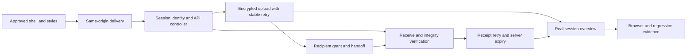

# Connected console integration

Date: 2026-09-06. Status: tested local product candidate; no publication or deployment.

The approved console experience now runs at `/console-experience/` on the same origin as the KEP API. The landing links there. The localhost:8781 console entry forwards to it while preserving query and hash. The original visual study is preserved as `console-experience/design-study.html` in the visualization workspace. `/files` remains a diagnostic interface.

## Product construction

All nodes are implemented. Current frontier: local candidate review. No construction blockers remain for this bounded session-based integration. Persistent inbox and reload recovery are separate future construction work.

- `console-session.js` reuses `file-client.js` and `protocol.js`; adapts the tested diagnostic page's grant coordination with pinned operations/signatures, and validates recipient cards before chain work.
- `console-experience.js` preserves the approved shell, navigation, compact forms, contextual policy disclosure, details/history and status layout. It contains no sample exchanges or simulated success actions.
- The controller retains identity, prepared ciphertext, retry operations and verified bytes in memory across hash navigation. Private keys are never written to browser storage.
- Text is encrypted as a UTF-8 file. Original file selection is limited to 10 MB. Extraction is not implemented or claimed.
- The overview lists actual packages created or opened in this tab. It is not an account-wide inbox. Reload clears identity and local handoffs; the interface warns and installs a before-unload prompt. Hosted files persist independently.
- Download acknowledgement records verified browser receipt, not proof of saving to disk. Failed acknowledgement transport retains verified bytes for saving and retries the same receipt.
- Countdown uses the backend expiry timestamp. Reaching zero requests refresh; the UI does not declare physical deletion.

## Operational support

Owner: current local development task. Build the browser bundle and Rust binary, restart the existing loopback backend against its task-owned test database, and verify entry links. These tasks support the implementation/product-test stage and are complete.

Deferred operational residue: live wallet transaction exercise, production identity recovery/storage, publication and deployment. No live Solana transaction, commit, push, publication or deployment was performed. The PostgreSQL expiry test is separately gated and was not rerun for this UI change; existing historical evidence is unchanged.

## Evidence

- `npm test`: 24 passing JavaScript tests; three browser bundles match their source.
- Targeted Rust: 7 passing (`interface_assets`, `file_lifecycle`, `third_party_vertical`); one PostgreSQL test ignored by its normal environment gate.
- Local Playwright journey: wallet message signing with a browser-generated test wallet; identity stable across navigation; original selected and policy auto-opened; encrypted upload; interrupted acknowledgement; verified file saved; receipt retry; real expiry; one real overview row; 390px layout without overflow.
- Recovered original: 10,246 bytes; SHA-256 `e0bc67dd79827270b37cfe77563646812e2a091fde90700bde386749afc33935`, equal to input.
- New controller test exercises grant finalization failure and retry with injected chain operations: two submissions total, one prepared grant, same envelope/signatures across finalization retry. This is not a live-chain test.
- Browser test exercised originator download. Existing independent-recipient crypto and Rust mocked-finality tests passed; live recipient wallet journey remains unverified.

## Preserved historical residue

Original PNG concepts, frozen orb assets, previous file-lifecycle receipts, diagnostic UI, and the simulated design study remain preserved. Historical receipts are not refreshed to pretend they bind this new UI epoch. Unrelated dirty work, DomainSpec, Arcanum, and alchLang were outside the write scope.

## Open Questions

- What user-controlled backup/recovery mechanism should preserve encryption identity across reloads and devices?
- What authenticated package index should provide a persistent inbox without exposing private filenames or handoff context?
- When should the operator separately exercise the recipient journey with real Devnet wallets?
