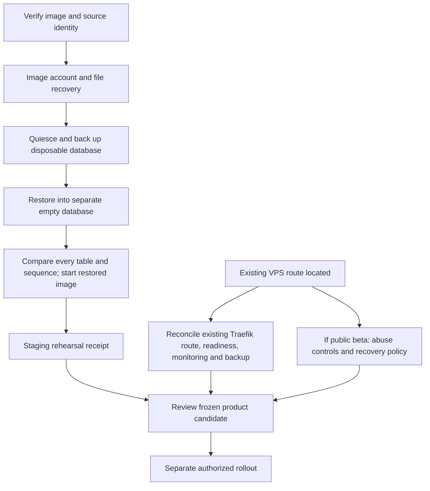

# Deployment preparation DAG

Target: existing public Solana Devnet VPS route recorded in
`DEPLOYMENT-ROUTE.json`: https://kep.cyberalchemylab.com/ at
`/srv/kep-hosted-devnet`. No external deployment performed by this continuation. Source and image evidence are in
`deployment-preparation-verification.json`; this continuation records a new
rehearsal epoch without changing prior receipts.

| Node | Lane | Owner | Dependency / affected stage | State |
| --- | --- | --- | --- | --- |
| A | Product construction | This task | Built image and selected implementation bytes | Source digest checks passed |
| B | Product construction | This task | A; product-test evidence | PASS; image browser recovery |
| C | Operational support | This task for rehearsal | B; disposable test database only | PASS; quiescent dump |
| D | Operational support | This task for rehearsal | C; separate empty database | PASS; restored |
| E | Product construction | This task | D; restored application behavior | PASS; data comparison and image readiness |
| F | Product construction | This task | A–E; candidate test receipt | PASS_BOUNDED; evidence/deployment-rehearsal-20260906/receipt.json |
| H | Operational support | Product owner | No construction stage; existing executed VPS/host route | LOCATED; DEPLOYMENT-ROUTE.json |
| I | Operational support | Deployment operator | H; remote environment, access, TLS, alerts, independent backup | Existing TLS/host recorded; live-state and new-image reconciliation pending |
| P | Product construction | Product owner + implementer | Existing public Devnet audience; quota, abuse and recovery decisions | Required for public beta; not waived by historical deployment |
| G | Product construction | Product owner / reviewer | Frozen candidate plus required tests; approval only | Not requested |
| J | Operational support | Deployment owner | G and exact rollout envelope | Not authorized |

## Runnable frontier and limits

A–F can run without H or I. The operational rehearsal is an exact dependency of
the restore test, not a general gate on other construction. No live data is
backed up or changed. Generated test secrets and dump stay in a private /tmp
folder; the repository receives only script, digests, counts and result evidence.

A local dump/restore on the same Docker host does not establish an independent
backup destination, RPO/RTO, disaster recovery, backup expiry, or security review.
Browser recovery uses an isolated test signer; no real wallet or chain effect.
Historical binding drift and paper-source drift remain preserved residue. Final
production readiness requires an exact current candidate, not refreshed approvals.

## Reproduce the restore rehearsal

Stop the disposable source writer first. Create a distinct empty destination, then
run `python3 tests/backup_restore_rehearsal.py --container CONTAINER --source SOURCE
--destination DESTINATION --output PRIVATE_DIRECTORY` on one line. The script
refuses a live KEP writer and a nonempty destination, creates a private dump, and
compares all KEP tables and sequence metadata. It preserves both databases.

The image browser script in the evidence folder uses loopback 8797 and private
/tmp fixture/recovery paths. It must be adapted to a fresh disposable run directory
and test fixture for reruns; never use real wallet material or a populated live
account database. No current test grants rollout authority.

## Existing deployment route correction

The prior assumption that hosting and a domain were unselected was incorrect.
The sibling `../deployment/` package contains executed deployment receipts.
Use `DEPLOYMENT-ROUTE.json` as the navigation record and follow its source refs.
The executed hostname is `kep.cyberalchemylab.com`; the older README and generic
script default `kep.cyberalchemize.com` are historical discovery residue.

Next runnable construction: reconcile the existing deployment Compose with the
new readiness endpoint, SIGTERM behavior, image identity and migration 003;
prepare one exact update candidate. Operator work starts with a bounded current
state observation of this existing host, not provisioning a second deployment.
No live DNS/TLS/SSH check was performed here. Past successful executions bind
their own images and consumed authorizations; none deploys the new local console.
The prior staging receipts remain unchanged as historical local evidence.

## Existing-route update candidate

Configuration reconciliation and local migration verification are implemented in
`../deployment/updates/console-20260906/PLAN.md`. Its `candidate.json` binds the
source set. Next dependency: current read-only VPS observation and reconciliation
of that state with this candidate, followed by exact review. No rollout occurred.

## Notification-fix successor r2

The current local update candidate is `../deployment/updates/console-20260906-r2/candidate.json`.
Its release image includes the success-notice fix and passed isolated account/file
recovery with automatic notification dismissal. The previous candidate is preserved.
Current VPS observation is recorded in deployment/evidence/vps-console-update-observation-20260906.json;
its baseline matched when observed, but it must be rechecked before rollout.

## Executed r2 update

The user-authorized r2 application update completed with bounded checks in
`../deployment/evidence/console-r2-execution-20260906/receipt.json`. Public HTTPS
routes and exact console bytes matched; readiness passed, migration 003 was
present, and one writer lock was observed. Database container/volume and the
protected environment were preserved. Independent backup, monitoring and broader
production assurance remain open; no historical approvals were rewritten.
