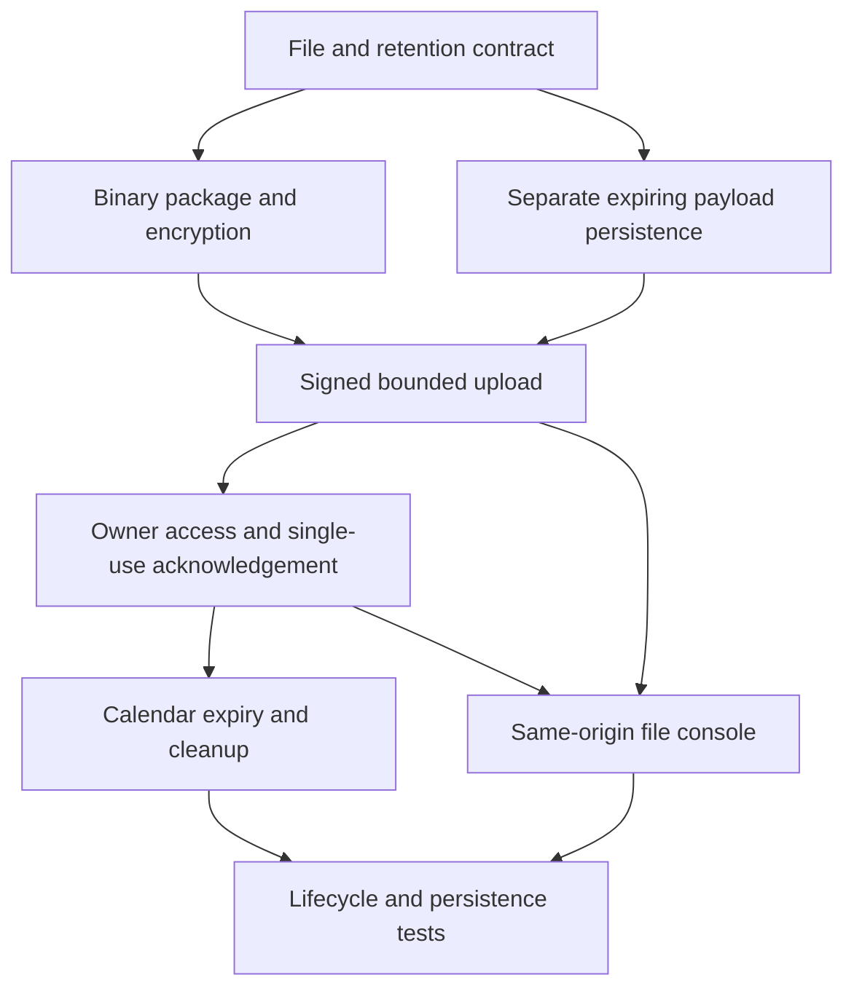

# File lifecycle construction — candidate epoch

User scope: implement the agreed original-file exchange, 10,000,000-byte limit,
policy acceptance, verified download acknowledgement, and one-calendar-year inactivity expiry.
No commit, publication, chain transaction, legacy-data migration, or deployment.



## Contract and dependency decisions

- Original file bytes stay unchanged inside an encrypted binary package. Filename,
  media type, byte length and original SHA-256 are encrypted in a bounded manifest.
- Server accepts ciphertext only, validates signed declared size and ciphertext size;
  it cannot independently measure plaintext without breaking the custody boundary.
- Retention version `kep-file-retention-v1`: no deadline before successful verified
  receipt; acknowledgement sets one calendar year from server time (Feb 29 clamps).
- Recipient acknowledgement asserts complete verified client receipt, not proof of
  filesystem save. It is bound to one signed access attempt, file digest, identity,
  policy and revision; expires after 15 minutes and is idempotent on replay.
- No acknowledgement after expiry resurrects content. Failed transfer/decryption does
  not acknowledge. Paused or expired file availability does not revoke knowledge ownership.
- New payloads use a separate mutable table, excluded from serialized application
  state and immutable encrypted_archive. Legacy archives and journals are untouched.
- Retained records include origin, ciphertext commitment, policy acceptance,
  acknowledgements and expiry tombstone; derived extraction is deferred and must
  be a distinct artifact referencing its source, never a replacement of original bytes.
- Existing grants and reissues continue to determine owners and envelopes. A new
  file is not evidence of a finalized grant or recipient authorization.

## Two lanes

Product construction frontier: implement A through H above. Runnable now: all nodes
in dependency order using mock finality and a disposable local database.
Causal blockers: none for local construction; live recipient grants require existing
owner-directed Solana execution, outside this task.
Operational support: deployment/operator owns rollout and backup retention (future
hosting stage); data owner owns legacy archive migration (deferred, no stage here).
Those tasks do not block the local prototype. No production erasure claim includes
backups, replicas or previously exported files.

## Open questions

- Production storage quotas, backup expiry and multi-instance concurrency require
  separate operational hardening. Current backend remains a single-writer process.
- Formal extraction format and provenance schema are future construction scope.
- Final product approval and publication require fresh evidence on selected bytes;
  old acceptance receipts are historical and will not be refreshed by this work.

## Construction result

| Node | Result | Evidence |
| --- | --- | --- |
| A — contract | Implemented as candidate | `src/files.rs`, encrypted manifest contract in `ui-src/file-client.js` |
| B — exact binary recovery | PASS | zero-byte, invalid UTF-8 and exact 10 MB round trips; tamper rejection |
| C — payload storage | PASS | disposable PostgreSQL restart, expiry rollback and legacy archive preservation |
| D — signed upload | PASS | policy/signature rejection, size boundaries, exact upload retry |
| E — access and acknowledgement | PASS | owner checks, mock-finalized recipient grant, single-use receipt, timeout/replay checks |
| F — expiry | PASS | leap-day clamp, no resurrection, atomic payload deletion with retained records |
| G — client integration | Local candidate | `/files` same-origin screen and reusable `createFileClient`; real HTTP browser round trip with test wallet |
| H — regression | PASS within stated scope | 19 JavaScript tests; 7 ordinary Rust tests plus 2 PostgreSQL tests run separately; both generated bundles checked |

The new file screen is separate from the visual console's simulated exchanges.
The visual landing page and console mockups remain unchanged. The reusable client
is the adapter for subsequent integration of their final visual components.
The local test service is at `http://127.0.0.1:8783/files`, backed by the task-owned
`kep-file-epoch-20260906` temporary PostgreSQL container, with no host data volume.
It is a local test service, not a deployed environment. Browser keys are ephemeral.

The browser test recovered exactly 10,246 bytes with SHA-256
`e0bc67dd79827270b37cfe77563646812e2a091fde90700bde386749afc33935`.
Its receipt retry preserved the deadline. No JavaScript page errors occurred;
a favicon request returned 404 in the test server (unrelated to the exchange).
Recipient cryptography and mock-finalized access are separately tested; the
browser round trip used the originator's authorized access. Live recipient chain
execution is not evaluated and no chain transaction was submitted.

## Preserved residue

- Existing `brand.css`, `static/index.html`, `tests/interface_assets.rs` and design
  system edits were byte-preserved against the initial working tree.
- Existing `src/ui.rs` changes were preserved exactly; only a new route merge was added.
- Historical implementation-binding records, acceptance decisions, generated
  governance evidence and immutable archived payloads were not rewritten.
- Current `static/assets/app.js` was rebuilt after the shared crypto source change;
  new `static/assets/files.js` was built separately. Historical acceptance is not
  carried forward onto these changed source bytes.
- No commit, push, publication, deployment, live wallet operation, legacy archive
  migration or production-data deletion was performed.

## Reproduce

From this implementation directory:

```sh
cargo test --offline --locked --features ui
npm test
# Separate disposable empty databases only:
CA2_KEP_FILE_TEST_DATABASE_URL=<disposable-db> cargo test --test file_lifecycle postgres_file_expiry -- --ignored
CA2_KEP_TEST_DATABASE_URL=<different-disposable-db> cargo test --test postgres_persistence -- --ignored
```

`npm run build:ui` rebuilds the existing client and `npm run build:files` rebuilds
the file client. `npm test` checks both bundles against their source. PostgreSQL
creation occurs only in a selected service/test runtime, never in browser preview.
