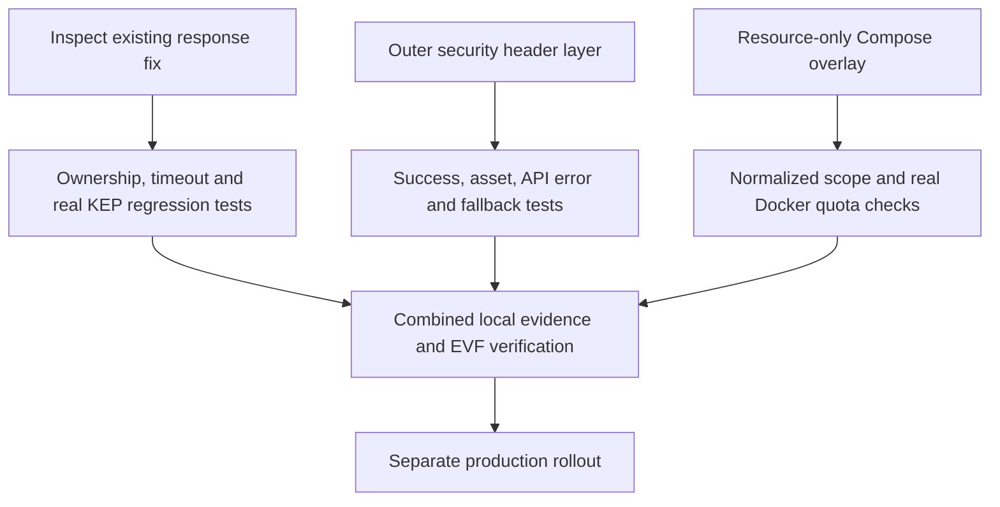

# KEP EVF findings repair

Route CA2-ROUTE-IMPLEMENT. User request: plan and fix the three findings. No production rollout, Git publication or changes to prior evidence.

Product construction: existing response-admission implementation is now integrated with byte ownership and transport timeouts. Preserve it and rerun focused ownership/liveness and real KEP PostgreSQL integration tests. Add a header layer around the complete hosted router, including errors and fallback routes, without wrapping/buffering bodies or changing CSP. HSTS max-age=31536000 is host-only, no subdomain/preload commitment; nosniff and no-referrer apply consistently. Browsers ignore HSTS on cleartext HTTP previews.

Operational support, owner this task for local preparation; deployment operator for later live application: local Compose plus a successor resource-only overlay. Application 768 MiB, 1 CPU, 128 PIDs; PostgreSQL 1 GiB, 1 CPU, 256 PIDs. Swap limit equals memory. These starting budgets exceed the observed sub-250-MiB short HTTP server peaks, but are not established workload sizing. Require adequate host headroom and a measured longer soak before broad capacity claims. Verify Docker actually applies quotas in isolated containers; no intentional OOM or fork bomb.

Writes: src/ui.rs, tests/security_headers.rs, compose.yaml; ../deployment/updates/evf-fixes-20260906 and this evidence directory. Response/transport implementation and historical fixtures stay untouched. Prototype/test frontier is runnable now. Deferred operational residue: production quota changes require careful database container recreation/restart and exact volume continuity; independent backup, monitoring and long-term capacity remain outside this repair. Preserve the previous live audit FAIL as historical evidence; local fix PASS cannot make that observation pass retroactively.
