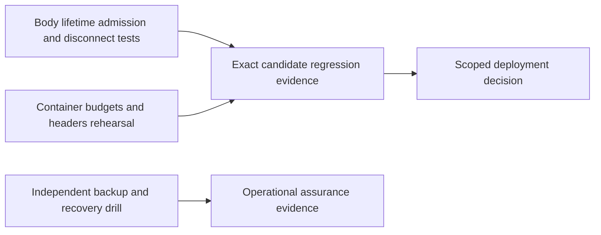

# KEP post-deployment EVF audit — 2026-09-06

**Result: FAIL for the five declared deployment obligations; EVF evidence verification PASS.** Three obligations passed and two failed. This is a bounded deployment-observation audit plus a separate source review, not a complete penetration test or security certification.

Target: https://kep.cyberalchemylab.com, application image `sha256:5f1270e03f4b3fdedefe52e5712b0e24fbacddc2016d302358c350c1da85c537`. The localhost:8783 preview is not the audited deployment. New concurrent response-admission development is excluded from the deployed source and preserved.

## Findings and priorities

1. **High availability concern — response concurrency lifetime is incomplete.** Deployed `bound_request` acquires its permit before reading the request but releases it when returning the Response (`source-review/api.rs:1067–1094`). The permit is not attached to the streaming response body. The existing request admission bound therefore does not establish a bound on outstanding slow response bodies. This is a source-derived finding against the image-bound snapshot, not a reproduced public resource-exhaustion attack. Next: finish the separate body-lifetime admission work and demonstrate permit release on body completion, disconnect and cancellation on an isolated server.
2. **High availability hardening gap — neither live container has explicit resource quotas.** Application and database observations show Memory=0, NanoCpus=0, CpuQuota=0, and PidsLimit=null. These establish absence of per-container limits, not absence of every host-level bound or a measured exhaustion threshold. Next: select tested application/database memory, CPU and PID budgets, preserving database headroom, then rehearse overload before a separately scoped configuration rollout.
3. **Medium browser hardening gap — public HTML lacks HSTS, X-Content-Type-Options and Referrer-Policy.** All three selected pages retain restrictive CSP including frame-ancestors none. CSP is valuable but does not satisfy the missing header predicates. Next: add consistent headers at the chosen application/edge owner, choose HSTS scope for this host, and add live header regressions.

## EVF results

| Obligation | Result | Exact evidence ceiling |
|---|---|---|
| Deployment identity and readiness | PASS | Observed image equals receipt; both containers healthy; five selected HTTPS routes return 200. |
| HTML security headers | FAIL | Required headers absent on selected pages. |
| Explicit container resource budgets | FAIL | Application and PostgreSQL quota fields are unset. |
| Backup receipt/checksum consistency | PASS | Existing quiescent backup hash matches the receipt; receipt records restore-list verification. No new restore was performed. |
| Application process hardening | PASS | Read-only root, dropped ALL capabilities, no-new-privileges present. |

EVF 0.4 archive checksum and Bubblewrap doctor passed. The contained executable runner evaluated every positive check twice. Its separate verifier accepted the S0–S12 receipt structure and input bindings with aggregate_state=failed. The live audit's S7 mutation stage is BLOCKED by POSITIVE_EXECUTION_REQUIRED; dependent normalization/join stages are also blocked. They are not hidden or counted as successful.

A separate contained checker calibration accepted five explicitly synthetic valid fixtures and rejected five negative controls; its independent evidence verification passed. That establishes bounded checker behavior, not that the site has the synthetic settings. No failed site expectation was changed to manufacture a passing audit.

The predicates are explicitly authored in workspace/obligation.md; they were not automatically derived from DomainSpec and are not formal theorems. Inputs are captured read-only observations collected outside the contained runner. EVF validates hashes and receipt consistency, not collector authenticity or continuous live truth. Its verifier does not re-execute the public probes.

## Construction frontier and operational residue

Product construction, owner: KEP implementation task. Runnable: body-lifetime concurrency correction and isolated slow-reader/disconnect/longer-soak tests. No changes made to that concurrent work by this audit. Existing protocol/signature/clock tests are prior evidence and were not freshly rerun here.

Operational support, owner: KEP operator, affected stage: deployed application/database. Runnable preparation: measured resource sizing and consistent security headers. Independent backup destination, recovery drill, readiness monitoring and image/host CVE assessment remain open; this audit did not establish their existence or absence. The retained backup is same-VPS and therefore does not establish independent disaster recovery. A binary-only rollback remains unsafe after normalized persistence migration.

## Preserved evidence and reproduction

All output is new under this directory. Production was inspected read-only; no service restart, state mutation, keys, wallet transaction, public load test, deployment or Git publication occurred. Historical failures, deployment receipts, unrelated dirty files and alchLang remain untouched.

kit.json pins the extracted EVF location and archive hash. Reproduce the audit with the contained evf freeze/run/verify workflow described by EVF's CORE-README, using workspace and its retained audit.json. run.json contains the exact evidence locator; verify.json distinguishes valid evidence from the failed audit result. checker-calibration has its own profile/run/verifier outputs. The temporary kit must remain at the recorded path for current verification; relocating it requires a new profile, not rewriting these receipts.

summary.json gives machine-readable status. workspace/observations.json contains the dated public/configuration observations. source-review.json and the frozen source copies bind the separate concurrency finding. Claim ceiling: no full-site safety clearance, no model-to-Rust proof, and no evidence of compromise asserted or disproved.
