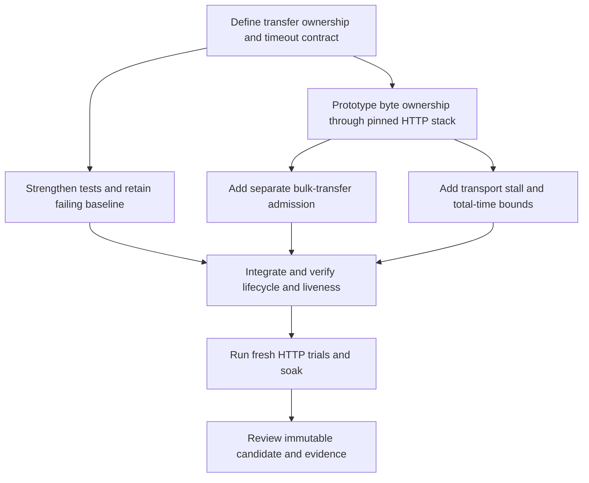

# KEP response admission: review and repair plan

Date: 2026-09-06. Review route: CA2-ROUTE-VALIDATE. Planning route: CA2-ROUTE-PLAN. Status: planning candidate, no implementation or operational authority. This is a focused follow-up review, not a complete site security assessment. No new load run was performed: the prior evidence manifest was verified against current inputs.

## Review findings

1. **High priority, confirmed: handler admission does not bound outstanding response data.** `src/api.rs:1067` acquires a permit in `bound_request` and drops it when `next.run` returns. `src/file_routes.rs:273` clones the ciphertext into a JSON response. The frozen HTTP resilience run observed six successful large responses held open in each of three cycles, with peak server RSS 235.1 MiB. The configured four-request limit is a handler bound, not a transport-response contract. The resource gap is real; the data does not establish a leak or total production memory ceiling.

2. **High priority, proposed-fix defect: attaching a permit only to the body object is insufficient.** Local pinned Axum 0.8.4 serializes JSON to Bytes; http-body-util 0.1.3 Full yields its data in one frame. Hyper 1.11.1 h1 dispatch marks the body for removal when is_end_stream is true and passes that frame to write_body_and_end, before poll_flush completes. A body drop can precede socket drain. A timeout checked only in poll_frame can likewise stop being polled during transport backpressure. Do not implement the previous suggestion as a body-only wrapper and claim closure.

3. **Medium priority, regression-test false positive.** `tests/http_resilience.rs` asserts only maximum <= 4 and accepts 429 for every offered reader. Zero accepted readers would satisfy that resource assertion. Client-open sockets also are not a direct server-buffer lifetime measurement. The revised test must establish actual accepted/active transfers, expected rejection, release and recovery. Reading only response headers and tiny prefixes is useful evidence but must be joined with bounded server-side ownership instrumentation.

4. **Medium priority, missing liveness coverage.** The test closes its readers after five seconds. It does not test an indefinitely stalled reader, trickle progress near a deadline, or release on transport error without client cooperation. Holding the shared request semaphore across all slow transfers would also risk blocking acknowledgements and account operations behind downloads. Health-only success would miss that starvation.

5. **Evidence limits.** The 60-download soak and recovery assertions passed in the retained epoch; they were not rerun in this review. The initial partial-transfer expiry check covers a never-downloaded file. Add exact pre/post expiry comparison after an earlier successful receipt as well. Rising post-cycle RSS is retained-memory evidence, not proof of a leak.

## Recommended design

Keep the existing short-lived request admission and 15-second request-body timeout. Add a **separate four-slot bulk-transfer pool**, acquired before copying/serializing payload-bearing responses, so transfer saturation does not occupy all handler capacity. Return the existing 429/Retry-After response when this pool is full. Small acknowledgements and account control operations continue through their current handler limits.

Tie the transfer reservation to ownership of the serialized payload bytes, not merely to a response wrapper. Candidate implementation: an immutable owner containing the payload and OwnedSemaphorePermit, carried through Bytes::from_owner. Prove that the pinned HTTP stack retains that owner while large data is buffered; explicitly inspect/test copy and flush paths. Do not claim the reservation measures remote receipt: release means bounded server ownership ended, not that a client saved or acknowledged a file.

Pair this with transport-aware stalled-write handling. A body polling timer alone is rejected. Prototype a bounded transport I/O wrapper or equivalent connection supervisor that sees write progress and can terminate a stalled response while dropping its buffers. It must not cancel an in-progress database commit. Proposed configurable candidate defaults: 30 seconds without write progress and 300 seconds total transfer time. These are testable starting values, not approved network-service guarantees. Use short injected durations in automated tests. After headers have been sent, timeout is a truncated/closed transfer, not a new HTTP error status; the client must not acknowledge incomplete content.

A separate transfer-byte budget may become necessary. Initially verify the four-slot bound against the existing maximum file and serialized response sizes, record transient allocation overhead, and refuse to present 4 x file size as a process RSS limit. Inventory legacy artifact access and account responses so a file-route fix is not claimed as universal outbound protection. Preserve file signatures, envelopes, acknowledgement deadlines, retention policy and durable state schema.

## Product-construction DAG

| Node | Concrete completion criteria | Proposed files |
|---|---|---|
| A | Define bulk routes, four slots, release semantics, timeout semantics and explicit HTTP protocol coverage | New transfer-admission design note |
| B | Baseline reproduces failure; assert four accepted holders, fifth/sixth rejected; add no-read, trickle, disconnect and error cases; snapshot retention before/after interruption | New `tests/response_admission.rs`; freeze old harness source in a new epoch before any change to `tests/http_resilience.rs` |
| C | A retained large frame keeps its reservation after body drop; clones/slices preserve ownership; flush/drop/error release exactly once; document bounded copying behavior | New `src/response_admission.rs` tests; pinned dependency fixture; `Cargo.toml`/`Cargo.lock` only if explicit dependencies are needed |
| D | Separate transfer pool acquired before payload allocation; serialization failures release; non-bulk controls do not consume transfer slots | `src/limits.rs`, `src/api.rs`, `src/file_routes.rs`, `src/lib.rs`, new module |
| E | Stalled writes close within the configured bound without relying on further body polls; trickle cannot evade absolute deadline; graceful shutdown bounded; no cancellation of persistence work | New `src/transport.rs`, `src/bin/hosted.rs`, targeted transport tests |
| F | Health, readiness, account control and an existing valid acknowledgement remain usable while transfer slots are occupied; normal transfer succeeds after EOF, disconnect and timeout; partial transfers leave receipt/expiry unchanged | Targeted API, lifecycle and transport tests |
| G | Three fresh real HTTP trials plus paced soak; exact journal counts; active transfer high-water <= 4 under slow readers; rejected requests create no access attempts; all owned processes cleaned up | New evidence epoch and runner; retained raw logs and memory/ownership samples |
| H | Source/binary digests and independent review checklist; explicit PASS/FAIL/not_evaluable per obligation, no widened security claim | New candidate review report |

The current frontier is A/B/C: the behavior contract, stronger regression criteria and transport ownership prototype. B and C are logically independent work after A; the graph does not authorize parallel agents. D/E depend on C proving the chosen boundary. If byte ownership cannot survive the relevant HTTP buffering path, stop that design and use connection/stream lifetime accounting before implementation continues. A body-wrapper-only fallback is not acceptable.

## Validation details

- Test maximum-size files and small files; no blanket rejection may count as PASS.
- Prove server-owned transfer state, not only the number of sockets retained by the client.
- Preserve Content-Length or deliberately test changed framing; current raw helper assumes Content-Length.
- Bound reader receive buffering in fixtures where feasible; ensure the transfer is actually backpressured before asserting capacity.
- Observe permit and queued-byte release after peer close, forced write error and timer expiry. Do not release a slot merely because a timer fired while payload memory remains retained.
- Distinguish a client disconnect from an acknowledgement; compare last_download_at/expires_at against the exact pre-interruption values, including after a prior successful download.
- Test HTTP/1.1 through the actual hosted binary. Determine enabled HTTP/2 behavior before claiming coverage; shared HTTP/2 connection cancellation must not be silently treated as per-stream cancellation.
- Rerun regular Rust tests and the relevant PostgreSQL lifecycle/single-writer tests after implementation. No database migration is planned.
- Repeat the slow-reader cycles and record phase memory; allocator retention remains a separate unresolved question unless longer measurements establish otherwise.

## Operational support and deferred residue

The implementing task owns fresh local databases, test-server orchestration and evidence capture; these support the product-test stage. Their only immediate prerequisites are the existing local test container and available loopback ports. No production service is touched.

The deployment operator owns production connection/proxy limits, timeout tuning against real user links, coherent database/binary recovery rehearsal, host time synchronization and separately authorized rollout. These are operational residue, not blockers for the runnable construction prototype. Product approval and operational authorization remain separate from test results. Goals registration remains unavailable as admitted execution state; this document is only a plan.

## Preservation and open questions

The existing HTTP failure epoch and clock-fix evidence remain unchanged. This review adds only this new directory; no source, test, migration, preview, key, alchLang, commit or deployment changes. Future changes to previously hashed test inputs require a new epoch while retaining historical source snapshots and hashes.

Open questions owned by C/E: exact ownership behavior in every enabled HTTP path; best transport integration that preserves write atomicity; total/dead-time settings for slow legitimate links; and whether a separate byte budget is required beyond the four-slot cap. None is resolved by modifying a passing status or refreshing an old digest.
