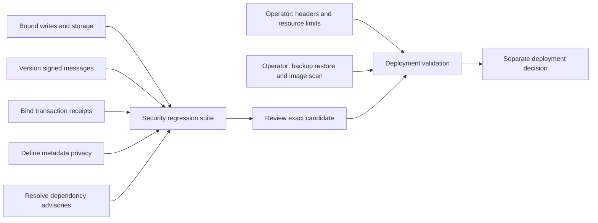

# KEP site security audit — 2026-09-06

## Verdict and scope

**OPEN FINDINGS: do not describe this service as security-cleared for unrestricted public use.** This is a source/configuration audit with bounded local tests, not a certification or a complete penetration test. No evidence of compromise was established; absence of compromise was not proved.

Targets: the current dirty hosted-devnet implementation checkout, local `http://127.0.0.1:8783`, and read-only observation of `https://kep.cyberalchemylab.com` plus its exact application/database containers. Public exploitation, load testing, wallet transactions, deployment and product mutations were excluded. No existing user key was loaded. Unrelated dirty work and historical evidence were preserved.

Public application image observed: `sha256:561bec08c109bc60b86023377c1916e2a1137052268cc4ff01b23a5e01a477c8`. Local checkout HEAD: `9832ee36c5332be825ff065fb8cff05b23b2fd81`, with uncommitted changes. Current source findings must not be represented as reproduced against that older image. Public configuration findings are directly observed.

## Findings

### S1 — High: unbounded persistent writes and global-state amplification

`src/api.rs:234,357` accepts client-error records without authentication, clones the whole database and persists it. Even duplicate attempt IDs reach persistence and append an event. Registration (`src/api.rs:405`) only requires a freely generated wallet signature. Account/file writes lack per-wallet storage budgets. File attempts accumulate in `src/file_routes.rs`; never-downloaded files have no expiry deadline under the selected retention policy.

`src/store.rs:97` serializes shared state and loops over all files/artifacts on each save. File payloads are omitted from JSON but still cloned in memory and revisited for SQL inserts. This amplifies cost as retained data grows. An attacker can exhaust storage or degrade all users without breaking encryption. No destructive load test was performed; saturation thresholds remain unmeasured.

Live containers have no configured memory, CPU or PID limits. No rate-limit middleware appears in the inspected KEP router labels or Traefik entrypoint arguments. This is not a claim about uninspected upstream services.

Fix: bound anonymous telemetry, enforce global and per-principal budgets before allocation/persistence, cap concurrency and RPC work, prune attempts, and persist individual records. Wallet quotas alone are insufficient against freely generated wallets. Resolve never-downloaded storage through admission/budget policy without silently changing the agreed download-based expiry policy. Add overload tests and operational resource limits.

### S2 — Medium: one signature authorizes two distinct registrations

`src/auth.rs:49` permits `:` inside IDs; `register_message` at line 63 joins fields using `:` without escaping or length framing. `operation=a:split, identity=identity` and `operation=a, identity=split:identity` produce identical signed bytes. Both distinct registrations returned HTTP 200 against the disposable local server using one signature. See `registration-repro.mjs` and `registration-repro.json`.

Impact: authorization and replay tracking do not bind the exact identity/operation tuple. The demonstration does not recover a private key or change the bound wallet/encryption key. Other legacy signed-message constructors need the same ambiguity review. JSON wrapping the already-ambiguous artifact string does not remove its ambiguity.

Fix: introduce versioned canonical structured messages with unambiguous fields, service/network context and replay semantics. Add negative tests for field-boundary shifts. Plan compatibility explicitly; do not merely change accepted signature bytes in place.

### S3 — Medium: transaction receipt does not prove the cited grant

`src/finality.rs:133-192` verifies a successful finalized transaction referencing the KEP program, then independently reads current artifact account state. It does not require that the supplied transaction invoked the grant instruction for the supplied artifact account. `src/api.rs:670` matches the current state to the prepared grant and stores the supplied signature.

A different finalized KEP transaction can therefore satisfy the transaction portion while an already-matching artifact satisfies the state portion. This is a source-demonstrated receipt-binding gap, not a demonstrated bypass of recipient/envelope/revision checks. No live forged receipt was submitted.

Fix: bind the transaction instructions, account keys (including loaded addresses where supported), expected artifact PDA, operation, successful execution and relevant state/slot to the prepared grant. Test an unrelated successful KEP transaction and a matching account; reject the pair.

### S4 — Low hardening / privacy decision: incomplete headers and public metadata

Live console response has a restrictive CSP, including `frame-ancestors 'none'`, but lacks HSTS, `X-Content-Type-Options` and an explicit Referrer-Policy. HTTP redirects to HTTPS (308), which does not replace HSTS. Add consistent headers at the intended owner layer, with HSTS scope chosen for this hostname.

An unauthenticated GET of the user-supplied image's `/v1/files/{id}` returned metadata (HTTP 200), without an explicit cache policy. `src/api.rs:998` also publicly returns owners/revision for a known artifact ID. This is metadata exposure, not a plaintext-file download. Confirm intended privacy, minimize metadata and use explicit `no-store` on sensitive API responses. Account read already uses `no-store`; browser API requests also request it.

### S5 — Dependency maintenance: npm findings require reachability-aware repair

`npm audit` reports four moderate package entries representing two underlying advisories propagated through `jayson` and `@solana/web3.js`. See `npm-audit.json`.

- [stream-json advisory](https://github.com/advisories/GHSA-528h-pc64-c93x): vulnerable filter complexity. Browser build input graphs contain no stream-json. The HTTP server is Rust. No reachable site exploit was established.
- [uuid advisory](https://github.com/advisories/GHSA-w5hq-g745-h8pq): affected v3/v5/v6 buffer paths. Browser graphs include uuid; inspected jayson generation uses `v4()` without a buffer. No affected application call path was established.

Do not apply npm's suggested downgrade to web3.js 0.0.3 blindly. Select compatible maintained dependencies and rerun transaction/crypto/browser regressions. Rust advisory results are recorded separately.

## Protections and validation observed

- Current Rust normal suite: 10 tests passed; four database tests initially ignored by default.
- Database evidence: account reload and atomic file expiry tests passed. Persistence and writer-fencing tests passed in dedicated empty databases (`persistence-isolated.txt`, `writer-isolated.txt`). The first combined database run failed an empty-database precondition after earlier tests populated it; retained in `postgres-tests.txt`, not hidden as a product failure or a clean run.
- JavaScript: 47 tests passed; all three committed browser bundles match current source; paper generation check passed. See `js-tests.txt`.
- Existing tests exercise wallet isolation, wrong signatures, ciphertext tampering, stale revisions, expiry boundaries, idempotent acknowledgements, file expiry rollback, persistence and stale-writer exclusion. These cover specific cases, not all attacks.
- Source uses strict Ed25519 verification; account encryption uses AES-GCM with wallet/revision AAD and random IV; file encryption/envelope code uses authenticated encryption and checks ciphertext/envelope/original digests. This is implementation inspection and test evidence, not an independent cryptographic proof.
- Console dynamic text has escaping; API requests use no-store. No persistent browser storage was found in the inspected console/account/session paths. A full DOM-XSS campaign was not performed.
- Live HTTPS works with normal certificate verification, HTTP redirects, readiness returns ready, application user is 65532, root filesystem is read-only, capabilities are dropped, no-new-privileges is enabled. Database is on an internal network with no host-published port. Inspected environment/backup files are mode 0600; their contents were not read.

## Construction and operations follow-up DAG

Product construction frontier is runnable now: S1 request/storage bounds; S2 signature schema; S3 transaction binding; S4 metadata contract. Each needs focused negative regression tests, then a combined tested candidate. Existing product source has not been changed by this audit.

Operational support owner: site operator, deployment stage. Resource limits/headers, exact public image vulnerability scan, independent backup/restore evidence and monitoring remain separate from runnable product fixes. Local improvements are not evidence that the older public deployment contains them.

## Remaining assurance gaps and preserved residue

Not evaluated: exhaustive protocol/smart-contract review or proof, real-wallet malicious-extension behavior, comprehensive browser injection fuzzing, OS/container-image CVEs, TLS protocol/cipher matrix, independent disaster recovery, incident/log history, secret scanning of full Git history, and destructive capacity testing. No broad public safety claim is justified until these are addressed to the intended exposure level.

Previous deployment/UX/formal evidence is historical and unchanged. Frozen artifacts, old encrypted archives and unrelated dirty files were untouched. Only audit evidence was added; local disposable database fixtures and a temporary cargo-audit installation were used. No commit, push, release, deployment or public transaction occurred.
