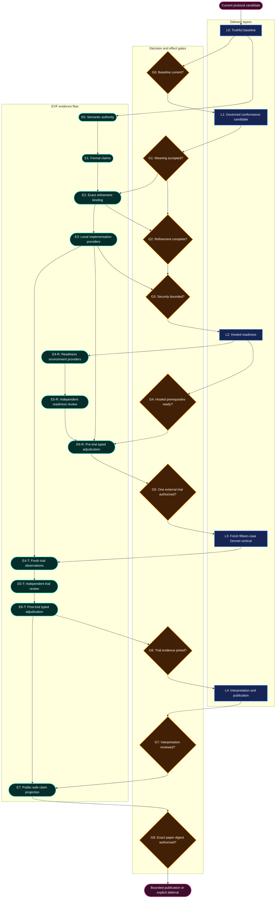

# Knowledge Expansion Protocol Completion Implementation Roadmap

This document sequences the work needed to turn the current Knowledge Expansion
Protocol candidate into an independently reviewable hosted Devnet protocol and,
later, a publication candidate. It covers every open proof category in Section
15 of the white paper and makes the deeper EVF evidence model explicit.

This is a planning candidate. It does not accept definitions, adopt a Product
Capability, admit an ontology or DomainSpec source, accept an implementation
binding, authorize an external trial, establish conformance, publish the paper,
or approve production use.

## 1. Context

- Target: Knowledge Expansion Protocol no-price encrypted co-ownership vertical.
- Current state: partially implemented, with bounded formal, Rust, browser,
  PostgreSQL, Solana program-test, HTTP, and prior Devnet observations.
- Primary participants: originator A, recipient B, protocol operator, evidence
  reviewer, and CyberAlchemy v2 product owner.
- Primary constraint: every claim must preserve the distinction between
  meaning, implementation, observation, conformance, authority, and external
  effects.
- Publication target: a technically reproducible white paper only after the
  evidence and limitation sections reflect current accepted receipts.

### Source spine

- `WHITE-PAPER.md`, especially Section 15.
- `EVIDENCE-MATRIX.md` and `CLAIM-LEDGER.md`.
- `research/levels/L1-residue-map.md` and
  `research/levels/L2-closure-plan.md`.
- The selected hosted capability's D65 predecessor records.
- `solana-coownership/.../formal-evidence/conformance-v2/claims.json` and its
  generated provider receipt.
- The selected implementation binding, runtime sources, provider observations,
  security reviews, and trial evidence.

## 2. Completion thesis

The protocol is not completed by accumulating passing tests. Completion needs a
typed evidence chain:

```text
canonical definitions
  -> adopted Product Capability
  -> admitted capability-local business ontology
  -> admitted DomainSpec v2 source
  -> deterministic compiled graph and system ontology
  -> accepted exact implementation binding
  -> formal-to-implementation refinement evidence
  -> bounded implementation and environment observations
  -> independent review
  -> typed aggregate conformance decision
```

Every arrow is a separately checked relation. A successor cannot repair a
missing predecessor by declaring a status or refreshing a digest.

## 3. EVF evidence architecture

The existing evidence is deeper than the current white paper reports. The
successor package already defines seven formal claims with fifteen projections
across Lean, TLA+/TLC, and Alloy, accompanied by bounded Rust, cryptographic,
SQL, and Solana providers. The roadmap preserves those assets and adds the two
missing joins: exact refinement and typed aggregate adjudication.

| EVF layer | Question answered | Required output | Claim ceiling |
| --- | --- | --- | --- |
| E0 Semantic authority | What does the protocol mean, and who may decide it? | Exact accepted/admitted D65 predecessor identities | Meaning and authority only; no behavior proof |
| E1 Formal claims | Which safety/state properties hold in bounded models? | Seven source-bound FormalClaims and deterministic Lean/TLC/Alloy receipts | Model properties only |
| E2 Refinement binding | Which exact Rust, Solana, SQL, and browser behaviors realize each formal transition? | Machine-readable claim-to-symbol-to-test-to-byte mapping with preservation obligations | Correspondence evidence; not external behavior |
| E3 Implementation providers | Do exact local bytes satisfy selected positive and negative obligations? | Rust, crypto, SQL, browser, secret-scan, and Solana program-test receipts | Bounded local behavior only |
| E4 Environment providers | Does the exact bound system behave in the declared hosted Devnet environment? | Backup/restore, TLS/perimeter, monitoring, finalized Devnet, reconciliation, and decryption receipts | One bounded environment only |
| E5 Independent review | Are important assumptions, blind spots, and failures independently challenged? | Security, storage, Solana, evidence, and legal review records | Review findings; never self-acceptance |
| E6 Typed adjudication | Are all prerequisites current, compatible, and sufficient for one exact claim? | Collect-all evaluation with PASS, BLOCK, or `not_evaluable`, causal blockers, and immutable inputs | Candidate assessment pending owner decision |
| E7 Publication projection | Which adjudicated claims may appear in the paper? | Claim ledger and reproducibility appendix bound to accepted receipts | Paper claim permission only; publication remains separate |

### EVF provider rules

1. Providers report observations; they do not grant authority.
2. A provider receipt binds exact source, tool, environment, input, output, and
   claim-ceiling digests.
3. Multiple providers are complementary, not votes. Three PASS results cannot
   override one missing mandatory prerequisite.
4. Contradiction, source drift, ambiguous external effect, or missing selected
   dependency fails closed.
5. The adjudicator preserves `not_evaluable`; it must never translate missing
   evidence into failure or success.
6. Publication consumes only adjudicated claims and must not expose private
   CyberAlchemy v2, DomainSpec, or Saturn prose.

## 4. Layering method

Each layer ends at the smallest boundary that unlocks a responsible decision.

```text
Layer value = decision unlocked + visible outcome + risk reduced
Layer cost  = implementation time + verification time + coordination burden
```

Work moves to the next layer when the next unit adds less value to the current
decision than beginning the next decision. Later layers must preserve all
earlier guarantees.

## 5. Layer decision table

| Layer | Decision question | Minimum working unit | Visible outcome | Promotion decision |
| --- | --- | --- | --- | --- |
| L0 — Truthful baseline | After this layer, do we know exactly what exists, what is current, and what remains unproved? | Refresh the source ledger, expose the complete EVF stack in the paper package, and produce one immutable candidate inventory | Reviewers see the real evidence without inflated claims | Freeze candidate, repair drift, or stop |
| L1 — Governed conformance candidate | After this layer, can the exact implementation be evaluated against accepted meaning and formal obligations? | Close D65 decisions, add E2 refinement, complete local hardening, and run typed E6 preacceptance | One exact candidate has causal PASS/BLOCK/`not_evaluable` results | Accept bounded binding, remediate, reject, or defer |
| L2 — Hosted readiness | After this layer, can one disposable hosted trial be run without relying on undeclared security, durability, or operational assumptions? | Independent restore, wallet/browser matrix, VPS/TLS/perimeter/monitoring envelope, credential lifecycle, and security review | Operator can rehearse a bounded trial without a protocol submission | Authorize one trial, remediate, or stop |
| L3 — Fresh Devnet vertical | After this layer, has one exact A-to-B knowledge-sharing event worked through the full hosted stack on public Devnet? | Run the frozen fifteen-case envelope once and join browser, API, PostgreSQL, Solana finality, reconciliation, and B-side decryption | A separately reviewable end-to-end trial receipt | Accept bounded trial evidence, reject, or investigate ambiguity |
| L4 — Interpretation and publication | After this layer, is there enough technical, product, novelty, and legal evidence to publish bounded claims and select the next product layer? | Peer-reviewed related work, user research, legal analysis, reproducibility appendix, paper rewrite, and immutable publication decision | A publishable or explicitly deferred paper and a bounded successor recommendation | Publish exact digest, revise, defer, or stop |

## 6. Layer 0 — Truthful baseline

### Decision question

After this layer, we know whether the repository can name one current evidence
baseline without confusing the fifteen Devnet cases, fifteen formal provider
projections, or Section 15's ten proof gaps.

### Included work

#### W0.1 — Exact source inventory

- Resolve the current selected hosted successor, predecessor decisions,
  implementation binding, runtime bytes, evidence receipts, and paper sources.
- Hash every selected source and record whether it is candidate, accepted,
  admitted, historical, stale, or superseded.
- Detect unrelated dirty bytes and exclude them from every candidate envelope.

#### W0.2 — EVF truth correction

- Extend `EVIDENCE-MATRIX.md` beyond the legacy single Lean claim.
- Represent the seven conformance-v2 claims and fifteen provider projections.
- Include bounded Rust, crypto, SQL, browser, Solana program-test, relation, and
  review evidence with their exact claim ceilings.
- Mark stale earlier assessments as historical rather than silently deleting or
  treating them as current.

#### W0.3 — Paper claim reconciliation

- Re-evaluate every `CLAIM-LEDGER.md` row against current source digests.
- Add missing EVF, Solana-program, relation-evidence, security-residue, and
  aggregate-conformance claims.
- Keep unsupported production, novelty, market, legal, and security claims out.

#### W0.4 — Reproducible baseline check

- Validate paper structure and source currency.
- Re-run only non-effectful deterministic evidence checks needed to establish
  currentness.
- Produce a collect-all discrepancy report; dependent checks remain
  `not_evaluable` when their inputs are stale or absent.

### Explicitly deferred

- Owner acceptance or ontology admission.
- Code repair unrelated to evidence currency.
- VPS changes, credentials, RPC submission, trial execution, and publication.

### Exit evidence

- One immutable source manifest covering every selected paper and EVF input.
- Zero unexplained selected-source drift.
- A paper evidence matrix that faithfully represents the deeper EVF stack.
- A discrepancy report with no omitted dependent checks.

### Promotion decision

- Continue when one current candidate baseline is reproducible.
- Repair when drift has a bounded owner and no external effect.
- Stop when selected dependency identity or ownership cannot be resolved.

## 7. Layer 1 — Governed conformance candidate

### Decision question

After this layer, we know whether one exact implementation can be evaluated
against owner-accepted meaning and the seven formal claims.

### Included work

#### W1.1 — D65 predecessor closure

Process each predecessor independently and in order:

1. review and accept the exact hosted canonical definition set;
2. adopt the exact hosted Product Capability;
3. admit the capability-local business ontology selectors actually consumed;
4. admit the exact DomainSpec v2 authored source;
5. verify deterministic compiled graph and system ontology currency;
6. accept one exact implementation binding;
7. preserve each decision's immutable digest and owner identity.

No decision is inferred from passing validation.

#### W1.2 — Formal-to-implementation refinement provider

- Map each FormalClaim to exact DomainSpec rules and operations.
- Map each operation to Rust/Solana symbols, SQL contracts, browser message
  constructors, and tests.
- Check totality: every mandatory formal transition has at least one bound
  implementation realization and rejection path.
- Check exclusivity: no bound implementation mutation lies outside admitted
  transition authority.
- Bind source bytes and compiler/tool identities to the refinement receipt.

#### W1.3 — Security and failure hardening

- Expand malformed-input tests at browser, HTTP, CBOR, SQL, and Solana account
  boundaries.
- Add property/fuzz tests for parsers, state transitions, reissue, replay, and
  commitment verification.
- Add concurrency tests for stale revisions, duplicate operations, preparation,
  finalization, reconciliation, and reissue races.
- Add bounded resource-exhaustion tests for payload size, account growth,
  request rate, database connections, and evidence output.
- Adjudicate the moderate transitive dependency advisory and rerun a complete
  dependency review.
- Assess secret zeroization, logging, memory lifetime, side channels, and
  custody boundaries.

#### W1.4 — EVF typed adjudicator candidate

- Consume E0–E5 receipts by exact digest.
- Evaluate mandatory prerequisites without majority voting.
- Emit PASS, BLOCK, and `not_evaluable` with causal dependency paths.
- Reject stale, contradictory, environment-mismatched, or acceptance-mismatched
  evidence.
- Keep candidate assessment separate from owner acceptance.

#### W1.5 — Independent review

- Have an independent reviewer assess cryptography, application security,
  Solana constraints, refinement completeness, and the adjudicator.
- Classify findings by severity, affected claims, and exact remediation bytes.
- Require zero unresolved critical/high findings before L2 promotion.

### Explicitly deferred

- Public hosting and external RPC effects.
- Off-host production-like recovery.
- Broad wallet/browser claims.
- Product demand, licensing, economics, reputation, and publication.

### Exit evidence

- Complete immutable D65 predecessor identities.
- Seven claims mapped through E2 to exact implementation and test bytes.
- Passing bounded negative/fuzz/concurrency/resource suites.
- No unresolved critical/high security findings.
- One E6 collect-all candidate assessment with no silent omissions.

### Promotion decision

- Continue when all mandatory L2 prerequisites are PASS or deliberately bounded
  by an owner-reviewed trial envelope.
- Remediate when findings are local and causally bounded.
- Reject or defer when meaning, refinement, or security cannot be closed.

## 8. Layer 2 — Hosted readiness

### Decision question

After this layer, we know whether a disposable hosted trial can be attempted
without inventing durability, interoperability, or operational readiness.

### Included work

#### W2.1 — Physically independent durability proof

- Define the three failure domains: operational SQL, recovery copy, and archive.
- Put at least one encrypted recovery/archive copy outside the VPS failure
  domain.
- Simulate loss of the operational database and application state.
- Restore into a clean environment using documented identities and manifests.
- Verify ciphertext bytes, commitments, journal order, artifact identity,
  recipient envelope, and recoverability.
- Record RPO, RTO, retention, rotation, deletion, and failure behavior.

#### W2.2 — Wallet and browser compatibility matrix

- Select supported browser and wallet versions explicitly.
- Test connection, rejection, disconnect, reconnect, wrong network, stale
  blockhash/session, wrong signer, and duplicate submission behavior.
- Verify instruction bytes and human-readable intent agree before signing.
- Verify plaintext and private keys remain client-side across every supported
  path.
- Record unsupported combinations rather than generalizing from one browser.

#### W2.3 — VPS and network envelope

- Pin OS/container/runtime dependencies and exact application bytes.
- Configure DNS, TLS, renewal, firewall, process isolation, database exposure,
  rate limits, and least-privilege service identities.
- Keep PostgreSQL private and expose only required HTTPS endpoints.
- Add health, readiness, structured logs, metrics, alerting, audit retention,
  and clock synchronization.
- Define credential creation, injection, rotation, revocation, emergency
  shutdown, and destruction without placing secrets in Git or evidence.

#### W2.4 — Incident and degraded-mode rehearsal

- Rehearse RPC outage, PostgreSQL outage, archive unavailability, TLS failure,
  stale finality, commitment mismatch, ambiguous submission, and credential
  compromise.
- Verify fail-closed delivery: submitted/confirmed state never releases material
  before matching finalized state and verified storage.
- Verify no automatic retry follows an ambiguous external effect.

#### W2.5 — Trial envelope construction

- Freeze program, service, client, migration, configuration, endpoint, cluster,
  payer, participant, budget, submission, case, evidence, cleanup, and retry
  limits.
- Keep funding authorization separate from protocol-trial authorization.
- Require one explicit owner authorization bound to the envelope digest.

### Explicitly deferred

- Protocol submissions until the separate trial authorization.
- Mainnet, paid RPC fallback, customer material, reusable credentials, scaling,
  publication, and production availability claims.

### Exit evidence

- Clean off-host encrypted restore PASS.
- Selected wallet/browser matrix completed with bounded support claims.
- VPS hardening and observability rehearsal PASS.
- Incident runbook exercised for every declared failure mode.
- One immutable, independently reviewed trial envelope ready for owner decision.

### Promotion decision

- Authorize exactly one trial when all mandatory prerequisites are current.
- Remediate the envelope when any selected dependency changes.
- Stop when secrets, external effects, or ambiguous-retry behavior cannot be
  bounded.

## 9. Layer 3 — Fresh hosted Devnet vertical

### Decision question

After this layer, we know whether one originator and one recipient can complete
the no-price encrypted co-ownership protocol through the full hosted Devnet
stack under the frozen envelope.

### Minimum working unit

```text
A authors exact knowledge bytes
  -> browser encrypts and prepares recipient-bound envelope
  -> API persists and verifies three storage layers
  -> A signs the exact Solana instruction
  -> finalized program state changes {A} to {A,B}
  -> service reconciles finalized state and stored-byte commitments
  -> B retrieves ciphertext and envelope
  -> B decrypts the exact original bytes
  -> B requests reissue
  -> A fulfills one policy-valid replacement
  -> B decrypts with the replacement key
```

### Frozen fifteen-case suite

1. `storage-three-layer-ready`
2. `initialize-positive`
3. `grant-wrong-signer`
4. `grant-stale-revision`
5. `grant-positive`
6. `grant-finalized-fetch`
7. `recipient-decryption`
8. `reissue-request-outsider`
9. `reissue-request-positive`
10. `reissue-request-replay`
11. `reissue-self-fulfillment`
12. `reissue-fulfill-positive`
13. `reissue-state-isolation`
14. `replacement-recipient-decryption`
15. `cost-observation`

### Execution rules

- Revalidate the exact envelope immediately before the first effect.
- Stop at the first real effectful failure.
- Never retry an ambiguous submission under the same authorization.
- Use finalized reads for activation and evidence.
- Keep infrastructure cost distinct from zero knowledge consideration.
- Preserve transaction signatures, account identities, slot/finality evidence,
  exact program bytes, exact stored-byte commitments, B-side decryption digests,
  and cleanup state.

### Exit evidence

- A single receipt joins all fifteen cases and their causal order.
- Exact program/account state proves `{A}->{A,B}` without removing A.
- B decrypts the exact bytes, and reissue changes only B's envelope plus allowed
  revision/request state.
- Storage, chain, API, and browser identities join without substituting locators
  for content commitments.
- An independent reviewer reproduces all read-only evidence checks.

### Promotion decision

- Accept the bounded trial observation when the full join is reproducible.
- Investigate without retry when effect status is ambiguous.
- Reject the trial claim when any mandatory join is missing or contradictory.

## 10. Layer 4 — Interpretation and publication

### Decision question

After this layer, we know which claims can responsibly be published and which
successor capability, if any, users actually need.

### Included work

#### W4.1 — Peer-reviewed related work and novelty adjudication

- Survey encrypted sharing, fair exchange, proxy re-encryption, capability
  security, decentralized identity, key transparency, digital rights,
  knowledge graphs, and decentralized data markets.
- Build claim-to-source comparisons instead of prose-only bibliography.
- Mark each claimed contribution as precedent, combination, engineering
  realization, open hypothesis, or defensible novelty.

#### W4.2 — User research

- Test participant understanding of co-ownership, custody, finality, reissue,
  inability to revoke learned knowledge, and infrastructure versus knowledge
  cost.
- Observe originator and recipient completion rates and failure points.
- Test perceived value and willingness to use before willingness to pay.
- Do not infer market demand from successful protocol execution.

#### W4.3 — Legal analysis

- Separate protocol membership from copyright ownership, licenses, database
  rights, confidentiality, contract rights, and jurisdiction.
- Identify which future policy statements require legal text or off-chain
  agreement rather than on-chain state.
- Constrain terminology in the paper and UI to what the protocol actually does.

#### W4.4 — White-paper closure

- Refresh every local source digest after accepted changes.
- Generate a reproducibility appendix from accepted, public-safe receipts.
- Rewrite architecture, evidence, threat, limitation, and related-work sections.
- Run technical, security, product-meaning, legal-language, and private/public
  boundary reviews.
- Freeze one immutable paper digest for a separate publication decision.

#### W4.5 — Successor selection

- Choose at most one next capability based on evidence: paid exchange,
  originator royalties, licensing assertions, or economic reputation.
- Start that successor again at canonical definitions under D65.
- Do not merge economics, rights, and reputation into the no-price substrate.

### Explicitly deferred

- Mainnet and production launch.
- Real customer knowledge or reusable credentials.
- Paid consideration, royalties, licensing enforcement, or reputation until a
  separately defined and adopted successor exists.
- Publication until the exact digest receives explicit authority.

### Exit evidence

- Reviewed related-work matrix and explicit novelty adjudication.
- User-research report with limitations and decision implications.
- Qualified legal analysis with jurisdiction and claim boundaries.
- Reproducible, public-boundary-reviewed paper candidate.
- Separate publish/revise/defer/stop decision bound to one digest.

## 11. Dependency DAG and backbone

The DAG separates delivery layers, evidence transformations, and human or
external-effect gates. An arrow means the target consumes the source as a
declared prerequisite; it does not mean the source automatically authorizes the
target.



### Reading the graph

- `E4-R -> E5-R -> E6-R` evaluates whether a trial may be proposed; it does
  not claim that a trial happened.
- `E4-T -> E5-T -> E6-T` begins only after G5 authorizes one frozen external
  envelope and L3 performs it.
- G1, G5, and G8 are human authority boundaries. Evidence can prepare them but
  cannot cross them automatically.
- A BLOCK or `not_evaluable` result keeps the affected successor unreachable;
  remediation creates a new current input rather than a backward authority
  edge. The graph therefore remains acyclic.

### Forbidden shortcuts

| Shortcut | Why it is forbidden |
| --- | --- |
| L0 directly to L3 | A truthful inventory is not accepted meaning, security closure, hosted readiness, or external-effect authority. |
| E1 directly to G6 | A formal-model result is not an observation of the Rust/Solana implementation or a hosted trial. |
| E3 directly to G5 | Local tests do not prove backup independence, browser/wallet compatibility, VPS hardening, or owner authorization. |
| G5 directly to G6 | Authorization permits one attempt; it is not evidence that the attempt occurred or succeeded. |
| E6-T directly to G8 | Technical adjudication does not replace novelty, user, legal, private/public-boundary, or publication review. |

### Work-package backbone

```text
W0.1 source inventory
  -> W0.2 EVF truth correction
  -> W0.3 paper claim reconciliation
  -> W0.4 baseline check
  -> W1.1 D65 predecessor closure
  -> W1.2 formal-to-implementation refinement
  -> W1.3 security and failure hardening
  -> W1.4 typed adjudicator
  -> W1.5 independent review
  -> W2.1 off-host restore
  -> W2.2 wallet/browser matrix
  -> W2.3 VPS/network envelope
  -> W2.4 incident rehearsal
  -> W2.5 trial envelope and owner authorization
  -> L3 fifteen-case Devnet vertical
  -> independent trial review
  -> W4.1 related work
  -> W4.2 user research
  -> W4.3 legal analysis
  -> W4.4 paper closure
  -> W4.5 successor selection
```

Safe work inside one layer may overlap only when it has no shared mutable bytes,
no hidden predecessor relation, and no external-effect ambiguity. Owner gates,
external submissions, aggregate adjudication, and publication remain serial.

## 12. Gate register

| Gate | Required decision/evidence | Blocks |
| --- | --- | --- |
| G0 Baseline current | Exact selected-source manifest and discrepancy report | All authoritative claims |
| G1 Meaning accepted | Complete D65 predecessor decisions in order | Exact implementation conformance |
| G2 Refinement complete | Seven formal claims mapped to exact implementation bytes and tests | Aggregate conformance |
| G3 Security bounded | Zero critical/high findings and accepted disposition of lower findings | Hosted readiness |
| G4 Durability/interoperability ready | Off-host restore, wallet/browser matrix, VPS rehearsal | Trial authorization |
| G5 External effect authorized | Exact immutable trial envelope and separate owner authorization | Any Devnet submission |
| G6 Trial joined | Fifteen cases and end-to-end evidence join independently reviewed | Hosted protocol claim |
| G7 Interpretation reviewed | Novelty, user, and legal evidence | Publication and successor selection |
| G8 Publication authorized | One immutable public-safe paper digest | Publication only |

## 13. Non-regression guardrails

- A remains an owner when B is added.
- Identity remains distinct from wallet and encryption-key material.
- Plaintext, content keys, signing keys, private recipient keys, passwords, and
  RPC credentials never enter public chain state, Git, logs, evidence, or SQL.
- Finalized matching state and verified exact-byte storage are both required
  before delivery activation.
- Replay, stale revision, wrong signer, wrong authority, commitment mismatch,
  and incomplete storage fail without partial protected-state mutation.
- Lost-key reissue changes only the recipient envelope and permitted
  request/revision state; compromise rotation remains a separate epoch change.
- Knowledge consideration remains exactly zero in this capability; Solana and
  storage costs remain separate infrastructure observations.
- No cross-system atomicity is invented between Solana and storage.
- Learned knowledge is not described as technically revocable.
- Passing validators, models, tests, or trials never silently become acceptance,
  production readiness, publication, deployment, or legal rights.
- Private DomainSpec, CyberAlchemy v2, and Saturn prose does not cross into a
  public paper or subsystem without a boundary review.

## 14. Stop conditions

Pause the affected layer when:

- selected source bytes drift after candidate freeze;
- an acceptance-bound digest changes;
- a mandatory owner or authority lane is ambiguous;
- formal and implementation semantics contradict;
- a critical/high security finding remains unresolved;
- a secret appears in a prohibited surface;
- backup restoration cannot reproduce exact identities and commitments;
- an external submission has ambiguous effect;
- one of the fifteen mandatory trial cases lacks evidence;
- independent review cannot reproduce the claimed result; or
- public/private boundary review finds private authority material in the paper.

## 15. Recommended immediate layer

Begin with **L0 — Truthful baseline**. It is the highest-value, lowest-effect
step because the white paper currently understates the existing EVF stack.
Correcting the evidence account and freezing one current source manifest lets
the owner see which D65 and security gates are genuinely open before any new
implementation or external trial work.

The most important deferred scope is another Devnet submission. Existing local
and historical Devnet evidence should be reconciled first; a fresh trial should
consume one accepted implementation and one explicitly authorized immutable
envelope.

## 16. Plan claim ceiling

This roadmap decomposes and orders candidate work. It does not prove any work
complete, approve its ordering, register a Goal or ConstructionBinding,
authorize repository mutation beyond this planning artifact, accept or admit a
D65 predecessor, accept conformance, authorize credentials or external effects,
deploy the hosted service, run a Devnet transaction, publish the paper, select a
commercial successor, or establish legal rights.
