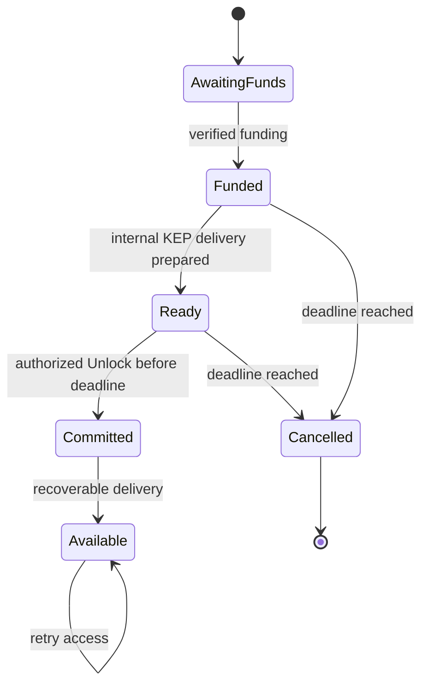

# Exchange purchase v1 — implementation plan candidate

Superseded sequencing and settlement choices: see the
[Solana + USDC successor plan](SOLANA-USDC-PLAN.md), following the user's acceptance
on 2026-09-08. This document preserves the earlier mock-first plan and its evidence.

Status: reviewable plan, not admitted execution state. Owner: Exchange product
owner. Sources: [analysis](ANALYSIS.md), [evidence](evidence.json),
[accepted decisions](../../../define/reviews/cyberalchemy-exchange/INTAKE.md).
Route: CA2-ROUTE-PLAN. Goals admission remains blocked; this plan does not grant
implementation, product approval, publication or operational effects.

## Objective and first deliverable

Demonstrate one local API-first purchase: seller lists an encrypted project file;
buyer funds mock escrow; seller prepares buyer-specific access using existing KEP;
buyer invokes Unlock; the purchase commits once and the buyer retrieves/decrypts
the same project; interrupted retrieval resumes without another charge. If the
order expires before commitment, refund once and release no purchase access.

Use existing KEP identities, client encryption, envelope contexts and co-ownership
semantics. Exchange operates trusted release. Preserve existing free sharing.
Prototype assumptions: one opaque project archive within the existing 10 MB file
limit, one mock currency in integer minor units, deterministic test clocks,
separate test database, and simulated KEP finality. These are bounded prototype
choices, not production asset, ledger, size or permanence promises.

## Proposed module placement and contracts

Use `cyberalchemy-exchange/capabilities/project-purchase/v1/` for the new commercial
capability: candidate definitions, capability, ontology, Alch model, DomainSpec
binding, implementation binding and evidence. Extend the existing internal KEP
hosted application only at explicit composition points; do not fork encryption,
identity, account recovery or file formats. Exact paths are planned, not created.

Candidate records:

| Record | Minimum meaning |
| --- | --- |
| Offer | Seller identity, offering kind/version, exact KEP version/policy, public description and immutable price/terms version |
| PurchaseOrder | Buyer/seller, offer snapshot, price/asset, deadline, state, replay identity and bound recipient key version |
| PreparedDelivery | Exact KEP preparation operation, recipient envelope commitment, complete public handoff context, expected revision and retention reservation |
| EscrowEntry | Mock funded amount and exactly one refundable or seller entitlement; no floating-point balances |
| PurchaseReceipt | Durable commitment ID, order/terms digest, bound grant result and recovery locator |
| DeliveryReceipt | Existing recipient acknowledgement; separate from commercial completion |

Candidate API: POST /v1/offers, GET /v1/offers, POST /v1/orders,
POST /v1/orders/{id}/fund, POST /v1/orders/{id}/prepare,
POST /v1/orders/{id}/unlock, GET /v1/orders/{id},
POST /v1/orders/{id}/access and POST /v1/orders/{id}/expire.
Funding in the prototype is explicitly simulated. In a real settlement binding,
a caller assertion that funding succeeded must not establish escrow credit.
All UI/CLI journeys use these same contracts and existing signed identity bindings.

## Lifecycle and invariants

An unfunded order can expire without a refund amount. A committed order never
returns to cancellable because a receipt, HTTP response or local download is lost.
The durable transition, not the button click, decides the result. Proposed deadline
rule is commit while now < deadline and expire when now >= deadline.

Each mutation verifies signer/identity, exact terms, recipient binding, expected
state/revision and operation identity. Identical replay returns the prior result;
same replay ID with changed bytes conflicts. Grant, local mock settlement and
release entitlement must share one durable transaction in the local prototype.
Preserve the original owner set; never revoke unrelated/pre-existing access.
No plaintext/content keys in server logs or new commercial records.

Both legacy access endpoints and new access routes must respect the same purchase
release boundary for purchase-created grants. Free sharing remains a separate
intentional operation, not a promise to prevent seller/co-owner redistribution.
Reissue cannot manufacture access for a buyer who has no committed membership.

## Ordered construction work

| Stage | Concrete work | Exit evidence | Dependencies |
| --- | --- | --- | --- |
| P0: reproduce exact baseline | Materialize locked JS/Rust dependencies with repository toolchain; run client and focused Rust suites; audit current hosted source/receipt selection. Prepare relocation path-manifest successor with history preserved. Separate UI asset binding from core checks where existing contracts permit. | Exact source manifest, commands, passing core/client results or narrowly identified code failures; no digest-only claim repair. | Dependency cache for tests; relevant source-owner process for binding changes. |
| P1: bind commercial meaning | Candidate PurchaseOrder/Offer/PreparedDelivery/escrow/receipt definitions; preserve KEP-D1–D12 and existing no-price capability; map business invariants, failure semantics and tests. Author Alch and selected DomainSpec contracts and explain native effects. | Traceable D65 prototype definition → capability → ontology → DomainSpec/compiler → implementation binding chain. | Accepted product decisions; selected source versions from P0. |
| P2: prove local order state | Add isolated mock settlement and order storage; implement authorized funding, preparation, commit, expiry and exact replay. Include mock grant result and release entitlement in the same transaction. | Concurrency, rollback, deadline and replay tests; no double debit, refund or release. | P1 contract; dedicated test persistence. |
| P3: compose real KEP delivery | Reuse sender encryption and envelope functions; split preparation from automatic grant submission; bind complete handoff to order. Gate every access path. Reuse recipient decrypt/automatic receipt and account recovery. Use injected simulated finality only. | Two independent clients, real encryption/decryption, correct owner preservation, wrong binding rejection and interrupted retrieval recovery with mock money. | P2; P0 client baseline. |
| P4: durable API/UI journey | Persist order/escrow/delivery documents and recovery reservation with journal; add purchase controls and CLI methods over the same API. No second acceptance button. Show waiting for seller, ready, committed/recovering, available or refunded honestly. | Process restart and injected persistence failures; browser/API parity; client sign rejection causes no purchase. | P3 and disposable PostgreSQL. |
| P5: review bounded product | Freeze exact candidate; run end-to-end matrix and verify manifests; produce runnable local demo and known-limits report. Seek product review of that exact candidate. | TESTED_PRODUCT evidence for mock payments and real KEP access only. | P0–P4 exit evidence. |
| P6: real settlement successor | Select asset/ledger and authority, resolve actual grant/payment atomicity and malicious-delivery outcome, implement reconciled settlement and retention obligations, then review exact deployment envelope. | Independently assessed real-settlement candidate and separate deployment authorization. | Product decisions and technical blockers below; not needed for mock prototype. |

No rough calendar estimate is substituted for these exit conditions. P0 determines
whether baseline repair affects effort; P2/P3 expose the substantive integration cost.

## Cross-system commitment: do not hide this gap

The existing hosted service observes finalized Solana grants after participant
wallet submission. A PostgreSQL transaction cannot retroactively undo that grant.
For P2–P5, the mock grant/finality state and payment effects must be explicit local
simulation in the same test transaction; never configure its success fixture as a
production finality provider. Keep the production Devnet gateway unchanged.

For P6, select an actual reviewed commitment mechanism. Options include a same-ledger
payment-and-grant composition with appropriate authorization, or an Exchange-ledger
commercial entitlement with explicitly defined asynchronous KEP reconciliation.
The latter changes what is atomic and needs product agreement. Do not claim a
saga can cancel after ownership or decryption has escaped. Unknown submission
outcomes reconcile before refund; neither timeout nor absent HTTP response proves
that no chain effect occurred. Current code enforces an exact top-level KEP
transition, so compatibility with a future atomic composition must be demonstrated.

## Test matrix

| Case | Required outcome |
| --- | --- |
| Happy purchase | Exact original bytes decrypt, owners include seller and buyer, one seller entitlement |
| Buyer or seller absent before Ready/Unlock | Deadline expiry refunds funded order, no purchase release |
| Duplicate funding/unlock/expiry | Same result for exact replay; never duplicate amounts or grants |
| Changed terms/key/version under same operation | Reject conflict before effects |
| Unlock races expiry | One terminal commercial outcome; no refund plus seller entitlement |
| Restart at each persistence boundary | Authoritative state survives; memory never advertises uncommitted access |
| Grant commit response lost | Read receipt and resume; no second grant or charge |
| Receipt transport fails after decryption | Purchase remains committed; receipt retry does not repay |
| Wrong signer/recipient or stale envelope revision | Reject; protect existing memberships |
| Deliberately incorrect key with matching envelope digest | Document exact existing KEP detection point; no claim of prepayment verification without evidence |
| Legacy access/finalize/reissue routes | Cannot unintentionally bypass purchase release; intentional free sharing remains distinct |
| Expiry during delivery/recovery | Reserved retention term holds; purchase clock does not delete ciphertext |
| Finality failure/unknown/reorg fixture | No premature release or unsupported refund; reconciliation state explicit |
| Payout/refund worker retries | Durable entitlement consumed at most once |

The malformed-key case is a real-money readiness blocker if detection occurs only
after irreversible purchase. It does not require inventing a new scheme now; first
measure the existing path and present that exact remaining gap. A mock demo must
not label it solved through test fixtures.

## Product frontier and operational lane

Current product frontier: P0 exact runnable baseline, followed by P1 commercial
contract binding. Runnable local work: dependency preparation, focused tests,
source comparison and candidate domain/API modeling. No operational deployment is
required to do those tasks. This plan itself is complete but not execution admission.

| Operational/support task | Owner | Affected stage | Blocking basis | Disposition |
| --- | --- | --- | --- | --- |
| Locked JS/Rust dependency availability | Implementation owner | P0 | Tests cannot load missing packages | Exact local prerequisite |
| Hosted path manifests after relocation | Binding owner | P0/P1 | Compiled dependency paths changed; preserve old evidence and derive successor | Scoped prerequisite to exact candidate claims |
| Missing Arcanum presentation asset | UI/binding owner | P4/full hosted binding | Existing author_binding.py requires absent file | Does not block isolated order model; required if retaining that full UI binding |
| Existing parent/white-paper drift | Source owners | Relevant reused predecessor or publication | Only selected predecessor drift blocks its claim; unrelated paper drift does not block modeling | Separate evidence review, never automatic refresh |
| Disposable PostgreSQL | Test/implementation owner | P4 | Durable restart/transaction evidence needs actual database | Required for durable milestone; memory tests can precede |
| Asset, fees, payment authority and ledger | Product/settlement owner | P6 | No production settlement contract selected | Deferred beyond mock prototype |
| Backups, retention and disaster recovery | Exchange operator | P6 | Recoverable paid access requires operational evidence | Deferred production work |
| Public network/Devnet submission, deployment, TLS | Operations owner | P6 | External effects and exact environment | Separately authorized; no blocking of local prototype |
| Standalone distribution, legacy symlink retirement | Repository/product owner | Packaging milestone | Existing pinned paths and consumer compatibility | Separate scope from purchase prototype |

## Open Questions

No need to re-decide KEP's product membership, encryption location or release
operator: preserve current KEP and use Exchange as already selected.

1. Product: accept the initial project offering as one existing KEP file (possibly
   an opaque archive) up to 10 MB? The prototype can use that existing bound;
   larger/multi-file packaging is a separate capability.
2. Product/operator: what paid-access retention/recovery term is promised? Existing
   one-year renewal after acknowledgement is not an indefinite recovery guarantee.
3. Implementation: can existing KEP controls establish sufficient readiness for
   real payment against malformed direct API inputs? First reproduce the exact case.
4. Settlement: which real commitment domain binds payment and co-owner grant?
   Defer actual currency/chain selection until P6 design, keep mock semantics explicit.
5. Repository/product: is installable standalone distribution required alongside
   purchase v1, or a later release milestone? Directory relocation did not select it.
