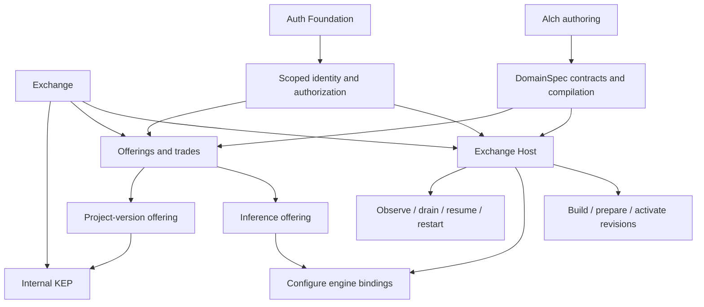

# Exchange ontology structure

Status: candidate source model, 2026-09-13. Owner: Exchange product owner.
These models organize existing meaning and components for review. The system map
is hand-authored, not compiler output or a newly admitted DomainSpec ontology.

The [offering catalog](OFFERINGS.md) binds the selected Lab, ARE and Craft + Alch
project offerings, managed Alch hosting, and community inference. Managed hosting
is a paid service outcome with a candidate bridge to existing host primitives.

The Auth Foundation arrows describe the target alignment. The inference consumer
exists; a common host/purchase binding is still a gap.

## Three linked models

| Model | Owns | Machine source |
| --- | --- | --- |
| Business | Participants, roles, offering, terms, orders, host responsibility and reused KEP terms | [business-ontology.json](business-ontology.json) |
| System | Existing controller, runtime, inference service, engine adapter, authorization binding, KEP and purchase components | [system-ontology.json](system-ontology.json) |
| Bridge | Which component supports which capability, with source evidence and limitations | [business-system-bridge.json](business-system-bridge.json) |

Each business node carries a handling choice: `reuse`, `specialize` or `propose`.
KEP reuse points at the unchanged owned definition. Proposed Exchange terms are
not inserted into canonical definitions. Unresolved decisions are explicit in the
question register rather than silently implemented by this graph.

## Distinctions that the model must preserve

| Terms | Relationship and boundary |
| --- | --- |
| User/service principal and participant role | Authentication identifies the principal; buyer, seller and operator describe responsibilities |
| Tenant and membership | Flat isolation scope and a principal's association with it; membership alone grants no invocation |
| Wallet and Knowledge Identity | Explicit control/binding evidence is required; they are not universal synonyms |
| Host project and project being sold | The first organizes executable revisions; the second is an offering for an exact artifact version |
| Build, activation and health | Compilation result, selected route and observed runtime condition are separate facts |
| Offering and engine binding | Public terms/capability description versus private operator connection and credentials |
| Inference request and paid order | A request may execute without an implemented payment contract; usage is an observation |
| Co-ownership, settlement and acknowledgement | Membership, durable commercial outcome and client decryption evidence remain distinct |
| Canonical business meaning and generated mirror | Definitions own meaning; generated graphs record a projection of selected authored inputs |

## Existing ontology alignment

The candidate reuses KEP's business ontology and definition selectors, the inference
business scaffold and approved security structure, and the host/purchase construction
records. It references their paths through [sources.json](sources.json).
Historical KEP admission and local compiler receipts keep their original scope;
they do not admit this combined Exchange model or repair existing source drift.

Before construction, the chosen capability needs exact definitions, its own business
model, authored Alch/DomainSpec bindings, generated system artifacts and acceptance
evidence. This packet supplies review input for that chain, not a construction grant.

## Open Questions

[OPEN-QUESTIONS.md](OPEN-QUESTIONS.md), particularly Q2–Q5 and Q9, owns the unresolved
host, identity, trade and source-ownership bindings.
