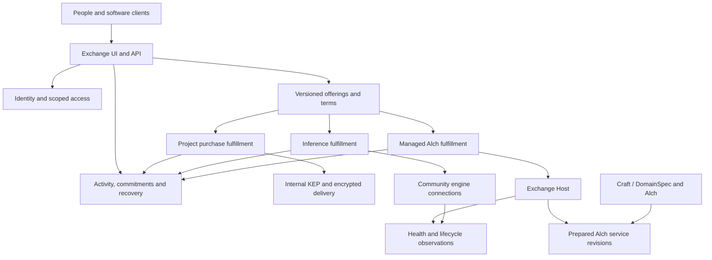

# Exchange MVP: one product, three complete journeys

Status: proposed product design, 2026-09-13. Owner: Exchange product owner.
Inputs: [product thesis](../../PRODUCT-THESIS.md), [selected offerings](../../OFFERINGS.md).
Capability traceability: [CAPABILITIES-AND-THESIS.md](CAPABILITIES-AND-THESIS.md).
Machine planning model: [plan.json](plan.json). No runtime implementation is performed here.

## The whole-product outcome

A provider can make an offering usable through Exchange, and an independent customer
can discover it, understand its terms, obtain the promised access or execution, and
recover after interruption. Both see the relevant activity and obligations through
one coherent application and API.

That product supports three fulfillment families in the proposed first complete MVP:

- **Project access:** Lab, separately sold ARE Static/Full, and Craft + Alch.
- **Community inference:** member-operated local engines with provider-selected free or paid access.
- **Managed Alch hosting:** Exchange-operated execution of a customer's submitted Alch source.

The catalog can contain the selected offering types without pretending unfinished
packages are ready to buy. Only an exact usable package or supported service is
published as available. ARE source consolidation remains work on the ARE offering,
not a substitute for building the Exchange product.

## Application structure

| Workspace | What the participant can accomplish | Capabilities |
| --- | --- | --- |
| Explore | Find projects, inference and managed hosting; inspect version/edition, price or free status, access requirements and availability | C02/C03 |
| My activity | Inspect purchases, requests, hosting agreements, costs, receipts and unresolved operations; resume permitted recovery | C04–C08 |
| My projects | Access acquired project versions and their stated entitlements; download/decrypt and recover delivery | C04/C08 |
| My services | Submit Alch, inspect builds, activate, invoke, observe usage, manage revisions and terminate hosting under its terms | C06/C07 |
| Provider workspace | Publish project offers, connect inference engines, set free/paid terms and access limits, inspect usage and actual settlement | C02/C05/C07 |
| Account and access | Establish identity, memberships, application permissions and explicit wallet bindings when needed | C01 |
| Operator workspace | Observe Exchange and fulfillment health; handle lifecycle, reconciliation and recovery incidents within operator scope | C08/C10 |

These are views of shared contracts, not separate products. One participant can
be buyer, provider and hosting customer. Operator permissions do not follow merely
from being a provider. People and software clients use the same domain operations
through C09; client-side signing/decryption remains where the existing security
model requires it.

## Product structure and implementation responsibilities

The boxes are responsibility boundaries, not a mandate for separate microservices.
A proposed first application can compose existing modules behind one product API.
Avoid a premature forced database merge: each fulfillment runtime retains authority
for its own state. The common activity view references those facts and cannot turn
an HTTP success into payment finality, engine availability or decryption proof.

Exchange owns the host experience and its managed hosting service. Community
providers retain operation of their local engines. Generic Alch/compiler contracts
and Auth Foundation keep their existing source owners. Moving all code into one
folder would not establish this composition or its correctness.

## Journey 1: publish and buy an exact project

1. Seller chooses a package manifest, product, version and edition, and declares the exact sale terms.
2. Exchange validates the offering's references and publishes an immutable listing revision.
3. Buyer reviews what is included and establishes the required identity/wallet bindings.
4. Buyer accepts that revision's terms and funds the project-purchase escrow.
5. Seller and Exchange prepare exact KEP access; buyer invokes Unlock.
6. The successful chain transaction grants membership, transfers payment and commits the order atomically.
7. Buyer retrieves ciphertext/envelope, decrypts locally and automatically records the acknowledgement.
8. My activity exposes the actual commitment and delivery state. Interrupted post-commit delivery resumes; pre-commit expiry follows the refund path.

ARE Static and Full must resolve to distinct exact deliverables. A buyer's edition
must not be inferred from a display label or changed when a new edition is published.
License/update/support terms and any relationship to hosting are explicit. A
project purchase creates no automatic right to invoke somebody else's engine.

## Journey 2: share or sell local inference

1. A community member connects a supported engine through the selected connection pattern.
2. The provider publishes its public model capabilities, allowed access, limits, availability expectations, and free or paid terms.
3. An independent caller discovers the offering and reviews its access, request-data and cost conditions.
4. For a free request, authorization and usage limits apply without a payment obligation. For a paid request, the selected price/budget and settlement contract must be accepted before chargeable work.
5. Exchange authorizes, validates and routes the request; the engine produces JSON or SSE output.
6. Exchange records attempt and usage provenance. Payment obligations, where applicable, follow the chosen contract rather than being inferred from a token counter.
7. The caller and provider see their own activity. Disconnect, timeout or unavailable engine produces a bounded outcome and the permitted recovery action.

A local same-machine fixture is useful construction evidence. The community journey
also needs an independently operated provider/caller test through the selected
network topology. A private model does not imply that prompts are invisible to its
provider; data handling must be explicit. No automatic network exposure is granted.

## Journey 3: buy managed Alch hosting

1. Customer selects a hosting plan and submits a supported Alch file.
2. Exchange validates the declared profile, dependencies, limits and bindings, then records a source/build revision and diagnostics.
3. Customer supplies permitted configuration and secret references and reviews the hosting terms. Source submission/build never silently activates a service.
4. Exchange prepares the revision; the customer explicitly activates under the selected agreement.
5. Exchange supplies the callable endpoint and scoped access. The customer invokes it through API or UI.
6. My services reports selected revision, actual health, observed usage, charge state and lifecycle controls separately.
7. The customer can perform supported updates or request drain/restart, with preservation of state governed by the contract.
8. Termination has an explicit execution cutoff, charge cutoff and retention/deletion outcome. Uncertain completion remains visible until reconciled.

The first supported profile may be deliberately bounded. Arbitrary files, arbitrary
network access, unlimited execution, scale-to-zero, elasticity and unrestricted
state migration are not inherited from the word serverless. The customer promise
is that Exchange operates the service; the supported guarantee must be tested.
A Craft + Alch purchase is not assumed to be a prerequisite or an included hosting credit.

## Shared logical contracts

The shared contracts are proposed design inputs, not new admitted definitions or
current API schemas. Exact fields and constraints must go through the selected
Define/Alch/DomainSpec construction chain before implementation.

| Contract | Why it is shared | What stays specific |
| --- | --- | --- |
| ParticipantBinding | A coherent account/access context across Exchange | Wallet and KEP links, tenant actions and operator grants |
| OfferingRevision | Stable discovery and selection | Project manifest, engine capability or hosting plan |
| TermsRevision | A participant can understand and pin what they accept | Free/paid mode, price unit, deadlines, failure policy and deliverable |
| ProjectPackage | Exact product, version and edition | Lab, ARE Static/Full, Craft + Alch contents and rights |
| EngineOfferingBinding | Connect a public offering to a controlled engine | Private endpoint/secret, supported protocol and access limits |
| HostingAgreement | Track ongoing managed service obligation | Profile, deployment/revision, storage, limits and charge/termination rules |
| OperationRecord | Correlate requests, retries and activity | Purchase, inference attempt and hosting lifecycle state machines |
| UsageAndSettlement | Explain costs without confusing observations with money | Type-specific meter, obligation, ledger and finality |

Minimum invariant: an accepted operation retains its actor/scope, exact offering
and terms revision, and relevant fulfillment identity. A terms edit never mutates
an existing purchase or accepted paid invocation. Free offerings cannot fall into
an implicit paid path. Inference and hosting settlement mechanisms remain decisions;
project purchase's Solana implementation does not silently select them.

## API surface as domain operations

Proposed operations, with transport paths/schema design left to construction:

- establish participant context and inspect scoped permissions;
- create/revise/publish an offering and list/get eligible offerings;
- create/inspect a project purchase, fund, prepare, Unlock, retrieve and acknowledge;
- register/check/enable a controlled engine binding and invoke inference;
- submit source, inspect build, prepare/activate a revision, inspect/control/terminate hosting;
- inspect usage, obligations, settlement receipts and recoverable activity.

Domain operations use stable identifiers and declared idempotency where applicable.
Read projections never initiate engine work, a charge or a deployment. Domain errors
must distinguish rejection, in-progress, terminal outcome and uncertainty. Existing
routes may be retained through compatibility bindings; this plan does not rename them.

## What makes this the Exchange MVP

One exact installed candidate must complete all three journeys through the common
application and API, including independent actors, denied access, restart and
uncertain outcomes. Evidence must identify which cases use fixtures or Devnet.
A working project-purchase script alone, a mock catalog alone or a working host
alone does not meet that whole-product acceptance.

A commercial pilot additionally needs real offered package bytes, selected paid
contracts, suitable isolation, authorized deployment, and the relevant delivery
correctness requirements. If a blocker requires a narrower pilot, record an explicit
scope decision rather than reporting the omitted capability as complete.

## Open Questions

[OPEN-QUESTIONS.md](../../OPEN-QUESTIONS.md) owns the unresolved decisions. The
immediate design blockers are identity binding (Q3), paid inference terms (Q4),
community access/connectivity (Q14/Q15), and hosting scope/charges (Q17/Q18).
Q5 blocks real-money project sales; Q19/Q20 govern ARE's deliverables, not creation
of the Exchange core. See the [roadmap](ROADMAP.md) for exact affected stages.
