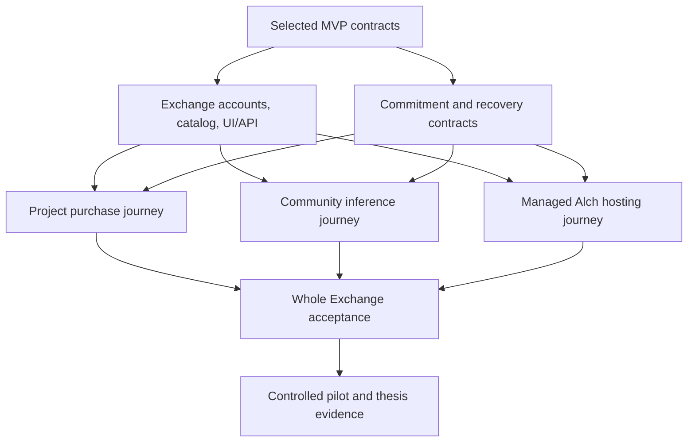

# Build the Exchange product

Status: proposed successor roadmap, 2026-09-13. Owner: Exchange product owner.
This supersedes the earlier generic sequencing for the selected MVP scope.
Machine graph: [plan.json](plan.json). This is not admitted Goals execution state.

## Current frontier

The product design and capability-to-thesis map are prepared for review. M0 is the
current product frontier: settle the exact common contracts and supported host
composition. The first implementation milestone is **Exchange itself**—participation,
catalog and coherent workspaces—not an isolated Lab listing or a new engine adapter.

| Milestone | Deliverable | Acceptance |
| --- | --- | --- |
| M0 | Exact MVP identity, offering, terms, host and fulfillment contracts | Selected semantic decisions, examples and counterexamples; unresolved dependencies cannot be guessed |
| M1 | One Exchange UI/API with participant access and persisted provider/catalog workflows | Independent actors publish/discover representative project, inference and hosting offerings; private data stays private |
| M2 | Commercial commitments and activity/recovery contracts | Free/paid, idempotency, metering, unknown outcome and termination cases executable against fixtures |
| M3 | Project purchase integrated into Exchange | Exact edition/version purchase, atomic commitment, decryptable delivery and restart recovery with valueless tokens |
| M4 | Community inference integrated into Exchange | Independent engine provider/caller, free and paid-contract paths, availability, JSON/SSE, limits and recovery |
| M5 | Paid managed Alch hosting integrated into Exchange | Submit → build → explicitly activate → call → observe usage/cost → recover → terminate |
| M6 | One frozen, tested Exchange candidate | All three journeys, current authorization, isolation negatives, API/UI parity, overload, restart and reconciliation |
| M7 | Controlled live pilot and product-value assessment | Exact deployments and participating users; measured setup effort, first use, failed fulfillment/recovery, repeat use and payment outcomes |

M1 and M2 can progress independently after their M0 decisions. M3/M4/M5 are
independent integration branches once the relevant shared contracts exist. This
DAG describes work dependencies, not authorization to deploy background agents.

## Reuse and construction gates

Reuse the existing host lifecycle and revision controllers; generated inference
service and Auth Foundation bindings; KEP and atomic purchase runtime; client
crypto and recovery logic. Keep source and version bindings explicit.

For each new or changed slice, carry the D65 chain: prototype meaning → product
capability → business ontology → Alch/DomainSpec authored source → compiled graph
and system ontology → exact implementation candidate → product tests → owner
product review. Existing records support only their exact predecessors. New planning
IDs compose inventory slices; they do not register canonical capabilities.

Generic language/compiler capabilities remain shared dependencies. Exchange-specific
adapters and screens consume them. Construct missing semantics through Alch/DomainSpec
where applicable; native adapters supply transport, clocks, secrets and storage.
No newly hand-authored map is described as compiler output.

## Runnable product work next

Prepare M0's concrete contract examples together: a Lab purchase, ARE Static versus
Full package selection, a free inference request, a paid inference request, and
an Alch hosting activation/termination. Bind each to its exact participant,
offering, terms, fulfillment and evidence identities. Select one supported host
profile for those examples.

Then implement M1's application and catalog alongside M2's agreed contract cases.
Use deterministic engines and valueless settlement for local construction. Fixtures
must be labeled and cannot authorize a charge or prove a real offering is ready.

## Operational tasks and exact blockers

| Task | Owner | Affected stage | Causal boundary |
| --- | --- | --- | --- |
| Paid inference/hosting rules | Commercial owner | M2, M4, M5 | Price units, meters, budget, failure and termination semantics must exist before paid acceptance |
| Host profile and execution boundary | Host owner | M0, M5, M7 | Supported source and isolated execution required before exposing customer code |
| Member connectivity and request-data terms | Host/provider owners | M4, M7 | Independent caller/provider topology and access/data controls required for community proof |
| Project versions and ARE editions | Offering owners | M3, M7 | Fixtures permit core development; real sale requires an exact releasable package and entitlements |
| Devnet funding, key custody, executor and fee ceiling | Deployment operator | M7 | Fresh exact preflight and deployment authorization before chain submission |
| Invalid-envelope correctness | KEP/security/product owners | M7 real-money project sales | Existing local tests do not prove correct plaintext before commitment |
| Live issuer, ingress, backup and retention | Identity/platform operators | M7 | Required for the chosen protected environment and operational guarantees |

The target pilot need not be blocked by unrelated future infrastructure. It is
blocked by any missing prerequisite of its actual exposed behavior. In particular,
real-money project sales cannot proceed under a blanket “local tests passed” claim.
September 8 balance and engine receipts are historical and need fresh verification
when the relevant live stage is selected.

## Deferred residue

General offering-type extensibility, a validator/reputation/dispute network,
multi-host global consistency, arbitrary Alch execution, unproven elasticity,
scale-to-zero and automatic engine improvement adoption remain outside this MVP.
ARE consolidation is a separate offering workstream; it must deliver valid Static
and Full packages before those editions can be sold. Paid inference and paid Alch
hosting are **inside** this proposed MVP; their missing contracts are visible work.

## Open Questions

The [existing question register](../../OPEN-QUESTIONS.md) owns decisions. M0 reviews
Q1/Q11 as release scope and Q2/Q3/Q4/Q14/Q15/Q17/Q18 as affected contracts. A narrower
commercial pilot requires a specific amendment; it cannot silently omit a selected
paid offering and still claim completion of this whole MVP.
