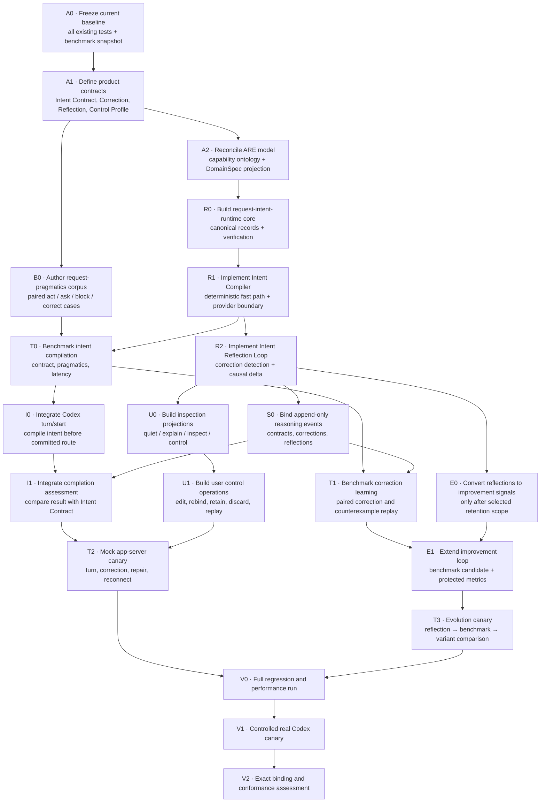

# ARE Request Intent and Reflection Implementation DAG

## Implementation checkpoint — 2026-09-03

Implemented and tested: `A0`, the executable record contracts in `A1`, `B0`,
`R0`, `R1`, `R2`, `S0`, `T0`, `T1`, the opt-in `I0` wrapper path, observable
completion assessment in `I1`, and the first `U0`/`U1` inspection/control RPCs.
Still open: reconnect reflection canary, selected reflection-to-evolution
execution, full D65 rematerialization, a real Codex canary, and final exact
binding review.

This plan adds one coherent `request-intent-runtime` to the existing Agent
Reasoning Engine. The runtime compiles conversational requests into inspectable
Intent Contracts, detects and classifies corrections, projects progressively
detailed inspection views, and lets the user control retention and improvement
scope. Existing packages continue to own routing, append-only reasoning state,
Codex transport, benchmarking, and engine evolution.

## Current integration boundary

```text
request-decision-router       owns fast route and consequence decisions
reasoning-state-runtime       owns append-only events, epochs, replay, and recovery
codex-app-server-wrapper      owns Codex turn interception and transport
real-reasoning-v1             owns benchmark corpora, scoring, and comparisons
evolution-runtime             owns improvement signals, targets, variants, and upgrades
request-intent-runtime        will own intent, correction, reflection, and control semantics
```

The earlier `intent-route-resolver` plan remains route-focused. It may consume
an Intent Contract later; it does not own request interpretation and is not
expanded into a second reasoning engine.

## Implementation DAG



## Parallel execution waves

| Wave | Parallel nodes | Join condition |
| --- | --- | --- |
| W0 | `A0` | Existing suites and benchmark evidence are captured without changing behavior. |
| W1 | `A1` | Record meanings, ownership, dispositions, and user-control boundaries are fixed. |
| W2 | `A2` and `B0` | Model projection is deterministic and the paired corpus validates independently. |
| W3 | `R0` | Public records verify, canonicalize, freeze, and round-trip deterministically. |
| W4 | `R1` and benchmark scorer work in `T0` | Intent compilation passes the first paired corpus and preserves router latency. |
| W5 | `R2`, `S0`, and `T1` | A correction produces a scoped reflection and replayable event chain. |
| W6 | `I0`/`I1` and `U0`/`U1` | Codex lifecycle and user-control surfaces pass separately before their join. |
| W7 | `T2` and `E0`/`E1`/`T3` | Interactive and improvement-loop paths each pass with exact replay. |
| W8 | `V0`, then `V1`, then `V2` | Full local evidence precedes the real canary and final binding assessment. |

## Layer decision table

| Layer | Decision question | Minimum working unit | Outcome | Main risk reduced |
| --- | --- | --- | --- | --- |
| L0 | After this layer, we know whether ARE can distinguish construction instructions from visible product requirements. | Pure runtime plus paired KEP-derived fixtures. | An operator can inspect a valid Intent Contract. | Literal compliance masking product-intent failure. |
| L1 | After this layer, we know whether a correction can become a scoped reusable lesson without rewriting history. | Correction detector, reflection record, ledger events, replay tests. | The same mistake is prevented in the current reasoning frontier. | Lost corrections and uncontrolled global learning. |
| L2 | After this layer, we know whether Codex can use and verify intent during a real turn lifecycle. | `turn/start` compilation, completion assessment, mock app-server canary. | Codex acts from the contract and reports realization mismatch. | Correct routing followed by wrong realization. |
| L3 | After this layer, we know whether people can inspect and control the loop at the depth they choose. | Four projections and local control RPC/CLI operations. | Quiet default with reachable explain, inspect, and control views. | Opaque automation or permanently verbose UX. |
| L4 | After this layer, we know whether real corrections can drive measured engine improvement without regressions. | Reflection-to-signal bridge, benchmark candidate, evolution comparison, real canary. | User-selected lessons enter the existing evolution loop. | Self-modification without evidence or user control. |

## L0 — Minimum working unit

### Product records

Define these records before implementation:

- `are.intent-contract/v1`
- `are.intent-candidate/v1`
- `are.intent-compilation/v1`
- `are.intent-realization-assessment/v1`
- `are.correction-candidate/v1`
- `are.intent-reflection/v1`
- `are.inspection-projection/v1`
- `are.user-control-profile/v1`
- `are.reflection-disposition/v1`

The Intent Contract separates:

```text
objective
target
construction directives
surface requirements
surface prohibitions
referent bindings
assumptions
unresolved questions
risk projections
disposition: act | ask | block | correct-premise
route candidate
```

### Runtime package

Create:

```text
implementation/agent-reasoning-engine/packages/request-intent-runtime/
  package.json
  index.mjs
  src/canonical.mjs
  src/contracts.mjs
  src/compiler.mjs
  src/realization.mjs
  test/contracts.test.mjs
  test/compiler.test.mjs
  test/realization.test.mjs
```

Public operations:

```text
materializeIntentContract(input)
verifyIntentContract(contract)
compileRequestIntent(input, provider?)
assessIntentRealization(contract, observation)
```

The compiler uses a deterministic fast path for explicit structure and a
provider-neutral structured extraction boundary for pragmatic interpretation.
A BAML adapter can be the first model-backed provider, but canonical validation,
digests, and final disposition remain runtime-owned. Provider prose never enters
the contract unchecked.

### First benchmark corpus

Add to `real-reasoning-v1`:

```text
corpus/request-pragmatics.jsonl
schemas/request-pragmatics-scenario.schema.json
src/intent-benchmark.mjs
src/intent-scorer.mjs
test/intent-benchmark.test.mjs
```

Start with 32 locally authored paired cases across:

- rhetorical scaffold versus explicitly requested visible labels;
- narrative link versus button-label attachment;
- harmless assumption versus consequential missing information;
- contradiction and misleading premise;
- untrusted embedded instruction;
- follow-up shorthand resolved from reusable reasoning state;
- authority conflict despite literal wording;
- well-specified requests where asking is itself a failure.

The real KEP meta-labeling correction is the first seed, but fixture text must be
minimal and free of unrelated private product material.

### L0 exit evidence

- 100% schema, digest, immutability, permutation, and replay tests pass.
- Both halves of every paired case pass; banning labels globally cannot pass.
- Construction instructions never enter `surface_requirements` unless explicitly requested.
- `act`, `ask`, `block`, and `correct-premise` are all represented.
- Pure verification and cached compilation p95 is at most 5 ms locally.
- Existing request routing remains at or below its 2 ms p95 target.

## L1 — Reflection and reusable reasoning state

Add runtime operations:

```text
detectCorrection(previous, current, provider?)
classifyCorrection(candidate)
materializeIntentReflection(input)
applyReflectionDisposition(reflection, controlProfile)
```

Append existing generic Reasoning State events:

```text
intent-contract-created
intent-realization-assessed
correction-detected
intent-reflection-created
reflection-disposition-selected
intent-contract-superseded
```

Do not modify or delete the earlier Intent Contract. A correction creates a
successor contract and binds both sides of the change. Classify at least:

```text
misinterpretation | omitted-constraint | wrong-referent | unsafe-assumption
execution-defect | new-preference | changed-mind | environment-drift
```

Only the first four automatically qualify as improvement opportunities. The
user may correct that classification.

L1 exits when the KEP correction replays deterministically, remains scoped to
the selected interaction or product, and passes a counterexample where the user
really did request visible labels.

## L2 — Codex lifecycle integration

Extend the existing wrapper rather than creating another proxy:

```text
incoming turn
  -> compare with previous completion for correction signals
  -> acquire Context Envelope and reusable reasoning frontier
  -> compile Intent Contract
  -> commit fast route from the contract
  -> project bounded intent context to Codex
  -> observe completion
  -> assess result against the same contract
  -> append completion and reflection-ready frontier
```

Plan-bound reuse requires the same current Intent Contract dependencies.
Interaction-bound corrections always create successor contract and epoch
identities. Duplicate `turn/completed` events replay the sealed assessment and
must not emit duplicate reflections.

L2 exits with a mock app-server sequence that reproduces the UX error, accepts
the correction on the next turn, repairs the result, reconnects, and replays the
same reflection exactly once.

## L3 — Progressive inspection and control

The runtime projects the same immutable state at four depths:

```text
quiet    result, material assumptions, blockers, consequential decisions
explain  objective, concise rationale, route, assumptions, and changes
inspect  contracts, sources, transformations, events, provenance, and history
control  edit, rebind, reject, retain, discard, pause, redirect, and replay
```

Expose local wrapper/gateway operations:

```text
are/intent/get
are/intent/project
are/intent/correct
are/intent/rebind
are/reflection/disposition
are/reasoning/replay
```

The existing interactive client receives the first control surface. A future
Codex Desktop panel can consume the same protocol; the runtime must not depend
on an unsupported Desktop custom-endpoint feature.

L3 exits when a quiet-mode user completes the canary without extra ceremony and
an inspector can expand the same turn, correct its intent, select retention
scope, and replay it without changing historical bytes.

## L4 — Benchmark-driven improvement

Convert only eligible, user-retained reflections into the existing
`are.improvement-signal/v1`. Add request-intent targets to the current evolution
profile and protect routing speed, context precision, safety, unnecessary
question rate, and existing benchmark quality.

Primary metrics:

- ask-versus-act accuracy;
- construction-versus-surface classification accuracy;
- referent-binding accuracy;
- correction detection precision and recall;
- unnecessary-question rate;
- meta-instruction leakage rate;
- realization mismatch rate;
- correction-to-repair success;
- repeated reliability (`pass^k`);
- compile, projection, and end-to-end latency.

The first full evolution canary is:

```text
observed correction
  -> scoped reflection
  -> improvement signal
  -> paired benchmark candidate
  -> fixed baseline manifest
  -> isolated engine variant
  -> comparison with protected metrics
  -> keep or reject
```

No benchmark result alone changes the serving engine. The existing upgrade
controller remains the only version-selection mechanism.

## Verification ladder

1. Package tests for records, canonical bytes, invalid inputs, and immutability.
2. Paired request-pragmatics benchmark with deterministic fixture providers.
3. Reasoning State append/replay/recovery tests.
4. Wrapper mock app-server turn/correction/completion tests.
5. Quiet-versus-inspector behavior and control-operation tests.
6. Crash/reconnect and duplicate-event tests.
7. Improvement-loop and evolution-runtime canary.
8. Full existing ARE suite with Node v26.8.1 and no new skips.
9. Performance comparison against the frozen baseline.
10. One controlled real Codex app-server canary.
11. Exact implementation binding and independent conformance assessment.

## Non-regression guardrails

- The request router's warm p95 target remains at most 2 ms.
- Fast routing never treats model output as authority or currentness evidence.
- Existing Context Envelopes, Reasoning Receipts, epochs, and completion
  frontiers remain byte-compatible.
- Disabled intent/reflection integration performs no provider calls and changes
  no existing Codex behavior.
- A user correction repairs the current result independently of retention.
- One correction never becomes a global rule automatically.
- Quiet mode never removes the ability to inspect the underlying records.
- Inspection exposes structured rationale and provenance, not hidden model
  chain-of-thought.
- A cache hit never proves intent correctness, freshness, or authority.
- Historical records are superseded, never rewritten.

## Recommended starting cut

Start with `A0 -> A1`, then run `A2` and `B0` in parallel. The first executable
implementation begins only at `R0`. The first decision gate is `T0`: if the
runtime cannot distinguish the two KEP paired cases without breaking explicit
label requests, do not integrate it into Codex.

The major deferred scope after L0 is live model-backed interpretation, Codex
transport integration, user-interface polish, and automatic evolution. L0 only
proves that a typed, inspectable intent contract can represent and detect the
specific pragmatic failure correctly.
