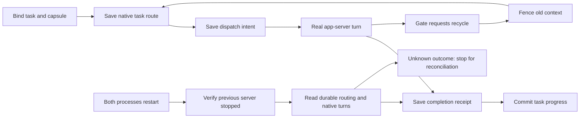

# Real app-server recovery candidate

Private CyberAlchemy-v2 product construction, selected through CA2-ROUTE-IMPLEMENT.
Definitions and ontology scaffolds are navigation prototypes; no operational authority is asserted.

| Lane | Work | Owner | Affected stage | State |
|---|---|---|---|---|
| Product construction | Durable coordinator route and real RPC adapter | Current task | Implementation prototype | Runnable |
| Product construction | Opt-in ConfigToml gate and generated schema | Current task | Compiled-system prototype | Runnable |
| Product construction | Offline dual-process crash and replay checks | Current task | Product test | Depends on binary build |
| Operational support | Live Luna usage envelope | User | No construction stage | Deferred |
| Operational support | Installed host activation | Host integrator | No construction stage | Deferred |
| Operational support | Publication and release | Source owners | No construction stage | Deferred |

No operational item blocks the offline construction frontier. There are no paid model calls in this plan.

The candidate extends five source patches from codex-native-receipts-v1. Its new Rust patch only exposes the existing generic gate configuration; private product prose stays in this package. The standard app-server protocol remains unchanged.

Open Questions are recorded in CONTRACT.json. Test results and the final runnable frontier are in TEST-RECEIPT.json and PROGRESS.json; planning itself supplies no PASS or approval.
