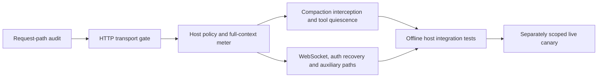

# Codex host gate prototype

This candidate adds an opt-in gated transport to an isolated pinned Codex HTTP crate. It is a transport primitive, not a completed ARE-to-Codex integration. No existing host call site selects it.

The transport prepares one immutable request, awaits a bounded asynchronous decision and passes the same request to the HTTP client. Denials and gate timeout become sanitized Build errors. Its dedicated client disables redirects, internal retries, ambient proxies and request logging. It rejects compressed input because prepared wire bytes may not retain the logical request. These constraints make this a bounded construction prototype; it must not replace the host's proxy/TLS policy without integration work.

The callback must supply a real context policy. No production token meter, output-limit enforcement, durable ARE handshake, global reservation accounting or fresh-context handover is implemented here. A successful local test cannot establish that native compaction will never occur.

## Measured result

The seven new gate tests passed over real loopback HTTP. The patched crate ran 99 tests: 93 passed and six failed. The unchanged upstream baseline ran 92 tests: 86 passed and the same six TLS classification/fallback tests failed. The root cause is unresolved; the full crate suite is FAIL. Build and exact patch replay passed. There were no live model calls.

## Construction frontier

| Lane | Work | Owner | Stage | State |
|---|---|---|---|---|
| Product construction | Isolated HTTP gate and loopback tests | Current task | Implementation/product test prototype | See TEST-RECEIPT.json |
| Product construction | Wire full-context ARE decision and model limits into host | ARE host integration | Implementation prototype | Next runnable work |
| Product construction | Intercept compaction, settle tools, cover WebSocket/fallback/auxiliary paths | ARE host integration | Implementation prototype | Required before full-host claim |
| Operational support | Install isolated build/test tools | Current task | No product stage | Local setup only |
| Operational support | Repository-wide formatting from archive | Upstream checkout maintainer | No product stage | Git metadata absent; targeted Rust formatter used |
| Operational support | Paid Luna canary | User and test operator | Live evidence | Deferred; prior allowance exhausted |
| Operational support | Installed host activation | User and host owner | Activation | Deferred; product not approved |

No operational residue blocks independent prototype work. The source revision has not been established as the installed binary's revision. The predecessor HTTP and runtime recycling packages remain historical, unchanged evidence.

## Reproduction

Fetch the exact revision in SOURCE-BINDING.json and verify the archive digest. From its root, apply `patch -p1 < transport-gate.patch`, then run `RUSTUP_TOOLCHAIN=1.94.1 just test -p codex-http-client`. The recorded build uses installed Rust 1.94.1; upstream declares 1.95.0, so this is not certification of the upstream required toolchain or full workspace. No Cargo dependency or lockfile changes are included.

## Open Questions

- Which host boundary exposes complete logical input, effective model limits and pending output reservations together?
- How will gate denial halt the outer sampling loop without an implicit retry?
- How will native tools reach a safe checkpoint before fresh-context handover?
- How will host proxy, TLS and credential behavior be retained?
