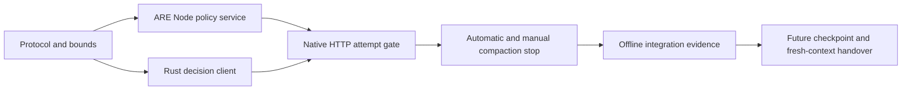

# Host policy bridge plan

Product frontier: connect the tested transport primitive to ARE decisions and native compaction interception.

| Lane | Task | Owner | Stage | Dependency / status |
|---|---|---|---|---|
| Product construction | Protocol, ARE service, Rust client | Current task | Prototypes | Runnable now |
| Product construction | Host transport and compaction wiring | Current task | Implementation prototype | Protocol |
| Product construction | Loopback and native host tests | Current task | Product test | Wiring and build prerequisites |
| Operational support | Rust 1.95 and upstream dependencies | Current task | Native test environment | Build prerequisite only |
| Operational support | Existing TLS baseline failures | Upstream compatibility owner | Regression evidence | Visible residue; independent construction continues |
| Operational support | Git-dependent global formatter | Checkout maintainer | No product stage | Archive lacks metadata; scoped formatter fallback |
| Operational support | Paid Luna test | User and test operator | Live evidence | Deferred, no renewed allowance |
| Operational support | Host activation | User and host owner | Activation | Deferred, not product-approved |

Exact mutation scope: this new private package and the Codex source files announced in the task. Preserve predecessor packages. No default activation or production credentials. Automatic context handover is a successor stage, not implied by a stop result.

## Open Questions

See CONTRACT.json. Unknown model bounds remain fail-closed. If native host tests cannot build, record their exact causal blocker separately from executed transport/bridge tests.
