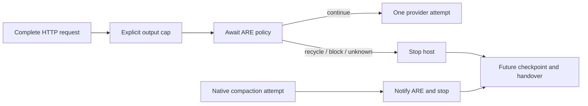

# ARE to Codex offline host policy integration

This candidate connects an ARE budget-policy service to an opt-in native Codex request path. It also intercepts automatic and manual native compaction before execution. A recycle decision stops the host; automatic checkpointing and fresh-context resumption are not implemented here.

The implementation changes the real session ModelClient construction, its common HTTP transport factory, WebSocket/compression selection, and the native automatic/manual compaction entry points. The feature is selected only through the programmatic `Config.experimental_context_gate` field. It is not a desktop setting, app-server API extension, or installed host activation.

The prototype accepts only literal loopback provider URLs. The dedicated transport cannot substitute for production proxy/TLS behavior. Auxiliary endpoint paths are rejected, rather than implicitly covered by the normal Responses path. The existing standard transport remains the default.

## Verification

See TEST-RECEIPT.json for executed tests and limits. Rust-to-Node tests use the actual policy service and compiled native transport probe against a local HTTP server. Native host tests use Codex TestCodexBuilder with automatic environment selection, temporary homes, synthetic auth and mocked HTTP peers. Their policy peer speaks the same protocol but does not itself execute the Node service. An additional explicitly selected native canary uses the real Node service and a mocked provider within one Codex task. These are distinct test surfaces.

No paid model call is required. All budget measurements in these tests are synthetic; no reliability, cost improvement, live Luna token bound or never-compaction guarantee is established.

Executed results: **8/8 native checks** and **11/11 Rust-to-Node bridge checks** passed. The HTTP suite passed **95/101**, with the same six TLS failure names present in the previous unchanged-source baseline. Scoped Clippy passed with one warning in an unchanged test. Patch replay and all 11 source postimage hashes verified. Global formatting and automatic fixes could not run because the isolated source archive has no Git metadata.

## Reproduction

Use the pinned revision and exact patch chain in SOURCE-BINDING.json. The upstream toolchain is Rust 1.95.0. Commands from the upstream root:

- `just test -p codex-core context_gate`
- `just test -p codex-http-client`
- `cargo build --manifest-path codex-rs/Cargo.toml -p codex-http-client --example context_gate_probe`

Run `node host-canary.mjs` with `ARE_CODEX_SOURCE` and `ARE_JUST_BIN` set to the isolated source root and installed `just`, with `cargo-nextest` on PATH. It runs the scoped native checks, including the otherwise ignored real-peer test.

Then run `node --test bridge.test.mjs` from this package with `ARE_HOST_GATE_PROBE` pointing to the built probe executable. `startDecisionService` requires an explicit scope, checkpoint reference, state digest, model profiles and output cap. No command here accesses a production login or invokes a real model.

## Construction and operational work

PLAN.md contains the construction DAG and separate operational lane. Current product work is the offline decision bridge and host stop path. The successor is a durable checkpoint and fresh-context handover. Live testing and activation remain deferred; pre-existing TLS failures and global formatting prerequisites do not hide runnable product construction.

## Open Questions

See PROTOCOL.md and CONTRACT.json. Source-path coverage, executed offline tests, live model conformance, product approval and host activation are separate claims.
