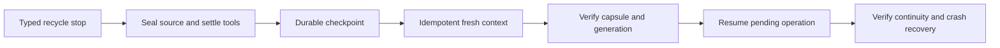

# Offline recovery construction plan

Product construction frontier: automatic recovery supervisor plus offline native integration. Runnable now: journal, operation reconciliation, generation sealing, exact capsule restoration, repeated recycling and crash tests. Required selected source bytes: prior recycling-v1/recycling.mjs, its canonical.mjs dependency, codex-host-policy-v1 decision service and the pinned isolated native source binding. These are prototype dependencies; no registered ontology selector is an admission dependency.

The next product-construction frontier is durable native-host operation lookup and typed app-server recovery routing. Its prototype work is runnable without live credits. Live meter conformance and a bounded Luna product test remain subsequent construction validation.

Operational support is separate. Renewed usage authorization is owned by the user and is an exact prerequisite only for paid testing. TLS baseline diagnosis is owned by transport compatibility work and affects broad regression validation. Installed-host activation belongs to a separate post-product-approval decision. All remain deferred and do not block the offline construction frontier.

## Open Questions

See CONTRACT.json. This package creates test checkpoints, not admitted CyberAlchemy repository session lifecycle artifacts.
