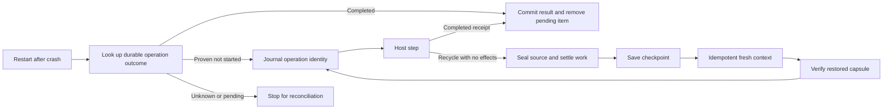

# ARE offline checkpoint and recovery supervisor

This prototype runs a bounded logical task across fresh host contexts. ARE can stop a provider request, the supervisor seals the source generation, checkpoints the complete structured task state, stages a fresh context, and resumes pending work. It does not activate ARE in the installed desktop task.

## Implementation and trust boundary

`supervisor.mjs` owns the state machine. `store.mjs` uses an exclusive Linux kernel `flock`, atomic rename, file fsync and directory fsync. A killed parent closes the lock-holder pipe; recovery never guesses whether a PID is stale. Temporary interrupted writes are ignored because only the atomically replaced checkpoint is read. Checksums detect corruption, not malicious edits by a store owner. The store is an explicitly selected private local directory on Linux, not an arbitrary hostile or shared-network filesystem.

An adapter provides `open`, `step`, `lookup`, and `seal`. `open` must be idempotent by handover identity and attest exact capsule restoration into a different native context. `lookup` must use durable host evidence: a timeout or a missing in-memory response is not proof that an operation did not execute. `seal` must prevent all further source dispatch and report zero pending and uncertain operations. Registration of callbacks does not prove these guarantees.

The journal is written before calling the host. Result commitment and removal from pending work are one atomic update. Recovered completions are committed without repeating their actions. Only a bound recycle receipt with both `provider_sent: false` and `effects_started: false` can start handover. Generic errors, uncertain outcomes and started tools do not trigger automatic replay. Recycle count is bounded. State capsules preserve objective, constraints, completed and pending work, facts, lessons and evidence, with a 64 KiB hard cap; an oversized result or capsule blocks without truncating it. The native fixture applies an additional 4 KiB capsule cap.

Caller state and adapter callback identities are snapshotted. Completion, lookup, sealing and staging receipts bind operation/context/generation or handover/capsule identities. A retired context cannot become a successor. Cancellation is checked before the next effect; this prototype does not forcibly terminate an already running host operation.

## Evidence surfaces

The crash suite kills the actual supervisor process at journal and handover boundaries. Its durable fixture host models transactional local tool effects and lookup. These tests exercise supervisor crash recovery; they do not establish exactly-once execution for arbitrary external tools or hardware power-loss behavior.

The native canary uses three real source-built Codex contexts, the predecessor ARE policy service, and a mocked Responses provider. Native history readback verifies capsule injection before resumption; outgoing requests verify the same capsule. Each source is shut down before its successor opens. The synthetic policy meter counts assistant messages to force recycling after two completed operations per context. This is a fixture bound, not a live token estimator.

The native adapter is test-only and keeps operation receipts in memory. If that native driver disappears, lookup returns unknown and the supervisor stops. Durable native-driver restart and production app-server routing remain the next product-construction work. Crash tests with the durable fixture host and successful native handover are separate claims.

## Reproduction

Run `node --test --test-reporter=tap recovery.test.mjs` from this package. Node 26 and Linux `flock` were used. Tests create and remove their own isolated temporary stores.

Apply the predecessor patch chain and this package's `NATIVE-RECOVERY.patch` at the revision in `SOURCE-BINDING.json`. Run `node native-canary.mjs` with `ARE_CODEX_SOURCE` set to that isolated root and `ARE_JUST_BIN` set to the installed `just`; put `cargo-nextest` on PATH. The runner selects only the ignored native recovery fixture using Rust 1.95.0. No production login or live model is used.

**Executed:** 26/26 recovery tests passed, including 12 real process-kill boundaries; the native canary completed six operations with two handovers across three native contexts; 7/7 scoped host regressions passed. These are offline fixture results, not live Luna measurements.

`TEST-RECEIPT.json` records executed results and limits. `PLAN.md` keeps product construction separate from deferred operational work. This package grants no product approval, admission, activation, publication, or deployment authority.

## Open Questions

See CONTRACT.json. The next integration requirement is durable native-host operation lookup and typed supervisor routing outside the test adapter; a live tokenizer and output-bound contract are still required before a live no-compaction claim.
