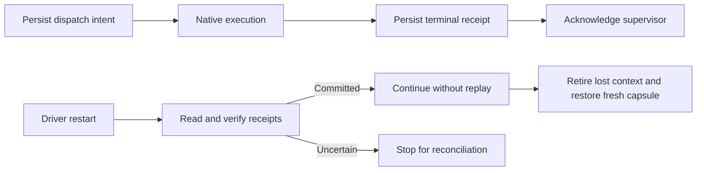

# Native receipt construction plan

Product construction frontier: native-owned persistent operation receipts, lookup, and lost-context retirement. Runnable work: receipt store, native test-driver integration, abrupt-exit tests, binding and corruption checks. Selected dependencies are the prior recovery supervisor/store and state capsule, prior policy service, and isolated pinned native source. No ontology admission selector is required.

Operational support: the source integration maintainer owns a versioned checkout for global format/fix (integration preparation); the user owns renewed usage scope for paid testing only; transport compatibility owns inherited TLS failures (broad validation); installed-host activation is a separate post-product-approval decision. These are deferred residue and do not block this offline construction frontier.

## Open Questions

See CONTRACT.json. The native adapter remains a test driver; production app-server wiring is subsequent product construction. No durable CyberAlchemy repository-session lifecycle artifact is created.
