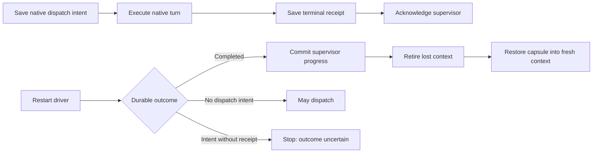

# Durable native-driver receipts

This offline candidate connects the existing ARE recovery supervisor to a native Codex test driver that persists its own operation receipts. Restarted drivers read the native journal. Completed operations are returned from that journal without dispatching them again. Lost native contexts are retired and replaced after pending outcomes are reconciled.

## Scope and implementation

The source-built native fixture owns `receipts.json`, an exclusive OS file lock, and atomic replacement with file and directory fsync. It writes dispatch intent before submitting a Codex turn and commits terminal receipts before returning them through the coordinator. Record lookup compares the full operation, including context, generation, item, and state digest. Open requests bind the full capsule and handover identity. A committed open receipt remains historical after driver exit; it does not imply the old context still exists. A subsequent operation on that lost context produces a no-effects recycle stop.

The native store refuses to seal a context with an operation that lacks a terminal receipt. The restart coordinator waits for the previous test process to exit, and the native file lock independently excludes another writer. All native execution in this fixture is confined to local mocked Responses calls. No external shell tools or production model requests are dispatched.

Native-store reads are capped at 4 MiB and serialized state writes at 2 MB. Test-runner retries are disabled so that only the explicit restart coordinator can restart a driver.

The store uses the existing upstream SHA-1 implementation strictly as an accidental-corruption checksum over an exact serialized payload. This is not a signature, hostile-store tamper protection, or an authorization claim. Store directories are private local fixture directories. No dependency or installed-host configuration changes are needed.

`driver-client.mjs` is the test-only transport. `native-host.mjs` binds supervisor operations to the native driver and the prior ARE policy service. A successful policy decision and observed provider call count classify completion; a denied request must have zero provider sends before it can be classified as recyclable. That terminal classification is persisted by the native driver before acknowledgement. A missing acknowledgement is never reconstructed from an in-memory response cache.

## Crash boundary

The native fixture intentionally calls `std::process::exit(86)` at selected boundaries. This terminates the actual driver process without Rust destructors or an acknowledgement. The harness observes its exit before starting another driver against the same journal. This is an abrupt process-exit test, not an injected Rust exception, an OS SIGKILL test, or a hardware power-loss test.

A crash after completion is observed but before its terminal receipt is committed remains uncertain. Even when the fixture audit shows a provider request happened, that audit is used only to check duplicate counts; it is not promoted into an operation-completion receipt. Unknown outcomes require reconciliation from the actual operation owner. The prototype does not promise exactly-once arbitrary external effects.

The Node coordinator stays alive while the native driver restarts. Simultaneous loss of coordinator state, host process, and remote provider evidence is outside this test. The prior package separately tested supervisor-process crashes with a durable fixture host.

## Measured offline results

| Native scenario | Observed result |
|---|---|
| Baseline | Four operations completed across one handover |
| Exit after open receipt | Four operations completed after restart, no duplicate provider sends |
| Exit after completion receipt | Saved completion recovered; four operations completed, no duplicate sends |
| Exit after seal receipt | Handover continued after restart; four operations completed |
| Exit after dispatch intent, before request | Reconciliation required; zero provider sends |
| Exit after provider response, before terminal receipt | Reconciliation required; one provider send, no retry |
| Corruption, scope drift, operation drift, competing writer | Each rejected before another provider send |

All ten native scenarios passed. The prior supervisor regression suite also passed 26/26, including its 12 actual SIGKILL scenarios. Seven scoped host regressions and final Clippy passed; Clippy retained only an unused import warning in an unchanged test. Scoped Rust formatting passed. Global formatting and automatic fixes could not run because the source archive has no Git metadata. Native receipt tests use abrupt exit code 86; those are separate crash mechanisms and evidence surfaces.

## Reproduction

Use the pinned source and ordered patches in SOURCE-BINDING.json. From this package, set `ARE_CODEX_SOURCE` to the isolated source root and `ARE_JUST_BIN` to `just`, put `cargo-nextest` on PATH, then run `node --test --test-reporter=tap native-crash.test.mjs`. The runner uses Rust 1.95.0, Linux local file locks, temporary Codex homes, synthetic credentials, a mocked provider, and synthetic budget measurements.

Intentional crash runs cause the selected native nextest subprocess to fail with the fixture's exit code. The outer tests must verify the exact fault marker and successful recovery or safe reconciliation; an arbitrary test failure cannot count as a successful crash test. See TEST-RECEIPT.json for current results. No live model credits are used.

## Construction and operations

Current construction is native receipt persistence and offline restart validation. Subsequent product construction includes production app-server integration, persistence of coordinator routing, and operation-owner reconciliation for external tools/providers. Live measurement needs a verified request meter and output contract. PLAN.md keeps usage authorization, versioned-checkout preparation, inherited TLS diagnosis, and installed-host activation in a separate operational lane.

## Open Questions

See CONTRACT.json. This candidate grants no product approval, admission, installed-host activation, publication, deployment, or durable CyberAlchemy repository-session lifecycle authority.
