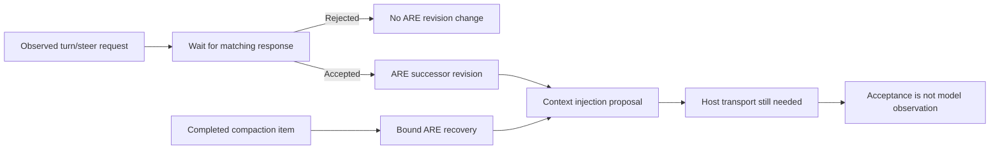

# ARE host mapping prototype

The local bridge translates app-server steering acceptance and completed compaction
items into continuity-v1 calls against the real ARE ledger. It returns native RPC
proposals; it does not open a transport, send RPCs or modify live host settings.



Evidence: 19 behavior tests passed, using the existing ledger and lifecycle.
Six payloads passed validation against JSON schemas generated from the installed
Codex binary. SOURCE-REGISTER.json records its version and provenance. Copied
protocol files are unchanged generated evidence; the TS excerpt set is not a
standalone compilation package. No live RPC or model call was performed.

The bridge checks exact thread/turn and RPC identities, rejects duplicate RPC IDs,
waits for successful steering acceptance before supersession, and preserves the
outbound user request. It currently supports one text item and one pending RPC.
Compaction completion becomes a recovery event, then a bounded developer-context
injection proposal. It does not treat compaction as user input or a new turn.

An empty correlated injection response records host acceptance only. Every result
keeps model_observed false. Terminal or compaction events racing a pending RPC
require reconciliation. External ledger drift also blocks a pending response.
Failed host turns map to interruption, never a completed learning episode.

The bridge is an in-memory integration component. Its receipts and pending RPCs
are not durable transactions. A transport must serialize events and reconcile
in-flight operations across disconnects; blindly reconstructing the bridge after
a crash is unsafe. Context injection after acceptance is not atomic with steering
or model scheduling, so this candidate cannot guarantee immediate model use.
Old input remains in host history; the bridge does not rewrite or merge the task.

Reproduce from this directory:

```sh
node --test --test-reporter=tap bridge.test.mjs
node protocol-fixtures.mjs > PROTOCOL-FIXTURES.json
python3 check-protocol.py protocol/json
```

Official interface reference: https://learn.chatgpt.com/docs/app-server
Native steering appends input within the active turn. Compaction uses completed
contextCompaction items. The installed generated schema is the version-specific
source for this candidate's message fields.

Product frontier: tested local host mapping. Next construction is durable
transport transactions and reconciliation, followed by model-free acceptance
checks. Host integrator owns future native canary and separately authorized
installation. The previous four Luna turns are exhausted; model calls here: zero.
No product approval, activation or parent-conversation integration is asserted.
