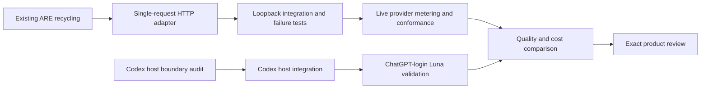

# HTTP transport beneath the ARE recycling gate

Status: locally tested candidate; no operational authority.

The existing ARE runtime exports `createHttpRecyclingTransport`. It implements
one text-only chat-completions HTTP POST beneath the existing recycling controller.
It has no redirect handling, SDK retry loop, pooled connection recovery, provider
tool execution, or hidden conversation-history reuse. The request body contains
one user message, the exact model, `max_completion_tokens`, and `stream: false`.

The token meter receives the complete serialized request. Immediately before the
POST, its result must equal the gate's reserved input bound. Endpoint, model,
measurement reference, output cap, transport limits, and any neutral secret
reference are bound into the transport identity used by checkpoint recovery.

HTTP is restricted to literal loopback addresses; remote endpoints require HTTPS.
Endpoint credentials, query parameters and fragments are refused. Optional
credentials use the existing neutral secret-provider interface; one callback can
consume at most one dispatch. Late or repeated callbacks cannot send again.
No environment or credential file is read by this module.

The deadline covers connection, response headers and body. A finite byte limit
covers declared and chunked responses. Non-200 status, compression, invalid UTF-8
or JSON, foreign model, missing usage, exceeded usage bounds, truncation, and
provider-native tool calls fail closed. Errors do not include remote response
bodies or credential material. Ambiguous requests remain blocked by the existing
recycling checkpoint; they are never automatically retried.

## Product evidence

The real loopback HTTP server receives three requests during an existing ARE
iterative run with two recycles. Tests assert that the actual received bodies
match measured bodies, retain supplied lessons, carry the output cap, and produce
an awaiting-approval patch candidate. Failure tests cover redirects, rate limits,
server errors, disconnects, stalled bodies, response-size limits, measurement
drift, usage violations, invalid model outputs, and credential callback misuse.

The server is deterministic, not a live model. Its synthetic token unit is one
serialized byte. This is not a Luna tokenizer and must not be used as a live
model token estimate. Sending an output cap and checking usage detects violations;
it does not prove that an arbitrary remote service obeys the cap. Model-specific
tokenizer, message framing, cap enforcement, and statelessness require live adapter
conformance before claiming a no-compaction guarantee.

Reproduce from the existing implementation's `packages/coding-agent-runtime`:

```bash
node --test test/http-recycling-transport.test.mjs
node --test test/*.test.mjs
```

## Construction and operational DAG



Product frontier: HTTP request control and local integration are implemented.
Runnable next: complete the pinned Codex request-boundary audit and implement
its host gate; select and validate a real provider/model meter. This adapter does
not implement ChatGPT login or replace the installed Codex host.

Operational support: host integrator owns isolated login setup at the live test
stage; the user owns a fresh bounded model allowance; runtime and desktop owners
own later activation/client integration. These remain deferred and do not block
local construction. Live validation is not evaluable until host/provider controls
and its separate usage envelope are ready. No real credentials, paid model calls,
product approval, publication or activation were used in this epoch.

## Open questions

- Which exact live model/tokenizer and framing contract will supply the meter?
- Does that provider enforce the requested cap and report full reasoning usage?
- Which pinned Codex build will cover internal compaction and retry boundaries?
- Do measured quality and cost improve against a maintained-summary baseline?
