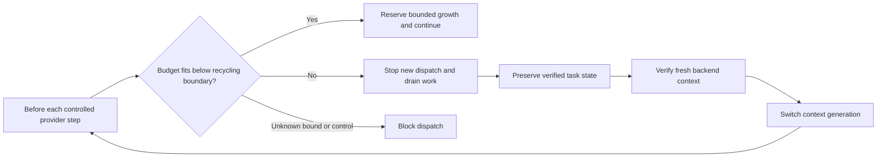

# Proactive context recycling

The user-selected target is now to recycle before native compaction. Reactive
compaction recovery is no longer the normal continuation path. Earlier test
packages remain intact as historical evidence.

## Budget contract

Current context upper bound + next input upper bound + all growth until the next
gate must be strictly less than recycle_at. recycle_at must be at or below the
verified native compaction limit minus a positive safety margin. Equality causes
recycling. Unknown or stale observations and unbounded growth block dispatch.

Checking only turn/start is insufficient: an autonomous turn can issue multiple
provider requests and gather large tool outputs. The gate must control each step
and reserve all intervening growth. Lifetime token usage, cached-token totals and
model window size alone do not establish current occupancy or the effective
native compaction trigger. No guessed live threshold is supplied here.

The tests use a synthetic 100,000-token compaction limit, an 80,000-token recycling
boundary and a 10,000-token safety margin. These are fixture values, not Luna or
Codex configuration recommendations.

## State handover

The capsule preserves the supplied objective, constraints, completed work, pending
work, facts, lessons and evidence references, bound to an exact checkpoint/state
digest. Oversized state is rejected, never silently truncated. It conveys no new
authority. Preserving supplied bytes does not establish that the supplied state
is semantically complete; extracting that state from real ARE records is still
an integration task.

A handover requires quiescent work, unchanged source route, exact capsule and
policy digests, a new context identity with fresh history, the next generation,
and a measured fresh context that fits the next reserved step. Old-generation
events are rejected after the local route switch. A native-compaction event on
the current context is an invariant violation and blocks continuation.

The host_observation_verified field is a precondition supplied by a trusted host
adapter; setting a boolean does not independently verify host state. This module
contains pure decisions and local routing results, not network operations or a
live enforcement installation. One logical task may eventually span multiple
backend contexts without requiring separate user-facing tasks.

## Evidence and remaining work

37 tests passed, including boundary cases, unknown limits, stale observations,
unbounded growth, capsule integrity, receipt mismatches, old-generation fencing,
and a 300-step simulation with repeated recycling and no compaction threshold
crossing. The simulation assumes truthful bounded-growth inputs.

Reproduce: `node --test --test-reporter=tap recycling.test.mjs` from this directory.
TEST-RECEIPT.json records hashes and explicit claim limits.

Product frontier: locally tested recycling guard and handover validation.
Runnable next: trusted host measurement, interception of every provider step and
crash-safe handover integration. Operational owner: host integrator; affected
stages: runtime enforcement, live validation and activation. Missing controls
block a live never-compact claim, not independent local construction.

Zero model calls were made. No live fresh context was created, no parent task was
changed and no product approval or activation is claimed.
